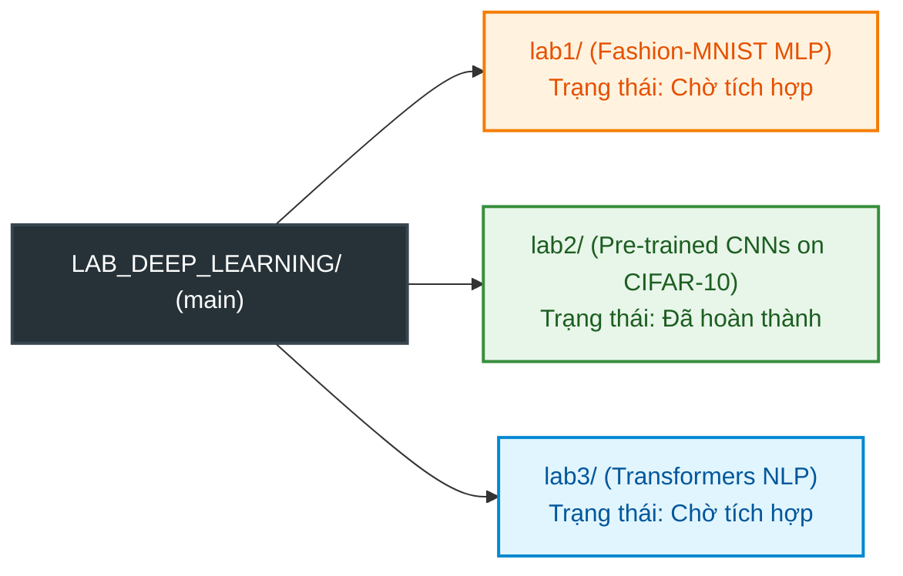

# Deep Learning Laboratory Coursework (LAB_DEEP_LEARNING)

Repository trung tâm quản lý toàn bộ các bài tập thực hành môn học Deep Learning theo kiến trúc **Monorepo**. Mỗi bài Lab được tổ chức độc lập trong một thư mục riêng biệt với đầy đủ mã nguồn, tài liệu đặc tả, kiểm thử tự động và báo cáo thực nghiệm.

---

## Danh mục các Bài Thực hành (Lab Directory)



| Thư mục | Đề tài thực hành | Dataset / Nhiệm vụ | Kiến trúc Mô hình | Trạng thái trên `main` |
| :--- | :--- | :--- | :--- | :---: |
| [`lab1/`](lab1/README.md) | **Practice 1: Basic Neural Networks** | Fashion-MNIST (10 lớp quần áo) | Multi-Layer Perceptron (MLP) | Sẵn sàng tích hợp (`origin/lab1`) |
| [`lab2/`](lab2/README.md) | **Practice 2: Pre-trained CNN Benchmark** | CIFAR-10 (10 lớp vật thể) | ResNet-18/50, VGG-16 BN, DenseNet-121 | **Đã hoàn thành** (Full Pipeline) |
| [`lab3/`](lab3/README.md) | **Practice 3: Transformers & NLP** | IMDB / Sentiment Analysis | Fine-tuning Pre-trained Transformers | Sẵn sàng tích hợp (`origin/LAP-3`) |

---

## Hướng dẫn Vận hành Lab 2 (Pre-trained CNN Benchmark)

Lab 2 đã được tích hợp hoàn chỉnh vào nhánh `main`. Để chạy thực nghiệm:

```bash
# 1. Di chuyển vào thư mục lab2
cd lab2

# 2. Kích hoạt môi trường ảo Python và cài đặt thư viện
source .venv/bin/activate
pip install -r requirements.txt

# 3. Chạy kiểm thử tự động toàn bộ module (14 unit tests)
python3 -m unittest discover tests -v

# 4. Kiểm tra tham số mô hình trước khi chạy (Model Inspection)
python3 main.py --model resnet18 --strategy freeze_all --inspect-only

# 5. Huấn luyện mô hình với Mixed Precision và TensorBoard logging
python3 main.py --model resnet18 --strategy freeze_all --epochs 15 --batch-size 64 --lr 1e-3
```

Xem toàn bộ tài liệu đặc tả, thiết kế kiến trúc và hướng dẫn dòng lệnh chi tiết tại: [lab2/README.md](lab2/README.md).

---

## Hướng dẫn Tích hợp Lab 1 và Lab 3 vào `main`

Để tránh xung đột tệp tin (Merge Conflict), người phụ trách Lab 1 và Lab 3 chỉ cần di chuyển mã nguồn vào đúng thư mục con tương ứng trên nhánh của mình trước khi merge vào `main`:

*   **Tích hợp Lab 1**: Xem hướng dẫn tại [lab1/README.md](lab1/README.md).
*   **Tích hợp Lab 3**: Xem hướng dẫn tại [lab3/README.md](lab3/README.md).
