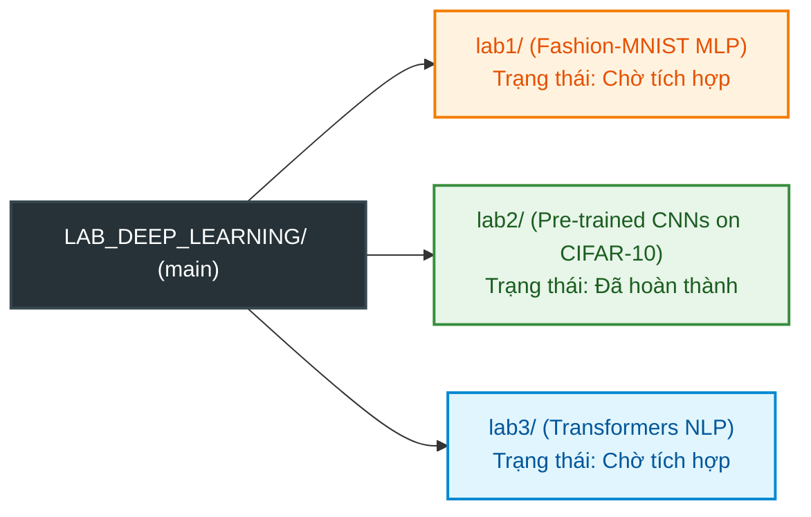

lab1
# Lab 1: PyTorch FashionMNIST Classification

**Họ và tên:** Bùi Đặng Bảo Phúc  
**Mã số sinh viên:** 079206003745  
**Lớp / Môn học:** Deep Learning  
**Kết quả đạt được (Test Accuracy):** **88.11%**

---

## 1. Nội dung công việc (Tasks Completed)

- [x] **Load & Preprocess Dataset:** Tải tập dữ liệu FashionMNIST và chuẩn hóa hình ảnh về khoảng `[-1, 1]`.
- [x] **Model Architecture:** Thiết kế mạng nơ-ron Multi-Layer Perceptron (MLP) gồm 3 lớp Fully-Connected tích hợp `ReLU` và `Dropout(0.2)` để hạn chế Overfitting.
- [x] **Training Pipeline:** Xây dựng vòng lặp huấn luyện với hàm mất mát `CrossEntropyLoss` và thuật toán tối ưu `Adam` (lr=0.001) trong 10 Epochs.
- [x] **Evaluation & Saving:** Đánh giá mô hình trên tập Test, đạt độ chính xác **88.11%**. Lưu và tải lại trọng số mô hình `fashion_mnist_model.pth`.
- [x] **Visualization:** Trực quan hóa biểu đồ Training Loss qua các Epochs và hiển thị kết quả phân loại ngẫu nhiên 10 hình ảnh.

---

## 2. Kiến trúc Mô hình (Model Architecture)

```
FashionClassifier(
  (flatten): Flatten(start_dim=1, end_dim=-1)
  (fc_layers): Sequential(
    (0): Linear(in_features=784, out_features=256, bias=True)
    (1): ReLU()
    (2): Dropout(p=0.2, inplace=False)
    (3): Linear(in_features=256, out_features=128, bias=True)
    (4): ReLU()
    (5): Dropout(p=0.2, inplace=False)
    (6): Linear(in_features=128, out_features=10, bias=True)
  )
)
```

---

## 3. Trực quan hóa & Kết quả (Results & Visualizations)

- **Training Loss Over Epochs:** Loss giảm đều từ **0.5420** (Epoch 1) xuống **0.2874** (Epoch 10).
- **Test Accuracy:** **88.11%**
- Các file hình ảnh kết quả được tạo tự động:
  - `loss_graph.png`: Đồ thị theo dõi tiến trình giảm Loss.
  - `predictions_display.png`: So sánh nhãn dự đoán (`Pred`) và nhãn thực tế (`Actual`).
  - `fashion_mnist_model.pth`: File lưu trọng số mô hình.

---

## 4. Hướng dẫn chạy Code (How to Run)

1. **Cài đặt thư viện cần thiết:**
   ```bash
   py -m pip install torch torchvision matplotlib numpy
   ```

2. **Chạy bài làm:**
   ```bash
   py lab1_fashion_mnist.py
   ```

# Deep Learning Laboratory Coursework (LAB_DEEP_LEARNING)

Repository trung tâm quản lý toàn bộ các bài tập thực hành môn học Deep Learning theo kiến trúc **Monorepo**. Mỗi bài Lab được tổ chức độc lập trong một thư mục riêng biệt với đầy đủ mã nguồn, tài liệu đặc tả, kiểm thử tự động và báo cáo thực nghiệm.

---

## Danh mục các Bài Thực hành (Lab Directory)



| Thư mục | Đề tài thực hành | Dataset / Nhiệm vụ | Kiến trúc Mô hình | Trạng thái trên `main` |
| :--- | :--- | :--- | :--- | :---: |
| [`lab1/`](lab1/README.md) | **Practice 1: Basic Neural Networks** | Fashion-MNIST (10 lớp quần áo) | Multi-Layer Perceptron (MLP) | Sẵn sàng tích hợp (`origin/lab1`) |
| [`lab2/`](lab2/README.md) | **Practice 2: Pre-trained CNN Benchmark** | CIFAR-10 (10 lớp vật thể) | ResNet-18/50, VGG-16 BN, DenseNet-121 | **Đã hoàn thành** (Full Pipeline) |
| [`lab3/`](lab3/README.md) | **Practice 3: Transformers & NLP** | IMDB / Sentiment Analysis | Fine-tuning Pre-trained Transformers | Sẵn sàng tích hợp (`origin/LAP-3`) |

---

## Hướng dẫn Vận hành Lab 2 (Pre-trained CNN Benchmark)

Lab 2 đã được tích hợp hoàn chỉnh vào nhánh `main`. Để chạy thực nghiệm:

```bash
# 1. Di chuyển vào thư mục lab2
cd lab2

# 2. Kích hoạt môi trường ảo Python và cài đặt thư viện
source .venv/bin/activate
pip install -r requirements.txt

# 3. Chạy kiểm thử tự động toàn bộ module (14 unit tests)
python3 -m unittest discover tests -v

# 4. Kiểm tra tham số mô hình trước khi chạy (Model Inspection)
python3 main.py --model resnet18 --strategy freeze_all --inspect-only

# 5. Huấn luyện mô hình với Mixed Precision và TensorBoard logging
python3 main.py --model resnet18 --strategy freeze_all --epochs 15 --batch-size 64 --lr 1e-3
```

Xem toàn bộ tài liệu đặc tả, thiết kế kiến trúc và hướng dẫn dòng lệnh chi tiết tại: [lab2/README.md](lab2/README.md).

---

## Hướng dẫn Tích hợp Lab 1 và Lab 3 vào `main`

Để tránh xung đột tệp tin (Merge Conflict), người phụ trách Lab 1 và Lab 3 chỉ cần di chuyển mã nguồn vào đúng thư mục con tương ứng trên nhánh của mình trước khi merge vào `main`:

*   **Tích hợp Lab 1**: Xem hướng dẫn tại [lab1/README.md](lab1/README.md).
*   **Tích hợp Lab 3**: Xem hướng dẫn tại [lab3/README.md](lab3/README.md).
main
