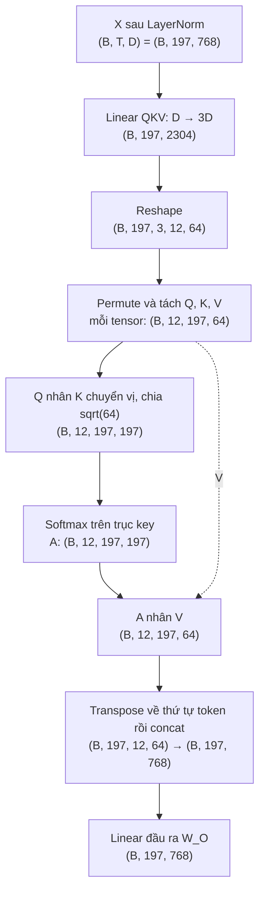
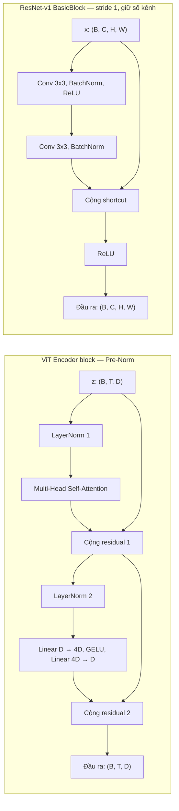
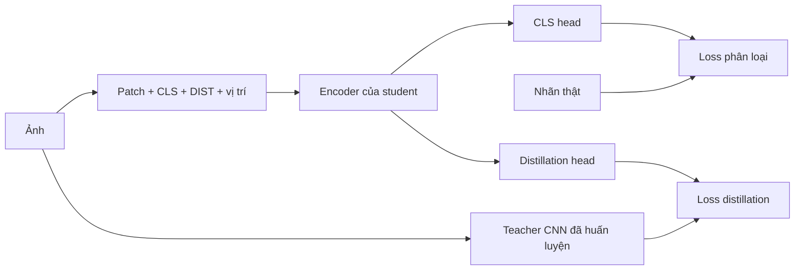

# Vision Transformer (ViT) — Nội dung các mục 5–8

> **Phạm vi:** Mục 5–8 trong `task.md`: Multi-Head Self-Attention, khối ViT Encoder, các biến thể và demo. Tên file giữ nguyên là `ViT_1-5.md` theo yêu cầu.
>
> **Tài liệu nối tiếp:** [Phần 1–4](D:/Github/Vision_Transformer_antigravity/ViT_Phan_1-4.md). Các sơ đồ dưới đây được tự dựng; nguồn học thuật, mã tham khảo và nguồn ảnh được ghi ở cuối tài liệu. Số liệu của notebook có sẵn được phân biệt với kết quả kiểm tra đoạn demo trong mục 8.

## Quy ước và phần nối từ mục 1–4

| Ký hiệu | Ý nghĩa | Ví dụ ViT-B/16 |
| :--- | :--- | :--- |
| $B$ | Số ảnh trong một batch | 1 trong demo |
| $H,W,C$ | Chiều cao, chiều rộng, số kênh ảnh | $224,224,3$ |
| $P$ | Cạnh patch | 16 pixel |
| $N=HW/P^2$ | Số patch, **chưa tính token đặc biệt** | 196 |
| $T=N+1$ | Độ dài chuỗi có `[CLS]` | 197 |
| $D$ | Số chiều embedding | 768 |
| $h$ | Số attention head | 12 |
| $d=D/h$ | Số chiều của mỗi head | 64 |
| $L$ | Số Encoder block | 12 |
| $r$ | Hệ số mở rộng MLP | 4, tức $rD=3072$ |
| $K_{\mathrm{cls}}$ | Số lớp phân loại | 1000 |

Trong đề bài, ký hiệu $(B,N,D)$ có thể được dùng cho cả chuỗi token. Tài liệu này dùng **$(B,T,D)$ khi đã có `[CLS]`**, tránh nhầm 196 patch với 197 token.

Với ảnh đầu vào $x\in\mathbb{R}^{B\times3\times224\times224}$, mỗi patch phẳng $x_p^i$ có $16\cdot16\cdot3=768$ phần tử. Bước tạo đầu vào Encoder là:

$$
z_0=[x_{\mathrm{class}};x_p^1E;\ldots;x_p^NE]+E_{\mathrm{pos}},
\qquad E\in\mathbb{R}^{(P^2C)\times D},\quad
E_{\mathrm{pos}}\in\mathbb{R}^{T\times D}.
$$

Các dấu chấm phẩy ở đây là **nối theo chiều token**. Positional embedding được cộng cho từng ảnh bằng broadcasting. Luồng kích thước là $(B,3,224,224)\rightarrow(B,196,768)\rightarrow(B,197,768)$. Công thức lược bỏ bias của phép chiếu; cài đặt demo có bias. Nguồn: [ViT, §3.1, Eq. (1)](https://arxiv.org/html/2010.11929v2#S3.SS1).

`[CLS]` là vector học được, ban đầu dùng chung cho các ảnh; sau attention, nó trở thành biểu diễn phụ thuộc nội dung từng ảnh. ViT gốc dùng vector này để phân loại, nhưng một kiến trúc khác có thể dùng pooling trên patch token. Positional embedding cung cấp thông tin bố cục: nếu bỏ vị trí và không có cơ chế vị trí thay thế, hoán vị các patch khiến đầu ra patch bị hoán vị tương ứng, còn đầu ra `[CLS]` không đổi trong chế độ suy luận. Mô hình vẫn đọc được nội dung bên trong mỗi patch nhưng mất thông tin về cách sắp xếp các patch.

---

# 5. Multi-Head Self-Attention (MSA)

## 5.1 Vì sao cần nhiều head?

Một attention head tạo một cách tổng hợp thông tin giữa các token. Nhiều head cho phép học nhiều phép chiếu và quan hệ song song: quan hệ cục bộ, quan hệ giữa các bộ phận của đối tượng hoặc quan hệ với bối cảnh. Màu sắc, kết cấu và hình dáng là các ví dụ trực quan về thông tin có thể được khai thác; mô hình **không được gán sẵn** head nào chuyên về một thuộc tính cụ thể.

Mỗi head vẫn nhận **toàn bộ $T$ token**. Việc chia head diễn ra trên chiều đặc trưng sau phép chiếu, không phải chia ảnh thành 12 vùng rồi giao một vùng cho mỗi head. Nguyên lý MSA dựa trên [Vaswani et al., §3.2](https://papers.nips.cc/paper/7181-attention-is-all-you-need).

## 5.2 Công thức và ý nghĩa từng thành phần

Gọi $X\in\mathbb{R}^{B\times T\times D}$ là đầu vào MSA, đã qua LayerNorm. Với head $j$:

$$
Q_j=XW_j^Q+b_j^Q,\quad
K_j=XW_j^K+b_j^K,\quad
V_j=XW_j^V+b_j^V,
$$

$$
W_j^Q,W_j^K,W_j^V\in\mathbb{R}^{D\times d},\qquad
Q_j,K_j,V_j\in\mathbb{R}^{B\times T\times d}.
$$

$$
A_j=\operatorname{softmax}_{\mathrm{key}}
\left(\frac{Q_jK_j^\top}{\sqrt d}\right),\qquad
\mathrm{head}_j=A_jV_j.
$$

| Thành phần | Cách hiểu trên ảnh |
| :--- | :--- |
| Query $Q_j$ | Thông tin mà token hiện tại dùng để tìm những token liên quan |
| Key $K_j$ | Đặc trưng của token được dùng khi tính mức độ tương hợp với query |
| Value $V_j$ | Nội dung được tổng hợp nếu token nhận attention |
| $A_j[b,u,v]$ | Trọng số mà query token $u$ dành cho key token $v$, trong ảnh $b$ |
| $\sqrt d$ | Hệ số điều chỉnh thang độ lớn của tích vô hướng; ở đây $\sqrt{64}=8$ |

Softmax được tính trên trục key cuối cùng. Với mỗi ảnh, head và query, tổng các trọng số trên $T$ key bằng 1 trước attention dropout. $A_j$ thường không đối xứng: patch mắt nhìn patch tai với trọng số lớn không buộc chiều ngược lại cũng lớn.

Sau đó nối các head **theo chiều đặc trưng** và chiếu đầu ra:

$$
\operatorname{MSA}(X)
=\operatorname{Concat}_{\mathrm{feature}}
(\mathrm{head}_1,\ldots,\mathrm{head}_h)W^O+b^O,
\qquad W^O\in\mathbb{R}^{hd\times D}.
$$

Vì $hd=D$, kết quả vẫn có shape $(B,T,D)$. $W^O$ trộn thông tin giữa các head; phép nối đơn thuần chỉ đặt các vector cạnh nhau. Dạng công thức này tương ứng [ViT, Phụ lục A](https://arxiv.org/html/2010.11929v2#A1); tên trục và các kích thước dưới đây được suy ra theo cấu hình demo.

## 5.3 Sơ đồ thay đổi kích thước tensor



Nguồn sơ đồ: tự dựng từ công thức MSA và [bảng shape của notebook](D:/Github/Vision_Transformer_antigravity/outputs/metrics/msa_shapes.csv).

| Bước | Shape tổng quát | Với $B=1$ |
| :--- | :--- | :--- |
| Đầu vào | $(B,T,D)$ | $(1,197,768)$ |
| Chiếu QKV gộp | $(B,T,3D)$ | $(1,197,2304)$ |
| Tách loại vector và head | $(B,T,3,h,d)$ | $(1,197,3,12,64)$ |
| Đổi trục | $(3,B,h,T,d)$ | $(3,1,12,197,64)$ |
| Mỗi tensor Q, K, V | $(B,h,T,d)$ | $(1,12,197,64)$ |
| Score và attention | $(B,h,T,T)$ | $(1,12,197,197)$ |
| Attention nhân Value | $(B,h,T,d)$ | $(1,12,197,64)$ |
| Nối các head | $(B,T,hd)$ | $(1,197,768)$ |
| Chiếu đầu ra | $(B,T,D)$ | $(1,197,768)$ |

**Điểm dễ sai trong code:** phải `transpose(1, 2)` từ $(B,h,T,d)$ sang $(B,T,h,d)$ trước khi `reshape(B,T,D)`. Reshape thẳng sẽ trộn sai token với head. QKV gộp là một phép tính hiệu quả tương đương các phép chiếu riêng, không có nghĩa ba loại vector dùng cùng trọng số.

Với $D$ cố định, các phép chiếu MSA có khoảng $4D^2$ trọng số, chưa tính bias. Tăng số head và giảm $d$ tương ứng không làm số trọng số này tăng theo $h$; số phần tử ma trận attention lưu tường minh vẫn là $BhT^2$.

## 5.4 Minh họa từ notebook


*Nguồn: mục 5 của notebook dự án, checkpoint pre-trained nêu trong mục 8; ảnh COCO `000000000285.jpg`, xem bảng nguồn ảnh cuối tài liệu.*

Trên ảnh này, nhiều head cuối có vùng sáng khá giống nhau, khác chủ yếu ở cường độ. Vì vậy không thể dùng hình để khẳng định “mỗi head luôn học một đặc trưng riêng”. Attention head có thể học thông tin trùng lặp.

Một cách so sánh bổ sung là khoảng cách attention trung bình. Với attention chỉ giữa các patch, chuẩn hóa lại từng hàng thành $\widehat A$, ta tính:

$$
\overline{\delta}_{\ell,j}
=\frac1N\sum_{u=1}^{N}\sum_{v=1}^{N}
\widehat A_{\ell,j}[u,v]\,\|p_u-p_v\|_2,
$$

trong đó $p_u$ là tọa độ tâm patch theo pixel. Đây là phép đo phạm vi không gian, không phải thước đo độ chính xác phân loại. [Số liệu notebook](D:/Github/Vision_Transformer_antigravity/outputs/metrics/attention_distance.csv) lấy trung bình trên 6 ảnh cho thấy các head ở block đầu có khoảng cách từ **13,6 đến 121,2 pixel**. Ví dụ này minh họa sự cùng tồn tại của tương tác gần và xa.

**Ý chính để trình bày:** nhiều head tạo nhiều phép tổng hợp trên cùng chuỗi token; sau concat và chiếu, kích thước đầu ra trở về $(B,T,D)$.

---

# 6. Khối ViT Encoder

## 6.1 Hai nhánh residual trong một block

Với đầu vào $z_{\ell-1}\in\mathbb{R}^{B\times T\times D}$:

$$
u_\ell=z_{\ell-1}+\operatorname{MSA}
\bigl(\operatorname{LN}_1(z_{\ell-1})\bigr),
$$

$$
z_\ell=u_\ell+\operatorname{MLP}
\bigl(\operatorname{LN}_2(u_\ell)\bigr).
$$

Đây là **Pre-Norm**: LayerNorm nằm trước MSA và MLP. Hai nhánh đều trả về cùng shape với đầu vào để cộng residual. Công thức bỏ qua dropout khi giải thích cấu trúc; trong suy luận với `model.eval()`, dropout không làm mất phần tử. Nguồn: [ViT, Eq. (2)–(3)](https://arxiv.org/html/2010.11929v2#S3.SS1).

## 6.2 Vai trò của từng thành phần

**LayerNorm.** Với một token $x\in\mathbb{R}^{D}$:

$$
\mu=\frac1D\sum_{i=1}^{D}x_i,\qquad
\sigma^2=\frac1D\sum_{i=1}^{D}(x_i-\mu)^2,
$$

$$
\operatorname{LN}(x)_i
=\gamma_i\frac{x_i-\mu}{\sqrt{\sigma^2+\epsilon}}+\beta_i.
$$

$\gamma,\beta$ là tham số học được; $\epsilon$ giúp ổn định phép chia. `LayerNorm(D)` chuẩn hóa trên chiều đặc trưng của **từng token**, không lấy trung bình trên batch hay trên toàn bộ token. Nó giữ shape $(B,T,D)$ và không cần running mean/variance như BatchNorm. Nguồn: [PyTorch LayerNorm](https://docs.pytorch.org/docs/2.15/generated/torch.nn.LayerNorm.html).

**MSA.** Trao đổi thông tin giữa các token. Đầu ra của patch có thể phụ thuộc mọi patch khác và `[CLS]`.

**MLP / Feed-Forward Network.** Biến đổi phi tuyến đặc trưng tại từng token bằng cùng một bộ trọng số:

$$
\operatorname{MLP}(x)=\operatorname{GELU}(xW_1+b_1)W_2+b_2,
\quad W_1\in\mathbb{R}^{D\times rD},\quad W_2\in\mathbb{R}^{rD\times D}.
$$

Trong demo: $768\rightarrow3072\rightarrow768$. GELU có dạng $\operatorname{GELU}(a)=a\Phi(a)$, với $\Phi$ là hàm phân phối tích lũy chuẩn. MLP không trực tiếp trộn các vị trí token; nó xử lý thông tin đã được MSA tổng hợp. Đây là MLP **bên trong Encoder**, khác classification head dùng để tạo logits. Cấu trúc có thể kiểm tra trong [mã ViT của timm](https://github.com/huggingface/pytorch-image-models/blob/v1.0.22/timm/models/vision_transformer.py).

**Residual connection.** Với $y=x+F(x)$, nhánh shortcut giữ một đường truyền trực tiếp từ đầu vào tới đầu ra. Khi lan truyền ngược, $\partial y/\partial x=I+\partial F/\partial x$; thành phần $I$ giúp truyền gradient qua mạng sâu. Đây là lý do sử dụng residual, không phải một bảo đảm tuyệt đối rằng gradient luôn ổn định.

## 6.3 So sánh trực quan với Residual Block của CNN



Nguồn sơ đồ: tự dựng theo ViT và [ResNet, §3, Figure 2](https://arxiv.org/html/1512.03385v1). Nhánh CNN là **BasicBlock kiểu ResNet-18/34**. ResNet-50 dùng bottleneck gồm conv $1\times1$, $3\times3$, $1\times1$; nếu đổi số kênh hoặc độ phân giải, shortcut cần phép chiếu phù hợp.

| Tiêu chí | ViT Encoder block | ResNet-v1 BasicBlock minh họa |
| :--- | :--- | :--- |
| Biểu diễn | Chuỗi $(B,T,D)$ | Lưới đặc trưng $(B,C,H,W)$ |
| Tương tác không gian | Attention toàn cục, trọng số phụ thuộc nội dung | Tích chập cục bộ, kernel dùng chung |
| Chuẩn hóa | LayerNorm trước từng khối con | BatchNorm sau convolution |
| Phi tuyến | GELU trong MLP | ReLU |
| Residual | Hai phép cộng: sau MSA và sau MLP | Một phép cộng quanh nhánh hai convolution |
| Kích thước | ViT chuẩn giữ $T,D$ qua các block | Có thể giảm $H,W$ và tăng $C$ giữa các stage |
| Giả định không gian | Ít ràng buộc cục bộ hơn | Có sẵn tính cục bộ và chia sẻ kernel |

Tích chập có tính **tương đương theo tịnh tiến** trong các điều kiện phù hợp; “bất biến tịnh tiến hoàn toàn” là cách nói quá mạnh, nhất là khi có stride, padding và biên ảnh. Inductive bias giúp CNN học hiệu quả từ dữ liệu hữu hạn, đồng thời hạn chế lớp quan hệ mà một tầng có thể biểu diễn trực tiếp.

## 6.4 Theo dõi tensor qua một block và đầu phân loại

| Phép tính | Shape với ViT-B/16 |
| :--- | :--- |
| $z$, LN1, MSA, cộng residual 1 | $(B,197,768)$ |
| LN2 | $(B,197,768)$ |
| Linear thứ nhất của MLP, GELU | $(B,197,3072)$ |
| Linear thứ hai, cộng residual 2 | $(B,197,768)$ |
| Sau 12 block và LayerNorm cuối | $(B,197,768)$ |
| Lấy token `[CLS]` | $(B,768)$ |
| Classification head của checkpoint demo | $(B,1000)$ |

Phép phân loại là $f=\operatorname{LN}_{\mathrm{final}}(z_L)[:,0,:]$, $s=fW_{\mathrm{cls}}+b_{\mathrm{cls}}$, rồi $p=\operatorname{softmax}(s)$. $s$ là logits; $p$ là xác suất softmax. Trong [notebook có sẵn](D:/Github/Vision_Transformer_antigravity/notebooks/ViT_demo.ipynb), mục 6 tính riêng hai nhánh rồi so với `blk(z)`, nhận sai khác tối đa **0,0** trên lần chạy đã lưu.

**Ý chính để trình bày:** MSA trao đổi thông tin giữa token, MLP xử lý đặc trưng của từng token; LayerNorm và residual hỗ trợ việc tối ưu một chuỗi block sâu.

---

# 7. Các biến thể và mở rộng của ViT

## 7.1 DeiT: học hiệu quả hơn với dữ liệu hữu hạn

DeiT giữ nền tảng ViT, cải thiện cách huấn luyện bằng augmentation, regularization và distillation. Bản distilled thêm token `[DIST]`: `[CLS]` học từ nhãn dữ liệu, `[DIST]` học từ teacher, thường là CNN. Cả hai tương tác với patch qua attention. Với 196 patch, chuỗi distilled có **198 token**. Teacher chỉ cần trong huấn luyện. Nguồn: [Touvron et al., §4](https://arxiv.org/html/2012.12877v2#S4).



*Sơ đồ tự dựng theo cơ chế distillation của DeiT.* Một dạng hard distillation với hai head là:

$$
y_t=\arg\max_k s_{t,k},\qquad
\mathcal L=\tfrac12\operatorname{CE}(s_{\mathrm{cls}},y)
+\tfrac12\operatorname{CE}(s_{\mathrm{dist}},y_t).
$$

$s_t$ là logits teacher; $y$ là nhãn thật. Khi suy luận, kết hợp dự đoán của hai head. DeiT cũng có bản không distillation. “Hiệu quả dữ liệu” ở đây bao gồm khả năng huấn luyện tốt trên ImageNet-1k, khoảng 1,28 triệu ảnh, **không đồng nghĩa** chỉ cần vài chục ảnh để huấn luyện từ đầu. Nguồn: [bài báo DeiT tại ICML 2021](https://proceedings.mlr.press/v139/touvron21a.html).

## 7.2 Swin Transformer: cửa sổ dịch chuyển và đặc trưng đa tỷ lệ

Swin dùng attention trong cửa sổ cục bộ, xen kẽ **W-MSA** và **SW-MSA** để trao đổi thông tin qua ranh giới cửa sổ. Với cửa sổ $7\times7$ token, bước dịch thường là 3 token; attention mask ngăn các liên kết giả do cuộn lưới ở biên. Patch merging giảm kích thước lưới và tăng số kênh. Swin gốc dùng relative position bias và global average pooling cho phân loại. Nguồn: [Swin, §3](https://arxiv.org/html/2103.14030v2#S3).

Ví dụ kích thước theo cấu hình Swin-T, ảnh $224\times224$, patch đầu vào $4\times4$:

```text
Ảnh RGB 224×224
    ↓ Patch embedding
56×56 token, 96 kênh    → 2 block
    ↓ Ghép mỗi nhóm 2×2 token: concat 4C rồi chiếu về 2C
28×28 token, 192 kênh   → 2 block
    ↓ Patch merging
14×14 token, 384 kênh   → 6 block
    ↓ Patch merging
 7×7 token, 768 kênh    → 2 block
    ↓ LayerNorm, global average pooling, linear head
Nhãn phân loại
```

Sơ đồ kích thước tự dựng từ cấu hình Swin-T. Các stage tạo biểu diễn ở nhiều độ phân giải, thuận tiện cho detection và segmentation. Shifted windows mở rộng đường truyền thông tin qua nhiều block; một block cửa sổ riêng lẻ chưa có kết nối trực tiếp tới mọi token.

Với $T_s$ token tại một stage, cửa sổ có $M^2$ token và chiều đặc trưng $D_s$, số phép nhân–cộng chính của MSA là:

$$
\mathrm{Global\ MSA}:\quad4T_sD_s^2+2T_s^2D_s,
$$

$$
\mathrm{Window\ MSA}:\quad4T_sD_s^2+2T_sM^2D_s.
$$

Công thức bỏ qua softmax, bias và padding. Khi $M,D_s$ cố định, window attention có chi phí tuyến tính theo $T_s$. Nguồn: [Swin, Eq. (1)–(2)](https://arxiv.org/html/2103.14030v2#S3.SS2).

## 7.3 Hybrid CNN–ViT

Mô hình lai dùng CNN tạo feature map rồi chuyển các vị trí hoặc patch trên feature map thành token cho Transformer:

```text
Ảnh → CNN backbone → feature map → flatten / projection → Transformer → head
```

CNN cung cấp đặc trưng cục bộ và có thể giảm số token trước attention; Transformer kết hợp thông tin xa. Đây là một hướng đã được mô tả trong [ViT, phần Hybrid Architecture](https://arxiv.org/html/2010.11929v2#S3.SS1). Hiệu quả phụ thuộc backbone và cách huấn luyện; không thể kết luận mô hình lai luôn tốt hơn ViT thuần. Riêng việc dùng `Conv2d(kernel_size=P, stride=P)` để cài đặt patch projection không tự biến ViT thành một backbone lai CNN–ViT.

## 7.4 Bảng so sánh

| Tiêu chí | ViT gốc | DeiT | Swin Transformer | Hybrid CNN–ViT |
| :--- | :--- | :--- | :--- | :--- |
| Kiến trúc | Chuỗi patch, global MSA, thường giữ một độ phân giải | Gần ViT; bản distilled thêm token và head | Phân cấp, window attention và shifted windows | CNN tạo feature map rồi Transformer xử lý token |
| Cách giảm khó khăn về dữ liệu | Pre-train lớn rồi fine-tune | Huấn luyện mạnh hơn; teacher truyền tri thức | Thêm tính cục bộ và phân cấp; vẫn cần cách huấn luyện phù hợp | Dùng inductive bias của CNN; mức lợi ích tùy thiết kế |
| Dữ liệu trong các nghiên cứu tiêu biểu | ImageNet-21k hoặc JFT-300M mang lại lợi ích rõ | Có thiết lập chỉ dùng ImageNet-1k | Có thiết lập ImageNet-1k và pre-train ImageNet-22k | Không có một mức chung cho mọi mô hình lai |
| Chi phí attention, bỏ batch | $O(T^2D)$ | $O(T^2D)$; thêm một token ở bản distilled | $O(T_sM^2D_s)$ tại một stage | $O(T_f^2D)$ nếu dùng global attention trên $T_f$ token |
| Chi phí khác | Phép chiếu và MLP $O(TD^2)$ | Như ViT; thêm chi phí teacher khi huấn luyện | Phép chiếu, MLP và patch merging | Thêm chi phí CNN backbone |
| Tác vụ phù hợp | Phân loại, trích xuất đặc trưng; có thể mở rộng cho dense prediction | Phân loại và chuyển giao đặc trưng | Phân loại, detection, segmentation đa tỷ lệ | Tùy backbone và head; có thể kết hợp đặc trưng cục bộ/toàn cục |
| Đánh đổi | Attention toàn cục tốn tài nguyên khi chuỗi dài | Không giải quyết chi phí bậc hai của global attention | Tương tác xa hình thành qua nhiều block/stage | Thiết kế phức tạp hơn, thêm thành phần CNN |

Nguồn tổng hợp: [ViT](https://arxiv.org/html/2010.11929v2), [DeiT](https://proceedings.mlr.press/v139/touvron21a.html), [Swin](https://arxiv.org/html/2103.14030v2). Các biểu thức chi phí chỉ rõ thành phần attention; không phải phép đo thời gian chạy hay bảng xếp hạng độ chính xác.

**Ý chính để trình bày:** DeiT tập trung vào hiệu quả huấn luyện; Swin thay đổi cách tổ chức attention và độ phân giải; hybrid kết hợp CNN với Transformer.

---

# 8. Demo và nhận xét

## 8.1 Mục tiêu, mô hình và dữ liệu

Demo thực hiện ba việc: phân loại một ảnh bằng ViT-B/16, lấy vector đặc trưng 768 chiều và chồng Attention Map lên ảnh đầu vào. Đồng thời, code kiểm tra công thức MSA và Encoder ở mục 5–6 bằng cách so sánh với `timm`.

| Thành phần | Thiết lập |
| :--- | :--- |
| Thư viện | Python, PyTorch, `timm`, Pillow, Matplotlib |
| Checkpoint | `vit_base_patch16_224.augreg2_in21k_ft_in1k` |
| Trọng số | **Đã huấn luyện sẵn — `pretrained=True`** |
| Nguồn trọng số | Pre-train ImageNet-21k; fine-tune lại trên ImageNet-1k với augmentation và regularization |
| Cấu hình | 12 block, 12 head/block, $D=768$, patch $16\times16$, 1000 lớp |
| Ảnh demo | `data/images/bear.jpg`, COCO val2017, ID 285 |
| Tiền xử lý | RGB, resize trực tiếp về $224\times224$, chuẩn hóa theo checkpoint |
| Thiết bị | Tự chọn CUDA nếu có, nếu không dùng CPU |

Nguồn checkpoint và API trích xuất đặc trưng: [model card chính thức trên Hugging Face](https://huggingface.co/timm/vit_base_patch16_224.augreg2_in21k_ft_in1k). Code không thay bằng trọng số ngẫu nhiên nếu tải checkpoint thất bại; lần chạy đầu cần Internet nếu chưa có cache.

**Về tiền xử lý:** resize trực tiếp giúp ảnh nền và heatmap dùng cùng hệ tọa độ, đồng thời khớp notebook hiện có. Với ảnh không vuông, cách này làm thay đổi tỷ lệ hình học. Khi đánh giá benchmark, cần dùng transform chuẩn của checkpoint, ví dụ `timm.data.create_transform`, và vẽ heatmap lên đúng vùng ảnh đã resize/crop mà mô hình thực sự nhận.

## 8.2 Chạy notebook có sẵn

Mở [notebooks/ViT_demo.ipynb](D:/Github/Vision_Transformer_antigravity/notebooks/ViT_demo.ipynb), cài thư viện và chạy lần lượt từ phần cấu hình. Các mục trong notebook tương ứng như sau:

| Nội dung cần trình bày | Vị trí trong notebook |
| :--- | :--- |
| MSA, shape và nhiều head | Mục 5 |
| Kiểm tra công thức Encoder | Mục 6 |
| Kết quả phân loại | Mục 7 |
| Attention lớp cuối và rollout | Mục 8 |
| Pre-trained so với ngẫu nhiên | Mục 9 |
| Thí nghiệm bỏ positional embedding | Mục 11 |
| So sánh ResNet và độ phức tạp | Mục 12–13 |

Notebook có kết quả chạy CPU được lưu sẵn. Nếu dùng nguyên notebook để tái lập kết quả, có thể đặt `DEVICE = "cpu"`: hàm `rollout` hiện tại tạo ma trận đơn vị trên CPU. Đoạn demo độc lập ngay dưới đưa attention về CPU trước rollout, nên tránh lệch thiết bị khi inference chạy CUDA. Số thứ tự các mục notebook khác số thứ tự yêu cầu trong `task.md`.

## 8.3 Mã demo độc lập

Cài thư viện trong terminal nếu môi trường chưa có:

```bash
python -m pip install torch torchvision "timm==1.0.22" numpy matplotlib pillow
```

Trong Colab/Jupyter có thể dùng `%pip install` với cùng danh sách thư viện. Chạy code từ thư mục gốc dự án hoặc thư mục `notebooks`. Có thể thay `image_path` bằng ảnh riêng; nguồn ảnh tải mặc định được ghi rõ trong code.

**Cách lấy attention:** tạm tắt `fused_attn` để `timm` tính tường minh softmax, rồi gắn forward hook vào `attn_drop`. Ở `eval()`, dropout là phép đồng nhất, nên hook lấy chính ma trận attention được dùng để nhân với Value. Hook và cấu hình fused được khôi phục bằng `finally`. Cách triển khai dựa trên [mã Attention của timm v1.0.22](https://github.com/huggingface/pytorch-image-models/blob/v1.0.22/timm/layers/attention.py).

```python
from pathlib import Path
from urllib.request import urlopen
import json
import numpy as np
import torch
import torch.nn.functional as F
import timm
from timm.data import ImageNetInfo, resolve_model_data_config
from torchvision import transforms
from PIL import Image
import matplotlib.pyplot as plt

torch.manual_seed(0)
device = torch.device("cuda" if torch.cuda.is_available() else "cpu")
root = Path.cwd().parent if Path.cwd().name == "notebooks" else Path.cwd()
image_path = root / "data" / "images" / "bear.jpg"
figure_path = root / "outputs" / "figures" / "08_demo_5_8.png"
report_path = root / "outputs" / "metrics" / "demo_5_8_verification.json"
for directory in (image_path.parent, figure_path.parent, report_path.parent):
    directory.mkdir(parents=True, exist_ok=True)

# Nguon: COCO val2017, image ID 285. Dung anh da co neu ton tai.
if not image_path.exists():
    url = "https://images.cocodataset.org/val2017/000000000285.jpg"
    with urlopen(url, timeout=60) as response:
        image_path.write_bytes(response.read())

model_name = "vit_base_patch16_224.augreg2_in21k_ft_in1k"
model = timm.create_model(model_name, pretrained=True).eval().to(device)
config = resolve_model_data_config(model)
size = config["input_size"][-1]  # 224 cho checkpoint nay
with Image.open(image_path) as source:
    image_rgb = source.convert("RGB").resize(
        (size, size), Image.Resampling.BICUBIC
    )
preprocess = transforms.Compose([
    transforms.ToTensor(),
    transforms.Normalize(config["mean"], config["std"]),
])
x = preprocess(image_rgb).unsqueeze(0).to(device)


@torch.inference_mode()
def predict_and_capture(model, x):
    attentions, handles, original_fused = [], [], []

    def capture(module, inputs, output):
        # CPU de rollout hoat dong ca khi model nam tren CUDA.
        attentions.append(output.detach().float().cpu())

    try:
        for block in model.blocks:
            original_fused.append(block.attn.fused_attn)
            block.attn.fused_attn = False
            handles.append(block.attn.attn_drop.register_forward_hook(capture))
        tokens = model.forward_features(x)  # da qua LayerNorm cuoi
        features = model.forward_head(tokens, pre_logits=True)
        logits = model.forward_head(tokens)
    finally:
        for handle in handles:
            handle.remove()
        for block, original in zip(model.blocks, original_fused):
            block.attn.fused_attn = original
    return logits.cpu(), features.cpu(), tokens.cpu(), attentions


@torch.inference_mode()
def verify_msa_and_block(model, x):
    # Cong thuc nay danh cho checkpoint ViT-B/16 duoc chi dinh o tren.
    patches = model.patch_embed(x)
    cls = model.cls_token.expand(x.shape[0], -1, -1)
    z = model.pos_drop(torch.cat((cls, patches), dim=1) + model.pos_embed)
    z = model.norm_pre(model.patch_drop(z))
    block = model.blocks[0]
    attn = block.attn
    xn = block.norm1(z)
    batch, token_count, dim = xn.shape
    heads, head_dim = attn.num_heads, dim // attn.num_heads
    qkv = attn.qkv(xn).reshape(batch, token_count, 3, heads, head_dim)
    q, k, v = qkv.permute(2, 0, 3, 1, 4).unbind(0)
    q, k = attn.q_norm(q), attn.k_norm(k)
    weights = ((q * attn.scale) @ k.transpose(-2, -1)).softmax(dim=-1)
    joined = (weights @ v).transpose(1, 2).reshape(batch, token_count, dim)
    manual_msa = attn.proj_drop(attn.proj(attn.norm(joined)))
    reference_msa = attn(xn)
    torch.testing.assert_close(manual_msa, reference_msa, rtol=1e-4, atol=1e-5)
    mid = z + reference_msa
    manual_block = mid + block.mlp(block.norm2(mid))
    reference_block = block(z)
    torch.testing.assert_close(manual_block, reference_block, rtol=1e-4, atol=1e-5)
    return {
        "msa_max_abs_error": (manual_msa - reference_msa).abs().max().item(),
        "block_max_abs_error": (manual_block - reference_block).abs().max().item(),
    }


logits, features, tokens, attentions = predict_and_capture(model, x)
assert tuple(tokens.shape) == (1, 197, 768)
assert tuple(features.shape) == (1, 768)
assert tuple(logits.shape) == (1, 1000)
assert len(attentions) == 12
for attention in attentions:
    assert tuple(attention.shape) == (1, 12, 197, 197)
    torch.testing.assert_close(
        attention.sum(dim=-1), torch.ones_like(attention[..., 0]),
        rtol=1e-5, atol=1e-6,
    )
errors = verify_msa_and_block(model, x)

names = ImageNetInfo()
probabilities, indices = logits.softmax(dim=-1)[0].topk(5)
top5 = [
    {"label": names.index_to_description(int(index)), "probability": float(prob)}
    for prob, index in zip(probabilities, indices)
]
print("Weights: PRETRAINED |", model_name)
print("Device:", device, "| torch:", torch.__version__, "| timm:", timm.__version__)
print("Tokens:", tuple(tokens.shape), "| Features:", tuple(features.shape))
print("Attention/block:", tuple(attentions[0].shape))
for rank, item in enumerate(top5, 1):
    print(f"{rank}. {item['label']}: {item['probability']:.2%}")
print("Verification:", errors)

# CLS o chi so 0; cac patch o chi so 1..196. Trung binh 12 head.
last_layer = attentions[-1][0, :, 0, 1:].mean(dim=0)

# Rollout: giu CLS trong ma tran khi nhan don, chi bo o buoc cuoi.
token_count = attentions[0].shape[-1]
identity = torch.eye(token_count, dtype=attentions[0].dtype)
rollout = identity.clone()
for attention in attentions:
    mean_attention = attention[0].mean(dim=0)
    residual_attention = mean_attention + identity
    residual_attention /= residual_attention.sum(dim=-1, keepdim=True)
    rollout = residual_attention @ rollout
rollout_vector = rollout[0, 1:]


def to_heatmap(vector):
    grid_h, grid_w = model.patch_embed.grid_size
    assert vector.numel() == grid_h * grid_w
    heatmap = vector.reshape(1, 1, grid_h, grid_w)
    heatmap = F.interpolate(
        heatmap, size=(size, size), mode="bilinear", align_corners=False
    )[0, 0]
    # Min-max chi de hien thi; khong phai xac suat phan loai.
    heatmap = (heatmap - heatmap.min()) / (heatmap.max() - heatmap.min() + 1e-8)
    return heatmap.numpy()


fig, axes = plt.subplots(1, 3, figsize=(12, 4), constrained_layout=True)
titles = ["Input (224 x 224)", "Last-layer CLS attention", "Attention rollout"]
for ax, title in zip(axes, titles):
    ax.imshow(np.asarray(image_rgb))
    ax.set_title(title)
    ax.axis("off")
axes[1].imshow(to_heatmap(last_layer), cmap="inferno", alpha=0.5, vmin=0, vmax=1)
axes[2].imshow(to_heatmap(rollout_vector), cmap="inferno", alpha=0.5, vmin=0, vmax=1)
fig.suptitle(f"Pretrained ViT-B/16 | {top5[0]['label']} | {top5[0]['probability']:.2%}")
fig.savefig(figure_path, dpi=160, bbox_inches="tight")
report = {
    "model": model_name, "weights": "pretrained", "device": str(device),
    "torch": torch.__version__, "timm": timm.__version__,
    "tokens_shape": list(tokens.shape), "features_shape": list(features.shape),
    "attention_shape": list(attentions[0].shape), "top5": top5, **errors,
}
report_path.write_text(json.dumps(report, indent=2, ensure_ascii=False), encoding="utf-8")
print("Saved:", figure_path)
print("Saved:", report_path)
plt.show()
plt.close(fig)
```

Code được biên soạn cho tài liệu này từ công thức đã trình bày, API công khai của `timm` và luồng xử lý trong notebook dự án. Kiểm tra MSA/Encoder áp dụng cho checkpoint đã chỉ định, ở chế độ suy luận; không dùng nguyên xi cho mọi biến thể có LayerScale, token bổ sung hoặc cấu trúc pooling khác.

## 8.4 Attention Map được tính như thế nào?

**Cách 1 — attention của lớp cuối:** lấy hàng query `[CLS]`, bỏ cột key `[CLS]`, trung bình các head:

$$
m_v=\frac1h\sum_{j=1}^{h}A_{L,j}[0,v],\qquad v=1,\ldots,N.
$$

Ta có vector 196 phần tử, reshape thành lưới $14\times14$, nội suy lên $224\times224$ rồi chồng màu lên ảnh mô hình nhận. Sau khi bỏ cột `[CLS]`, tổng các phần tử còn lại không nhất thiết bằng 1.

**Cách 2 — Attention Rollout:** trung bình head, cộng nhánh identity rồi chuẩn hóa từng hàng:

$$
\overline A_\ell=\frac1h\sum_{j=1}^{h}A_{\ell,j},\qquad
\widetilde A_\ell=\operatorname{RowNormalize}(\overline A_\ell+I_T),
$$

$$
R_0=I_T,\qquad R_\ell=\widetilde A_\ell R_{\ell-1},\qquad
m=R_L[0,1:T].
$$

Thứ tự nhân là $R_L=\widetilde A_L\cdots\widetilde A_1$. Phải giữ cả hàng/cột `[CLS]` trong lúc nhân; loại bỏ sớm sẽ làm mất các đường truyền qua token này. Đây là một phép xấp xỉ luồng attention, với cách kết hợp nhánh attention và residual theo trọng số ngang nhau. Nó không mô phỏng đầy đủ MLP, LayerNorm hay các phép chiếu Value/output. Nguồn: [Abnar & Zuidema, Attention Rollout](https://aclanthology.org/2020.acl-main.385/).


*Nguồn: đoạn code mục 8.3, ảnh COCO ID 285, checkpoint pre-trained của `timm`. Heatmap được chuẩn hóa min–max riêng từng bản đồ để hiển thị.*

**Cách đọc:** vùng sáng có trọng số tương đối cao trong cách trực quan hóa đang dùng. Đây không phải segmentation mask, bản đồ xác suất đối tượng, hay chứng minh nhân quả cho nhãn dự đoán. Do chuẩn hóa riêng, độ sáng tuyệt đối giữa hai bản đồ không thể đem so sánh như một thang xác suất chung.

## 8.5 Kết quả và nhận xét thực nghiệm

### Kết quả của notebook có sẵn

Dữ liệu dưới đây được đọc từ [predictions_top5.csv](D:/Github/Vision_Transformer_antigravity/outputs/metrics/predictions_top5.csv), không phải độ chính xác đo trên tập kiểm định:

| Ảnh | Nhãn top-1 | Xác suất softmax |
| :--- | :--- | ---: |
| `bear.jpg` | brown bear | 88,68% |
| `cats.jpg` | remote control | 37,40% |
| `stop_sign.jpg` | street sign | 81,95% |
| `truck.jpg` | garbage truck | 88,89% |
| `baseball.jpg` | ballplayer | 69,96% |
| `kitchen.jpg` | microwave | 37,98% |

Ảnh `cats.jpg` chứa cả mèo lẫn điều khiển từ xa, trong khi mô hình phân loại chỉ trả một phân phối trên 1000 lớp ImageNet. Tên file không phải nhãn chuẩn. Muốn tính accuracy cần tập có nhãn mục tiêu rõ ràng và quy trình đánh giá thống nhất; sáu ảnh minh họa không đủ để kết luận ViT chính xác hơn CNN.


*Nguồn: mục 8 của notebook dự án; hàng đầu là ảnh đầu vào, hàng giữa là `[CLS]` attention lớp cuối, hàng cuối là rollout. Nguồn từng ảnh nằm ở cuối tài liệu.*

Với ảnh gấu, rollout làm nổi bật thêm vùng quanh mắt và mặt. Tuy nhiên, một số vùng nền cũng sáng; ở ảnh biển báo, attention lớp cuối không chỉ tập trung vào biển. Các quan sát này cho thấy bản đồ hữu ích để khảo sát mô hình, nhưng không bảo đảm luôn khoanh đúng đối tượng.

Notebook còn có đối chứng cùng kiến trúc với `pretrained=False`: trên ảnh gấu, top-1 là `parachute` với xác suất khoảng **0,42%**, so với `brown bear` **88,68%** của bản pre-trained. Đây là kết quả được lưu trong [summary.json](D:/Github/Vision_Transformer_antigravity/outputs/metrics/summary.json). Trọng số ngẫu nhiên thích hợp để kiểm tra cấu trúc và tensor, chưa có cơ sở để phân loại ảnh có ý nghĩa. Xác suất lớn nhất của mô hình ngẫu nhiên không nhất thiết đúng bằng $1/1000=0,1\%$.

### Kiểm tra đoạn demo của tài liệu

Đã chạy nguyên đoạn Python mục 8.3 trên CPU ngày **20/11/2026**, với Python 3.10, PyTorch `2.14.1+cpu` và `timm 1.0.22`, dùng ảnh và trọng số đã có trong máy. Các `assert` kiểm tra đủ 12 attention tensor, tổng từng hàng bằng 1, shape của đặc trưng và logits; `assert_close` đối chiếu MSA tính theo công thức và Encoder hai nhánh với `timm`.

| Hạng mục kiểm tra | Kết quả thực thi |
| :--- | :--- |
| Trọng số | Pre-trained, không khởi tạo ngẫu nhiên |
| Token sau Encoder và LayerNorm | $(1,197,768)$ |
| Vector đặc trưng | $(1,768)$ |
| Logits | $(1,1000)$ |
| Attention | 12 tensor, mỗi tensor $(1,12,197,197)$ |
| Tổng mỗi hàng attention | Bằng 1 trong sai số số thực cho phép |
| Sai khác tuyệt đối lớn nhất của MSA | $8{,}34465\times10^{-7}$ |
| Sai khác tuyệt đối lớn nhất của Encoder block | $0$ |
| Top-1 | `brown bear`, khoảng **88,68%** |
| Hình đầu ra | Đã tạo ảnh gốc cùng hai Attention Map trong mục 8.4 |

Chi tiết được lưu trong [demo_5_8_verification.json](D:/Github/Vision_Transformer_antigravity/outputs/metrics/demo_5_8_verification.json). Sai số nhỏ của MSA xuất hiện do thứ tự tính toán và kernel attention; kết quả có thể chênh nhẹ theo thiết bị. Đã kiểm tra thực thi CPU; nhánh CUDA chưa được chạy trong lần kiểm tra này. Lần kiểm tra dùng backend Matplotlib không có cửa sổ tương tác để lưu PNG; trong notebook, `plt.show()` hiển thị hình trực tiếp.

## 8.6 Độ phức tạp: vì sao ảnh lớn tốn tài nguyên?

Với $P$ cố định, số token tăng theo diện tích ảnh:

$$
T=\frac{HW}{P^2}+1.
$$

Đối với một block ViT, bỏ qua bias, chuẩn hóa, GELU và softmax, số phép multiply–accumulate (MAC) chính là:

| Thành phần | MAC xấp xỉ |
| :--- | :--- |
| Chiếu Q, K, V | $3BTD^2$ |
| Chiếu đầu ra MSA | $BTD^2$ |
| Tính $QK^\top$ và $AV$ qua mọi head | $2BT^2D$ |
| Hai lớp MLP, hệ số mở rộng $r$ | $2rBTD^2$ |
| Tổng với $r=4$ | $12BTD^2+2BT^2D$ |

Các số này được suy ra trực tiếp từ kích thước các phép nhân ma trận ở mục 5–6. Vì vậy, nói “ViT có attention $O(T^2)$” cần hiểu là thành phần tương tác giữa token; **toàn block** có cả $O(TD^2)$ và $O(T^2D)$. Ở độ phân giải 224, các phép chiếu và MLP vẫn chiếm phần lớn MAC của cấu hình này.

Với $B=1,h=12,D=768,L=12$, lưu một ma trận attention đầy đủ ở FP32 tốn $4hT^2$ byte mỗi block:

| Ảnh | Patch $N$ | Token $T$ | Attention/block, FP32 (MiB) | Phần tuyến tính, 12 block (GMAC) | $QK^\top$ và $AV$, 12 block (GMAC) |
| :--- | ---: | ---: | ---: | ---: | ---: |
| $224\times224$ | 196 | 197 | 1,78 | 16,73 | 0,72 |
| $320\times320$ | 400 | 401 | 7,36 | 34,06 | 2,96 |
| $384\times384$ | 576 | 577 | 15,24 | 49,01 | 6,14 |
| $448\times448$ | 784 | 785 | 28,21 | 66,67 | 11,36 |
| $512\times512$ | 1024 | 1025 | 48,09 | 87,06 | 19,37 |

Nguồn số liệu tính toán: [complexity_vs_resolution.csv](D:/Github/Vision_Transformer_antigravity/outputs/metrics/complexity_vs_resolution.csv). Cột trong CSV mang tên `attn_mem_MB_per_block`, nhưng phép chia dùng $2^{20}$ nên đơn vị chính xác là **MiB**. Bảng chỉ tính ma trận attention, chưa gồm Q/K/V, MLP activation, tham số, gradient hoặc optimizer state.

Tăng cạnh ảnh từ 224 lên 448 làm số patch tăng 4 lần, còn số cặp token tăng $(785/197)^2\approx15,88$ lần. Tương tự, giảm cạnh patch một nửa ở ảnh cố định làm số patch tăng 4 lần và phần attention tăng xấp xỉ 16 lần. Các kernel attention tối ưu có thể tránh lưu toàn bộ ma trận đồng thời, nhưng demo cố ý lấy ma trận tường minh để trực quan hóa.

**Phân biệt MAC với FLOP:** một số tài liệu tính một phép nhân–cộng là 1 MAC, một số bộ đếm tính là 2 FLOP. Ngoài ra, bộ đếm có thể bỏ sót phép toán fused. Không trộn số GMAC lý thuyết ở bảng này với số đo profiler nếu chưa kiểm tra quy ước và các phép toán được đếm. Khi tăng độ phân giải của mô hình đã pre-train, positional embedding còn cần nội suy phù hợp; thay kích thước input đơn thuần không đủ.

## 8.7 Ưu điểm, hạn chế và đánh đổi

| Khía cạnh | Nhận xét |
| :--- | :--- |
| Ngữ cảnh toàn cục | Global attention tạo đường kết nối trực tiếp giữa mọi token trong một block; trọng số kết nối vẫn do dữ liệu quyết định |
| Biểu diễn dùng lại | Vector `[CLS]` 768 chiều trong demo có thể làm đầu vào cho bộ phân loại khác; patch token giữ biểu diễn từng vùng |
| Khả năng mở rộng | Có thể tăng chiều đặc trưng, số block và dữ liệu huấn luyện, đổi lại chi phí tài nguyên lớn hơn |
| Nhu cầu dữ liệu | Ít inductive bias về không gian khiến ViT gốc khó học từ đầu khi dữ liệu hạn chế; pre-train, augmentation và distillation giúp cải thiện |
| Ảnh độ phân giải cao | Số cặp token tăng bậc hai; patch nhỏ giữ chi tiết tốt hơn nhưng đắt hơn |
| Chi tiết nhỏ | Patch lớn có thể làm việc biểu diễn các vật thể nhỏ khó hơn; đây là lý do quan tâm tới nhiều độ phân giải |
| Khả năng giải thích | Attention Map giúp quan sát quan hệ token, nhưng không thay thế đánh giá định lượng hay phân tích nguyên nhân |
| So sánh với CNN | Phải kiểm soát dữ liệu pre-train, độ phân giải, tài nguyên, cách huấn luyện và tác vụ; không có kết luận “ViT luôn tốt hơn CNN” từ demo này |

Trong nghiên cứu gốc, ViT hưởng lợi rõ từ pre-train lớn; các hướng như DeiT cho thấy không nên coi dữ liệu khổng lồ là điều kiện bắt buộc cho mọi Vision Transformer. Nguồn: [ViT, §4.3](https://arxiv.org/html/2010.11929v2#S4.SS3), [DeiT](https://proceedings.mlr.press/v139/touvron21a.html).

---

## Gợi ý phân chia nội dung khi làm slide

| Slide | Nội dung chính | Minh họa có thể dùng |
| :--- | :--- | :--- |
| 1 | MSA: nhiều phép chiếu trên cùng chuỗi | Công thức mục 5.2 |
| 2 | Theo dõi tensor và concat head | Sơ đồ mục 5.3 |
| 3 | Quan sát nhiều head | Hình mục 5.4 và nhận xét về sự trùng lặp |
| 4 | Pre-Norm, MLP và residual | Hai phương trình mục 6.1 |
| 5 | ViT block so với ResNet block | Sơ đồ song song mục 6.3 |
| 6 | DeiT, Swin và hybrid | Sơ đồ distillation, các stage Swin và bảng mục 7.4 |
| 7 | Cấu hình, trọng số và phân loại ảnh | Bảng mục 8.1, kết quả mục 8.5 |
| 8 | Attention Map và rollout | Hình do code mục 8.3 tạo ra |
| 9 | Độ phức tạp và đánh đổi | Bảng độ phân giải mục 8.6, nhận xét mục 8.7 |

## Tài liệu tham khảo và nguồn minh họa

1. Dosovitskiy, A. et al. (2020; ICLR 2021). [*An Image is Worth 16x16 Words: Transformers for Image Recognition at Scale*](https://arxiv.org/abs/2010.11929). Nguồn kiến trúc ViT, patch/position embedding, MSA, Encoder và hybrid.
2. Vaswani, A. et al. (2017). [*Attention Is All You Need*](https://papers.nips.cc/paper/7181-attention-is-all-you-need). Nguồn scaled dot-product attention và multi-head attention.
3. He, K. et al. (2015; CVPR 2016). [*Deep Residual Learning for Image Recognition*](https://arxiv.org/abs/1512.03385). Nguồn residual learning, BasicBlock và bottleneck.
4. Touvron, H. et al. (2021). [*Training data-efficient image transformers & distillation through attention*](https://proceedings.mlr.press/v139/touvron21a.html). Nguồn DeiT và distillation token.
5. Liu, Z. et al. (2021). [*Swin Transformer: Hierarchical Vision Transformer using Shifted Windows*](https://arxiv.org/abs/2103.14030). Nguồn phân cấp, window attention, shifted windows và độ phức tạp.
6. Abnar, S. & Zuidema, W. (2020). [*Quantifying Attention Flow in Transformers*](https://aclanthology.org/2020.acl-main.385/). Nguồn thuật toán attention rollout và giới hạn khi diễn giải attention.
7. Wightman, R. và cộng đồng. [*PyTorch Image Models — timm*](https://github.com/huggingface/pytorch-image-models/tree/v1.0.22). Phiên bản mã tham khảo: 1.0.22; dùng `create_model`, `forward_features`, `forward_head` và forward hook.
8. [*Model card: vit_base_patch16_224.augreg2_in21k_ft_in1k*](https://huggingface.co/timm/vit_base_patch16_224.augreg2_in21k_ft_in1k). Nguồn trọng số, dữ liệu huấn luyện và hướng dẫn suy luận.
9. PyTorch. [*LayerNorm*](https://docs.pytorch.org/docs/2.15/generated/torch.nn.LayerNorm.html). Nguồn công thức chuẩn hóa và các trục tính thống kê.
10. [*Microsoft COCO*](https://cocodataset.org/). Nguồn ảnh mẫu; xem ID và URL gốc trong bảng dưới.
11. [Notebook của dự án](D:/Github/Vision_Transformer_antigravity/notebooks/ViT_demo.ipynb) và [thư mục số liệu](D:/Github/Vision_Transformer_antigravity/outputs/metrics). Nguồn kết quả thực nghiệm có sẵn; các số liệu này không phải benchmark mới trên toàn bộ ImageNet.

**Nguồn ảnh được dùng trong các hình và bảng của tài liệu:**

| Tên trong dự án | COCO val2017 ID | Ảnh nguồn |
| :--- | ---: | :--- |
| `bear.jpg` | 285 | [000000000285.jpg](https://images.cocodataset.org/val2017/000000000285.jpg) |
| `cats.jpg` | 39769 | [000000039769.jpg](https://images.cocodataset.org/val2017/000000039769.jpg) |
| `stop_sign.jpg` | 724 | [000000000724.jpg](https://images.cocodataset.org/val2017/000000000724.jpg) |
| `truck.jpg` | 18837 | [000000018837.jpg](https://images.cocodataset.org/val2017/000000018837.jpg) |
| `baseball.jpg` | 872 | [000000000872.jpg](https://images.cocodataset.org/val2017/000000000872.jpg) |
| `kitchen.jpg` | 802 | [000000000802.jpg](https://images.cocodataset.org/val2017/000000000802.jpg) |

Các sơ đồ Mermaid/ASCII và bảng kích thước là minh họa tự dựng theo nguồn được dẫn tại từng mục. Hình nhiều head và hình attention trên năm ảnh được notebook tạo ra; hình demo ba ô được code mục 8.3 tạo ra. Không gán một giấy phép ảnh chung cho toàn bộ COCO: quyền sử dụng từng ảnh cần được đối chiếu metadata tương ứng nếu tái xuất bản.
