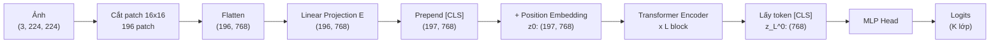

# Vision Transformer (ViT) — Tài liệu cho Phần 1–4

> **Phạm vi:** (1) Đặt vấn đề · (2) Kiến trúc tổng quan · (3) Biểu diễn đầu vào (Patch & Position) · (4) Self-Attention trên ảnh.
> **Nguồn chính:** Dosovitskiy et al., *"An Image is Worth 16x16 Words"*, ICLR 2021 [1]. Các công thức (1)–(4) lấy từ §3.1 của [1]; công thức (5)–(7) lấy từ Phụ lục A của [1].
> **Quy ước:** `[n]` là mục trong phần *Tài liệu tham khảo* ở cuối file. Code đánh dấu ✅ là đã chạy kiểm tra, kết quả in ra được ghi kèm; code đánh dấu ⚠️ chưa chạy trong môi trường soạn tài liệu (không có PyTorch), cần chạy thử trên Colab.

---

## Ký hiệu dùng xuyên suốt

| Ký hiệu | Ý nghĩa | Giá trị với ViT-B/16, ảnh 224×224 |
| :--- | :--- | :--- |
| $H, W, C$ | Chiều cao, chiều rộng, số kênh ảnh | 224, 224, 3 |
| $P$ | Cạnh của một patch (vuông $P \times P$) | 16 |
| $N = HW/P^2$ | Số patch = độ dài chuỗi (chưa tính `[CLS]`) | 196 |
| $D$ | Kích thước vector ẩn (hidden size) không đổi trong toàn mô hình | 768 |
| $P^2 \cdot C$ | Số phần tử của một patch sau khi flatten | 768 |
| $L$ | Số Encoder block | 12 |
| $k$ | Số attention head | 12 |
| $D_h = D/k$ | Kích thước mỗi head | 64 |
| $B$ | Batch size | tùy chọn |

> Lưu ý: ở ViT-B/16, $P^2 \cdot C = 768$ **trùng** với $D = 768$ chỉ là ngẫu nhiên. Với ViT-L ($D = 1024$) hai số này khác nhau, nên khi giải thích cần phân biệt rõ hai đại lượng.

---

# 1. Đặt vấn đề

## 1.1 Bối cảnh

- Trước ViT, thị giác máy tính do CNN thống trị: LeCun et al. (1989), AlexNet (2012), ResNet (2016) [1].
- Ở NLP, Transformer [2] đã trở thành mô hình mặc định: pre-train trên corpus lớn rồi fine-tune trên tác vụ nhỏ (BERT [3]), và có thể mở rộng tới hơn 100 tỷ tham số mà hiệu năng vẫn chưa có dấu hiệu bão hòa [1, §1].
- Câu hỏi của bài báo: **có thể áp dụng một Transformer "thuần" (không tích chập) trực tiếp lên ảnh, với ít chỉnh sửa nhất có thể, hay không?** Các hướng trước đó hoặc kết hợp attention với CNN, hoặc thay một phần conv nhưng vẫn giữ khung CNN; những kiểu attention chuyên biệt (sparse, axial, local…) khó triển khai hiệu quả trên phần cứng hiện đại [1, §1–2].

## 1.2 Hạn chế của CNN truyền thống

**(a) Inductive bias cục bộ (locality).** Trong CNN, tính cục bộ, cấu trúc lân cận 2D và tính *translation equivariance* được "gài sẵn" vào từng lớp, xuyên suốt mô hình [1, §3.1]. Đây là giả định mạnh về cấu trúc ảnh: điểm ảnh gần nhau liên quan chặt chẽ và cùng một mẫu hình có ý nghĩa như nhau ở mọi vị trí.

**(b) Khó nắm bắt phụ thuộc tầm xa (global context).** Một unit trong CNN chỉ phụ thuộc vào một vùng của ảnh, gọi là *receptive field* (RF) [5]. Với kernel $k \times k$, stride 1, mỗi lớp conv chỉ mở rộng RF thêm $(k-1)$ pixel, nên sau $L$ lớp RF chỉ là $1 + L(k-1)$. Để hai vùng xa nhau "nhìn thấy" nhau, mạng phải rất sâu hoặc dùng downsampling. Thêm nữa, Luo et al. [5] chỉ ra *effective receptive field* (vùng thực sự ảnh hưởng đáng kể) có phân bố gần Gaussian và chỉ chiếm một phần của RF lý thuyết.

**(c) Trọng số kernel cố định theo vị trí tương đối, không phụ thuộc nội dung.** Cùng một kernel áp lên mọi vị trí bất kể ảnh chứa gì. Self-attention thì ngược lại: trọng số tổng hợp $A_{ij}$ được tính từ chính nội dung của hai patch (xem Phần 4).

> **Cần nói cho cân bằng khi thuyết trình:** inductive bias của CNN *không phải là lỗi thiết kế* mà là một **đánh đổi**. Khi dữ liệu ít, giả định cục bộ giúp CNN học tốt hơn. Chính bài báo gốc ghi nhận ViT huấn luyện trên ImageNet (không có pre-train lớn) cho độ chính xác thấp hơn ResNet cùng cỡ vài điểm phần trăm, vì thiếu các inductive bias này [1, §1]. Kết luận của họ là *"large scale training trumps inductive bias"*, tức khi dữ liệu đủ lớn (14M–300M ảnh) thì việc tự học từ dữ liệu là đủ và thậm chí có lợi.

## 1.3 Động lực mang Transformer từ NLP sang CV

1. **Khả năng mở rộng (scalability):** kiến trúc Transformer và các cài đặt tối ưu của nó (đã phát triển cho NLP) có thể dùng gần như nguyên vẹn [1, §3].
2. **Tương tác toàn cục ngay từ lớp đầu:** mỗi token attend được tới mọi token khác.
3. **Rào cản kỹ thuật:** self-attention có chi phí bậc hai theo độ dài chuỗi. Nếu coi **mỗi pixel là một token** thì [1, §2]:

| Cách tokenize ảnh 224×224 | Độ dài chuỗi $N$ | Số phần tử ma trận attention ($N^2$) |
| :--- | :--- | :--- |
| Mỗi pixel là 1 token | $224 \times 224 = 50{,}176$ | $\approx 2.52 \times 10^9$ (≈ 5.0 GB nếu lưu fp16, **cho một head ở một layer**) |
| Mỗi patch 16×16 là 1 token | $196$ (197 nếu có `[CLS]`) | $196^2 = 38{,}416$ |

Tỷ lệ giảm là $P^4 = 16^4 = 65{,}536$ lần. Đây là lý do cốt lõi của ý tưởng *patch*: **"Image patches are treated the same way as tokens (words) in an NLP application"** [1, §1], tương ứng với tên bài báo *"An Image is Worth 16x16 Words"*.

**Kết quả đáng nhắc (để chứng minh động lực hợp lý)** [1, Table 2]: ViT-L/16 pre-train trên JFT-300M đạt 87.76% top-1 ImageNet (so với BiT-L ResNet152x4 87.54%), với chi phí pre-train khoảng 0.68k TPUv3-core-days so với 9.9k của BiT-L. ViT-H/14 đạt 88.55%. (Con số compute là trong thiết lập thí nghiệm của tác giả; chính họ lưu ý hiệu quả pre-train còn phụ thuộc lịch huấn luyện, optimizer, weight decay…)

## 1.4 Minh họa: vùng tiếp nhận cục bộ (CNN) và attention toàn cục (ViT)

**Số liệu receptive field của chồng conv 3×3, stride 1** (công thức $\text{RF} = 1 + L(k-1) = 2L+1$):

| Số lớp conv $L$ | 1 | 2 | 3 | 4 | 5 | 7 |
| :--- | :--- | :--- | :--- | :--- | :--- | :--- |
| RF | 3×3 | 5×5 | 7×7 | 9×9 | 11×11 | 15×15 |

Ngược lại, ở ViT, ma trận attention $A \in \mathbb{R}^{N \times N}$ là ma trận **dày đặc**: ngay layer 1, patch $i$ đã có thể lấy thông tin từ mọi patch $j$.

**✅ Code tạo hình minh họa** (lưới 14×14 ô, ô đỏ là vị trí đang xét; kết quả lưu `receptive_field.png`):

```python
import numpy as np
import matplotlib.pyplot as plt

G = 14                        # lưới 14x14 (ví dụ: 14x14 patch / feature cell)
center = (6, 6)               # ô đang xét
fig, axes = plt.subplots(1, 5, figsize=(13, 3))
titles = [f"CNN: {L} lớp conv 3x3\nRF = {2 * L + 1}x{2 * L + 1}" for L in (1, 2, 3, 4)]
titles.append("ViT: layer 1\nglobal attention")

for ax, title, L in zip(axes, titles, (1, 2, 3, 4, None)):
    m = np.zeros((G, G))
    if L is None:
        m[:] = 1                                   # nhìn được toàn bộ ngay từ layer 1
    else:
        r = L                                      # RF = 2L+1  =>  bán kính L (stride 1, k = 3)
        m[max(0, center[0] - r):center[0] + r + 1,
          max(0, center[1] - r):center[1] + r + 1] = 1
    ax.imshow(m, cmap="Blues", vmin=0, vmax=1.3)
    ax.scatter(center[1], center[0], c="red", s=40)
    ax.set_title(title, fontsize=9); ax.set_xticks([]); ax.set_yticks([])
plt.tight_layout(); plt.savefig("receptive_field.png", dpi=150); plt.show()
```

**Hạn chế của minh họa này (nên ghi chú trên slide):** nó là mô hình đơn giản hóa với stride 1 và không có pooling. ResNet thực tế có stride/pooling nên RF lý thuyết tăng nhanh hơn nhiều; tuy nhiên [5] cho thấy vùng ảnh hưởng *thực sự* nhỏ hơn RF lý thuyết.

**Bằng chứng thực nghiệm từ ViT (đừng nói "ViT luôn nhìn toàn cục"):**

- Bài báo gốc đo **attention distance** (khoảng cách trung bình trong không gian ảnh mà attention tổng hợp thông tin, tương tự kích thước RF của CNN). Kết quả: một số head đã attend phần lớn ảnh ngay ở các lớp thấp, trong khi các head khác vẫn rất cục bộ; khoảng cách tăng dần theo độ sâu; ở nửa sau mạng, đa số head attend rộng [1, §4.5, Phụ lục D.7].
- Raghu et al. [6] kết luận ViT tổng hợp thông tin toàn cục ở các lớp thấp nhiều hơn ResNet, nhưng thông tin cục bộ ở lớp thấp vẫn quan trọng, và pre-train trên dữ liệu lớn giúp các lớp attention đầu học được điều đó.

**→ Thông điệp:** ViT *có khả năng* nhìn toàn cục từ đầu và *tự học* mức độ cục bộ/toàn cục phù hợp, thay vì bị áp đặt sẵn như CNN.

## 1.5 Bảng tóm tắt đối chiếu CNN và ViT (theo inductive bias)

| Tiêu chí | CNN (ví dụ ResNet) | ViT |
| :--- | :--- | :--- |
| Tính cục bộ | Có trong **mọi** lớp conv | Chỉ ở bước cắt patch; các lớp MLP là cục bộ, self-attention là toàn cục [1, §3.1] |
| Cấu trúc lân cận 2D | Gài sẵn trong từng lớp | Dùng rất ít: lúc cắt patch và lúc nội suy position embedding khi đổi độ phân giải [1, §3.1–3.2] |
| Translation equivariance | Có (nhờ weight sharing của conv) | Hạn chế (MLP có, attention không phải theo nghĩa này) |
| Trọng số tổng hợp thông tin | Kernel cố định, không phụ thuộc nội dung | $A_{ij}$ tính động từ nội dung |
| Cần dữ liệu pre-train | Ít hơn | Nhiều hơn rất nhiều (ImageNet-21k / JFT-300M) [1, §4.3] |
| Chi phí theo số token | Tuyến tính theo số vị trí | Bậc hai: $O(N^2)$ |

### Gợi ý nội dung slide cho Phần 1
- Slide 1: Bối cảnh (CNN thống trị ↔ Transformer thành công ở NLP) + câu hỏi nghiên cứu.
- Slide 2: Hạn chế CNN (a)(b)(c) + khung "đây là đánh đổi, không phải lỗi".
- Slide 3: Vì sao không dùng pixel làm token (bảng $N^2$) → ý tưởng patch.
- Slide 4: Hình `receptive_field.png` + 2 gạch đầu dòng về attention distance.
- Hình ngoài (nếu dùng): ghi nguồn rõ, ví dụ *Figure 7 (phải)* của [1] cho attention distance.

---

# 2. Kiến trúc tổng quan

## 2.1 Ý tưởng chính

ViT bám sát Transformer gốc [2] "càng sát càng tốt" để tận dụng nguyên cài đặt từ NLP [1, §3]. Khác biệt cốt lõi nằm ở **cách biến ảnh thành chuỗi token**; phần còn lại là một **Transformer Encoder** chuẩn (không có Decoder) cộng với một **MLP Head** để phân loại.

## 2.2 Sơ đồ tổng quan



Phiên bản ASCII (tiện chép sang công cụ vẽ slide):

```
 Ảnh (3,224,224)
      │  cắt lưới 14x14 patch, mỗi patch 16x16x3
      ▼
 196 patch  ──flatten──►  (196, 768)
      │  nhân với E ∈ R^{768×D}   (Linear Projection = "Patch Embedding")
      ▼
 (196, D)  ──prepend [CLS]──►  (197, D)
      │  cộng E_pos ∈ R^{197×D}
      ▼
 z0  (197, D)
      │
      ▼
 ┌───────────────────────────────────────┐
 │  Transformer Encoder block  (lặp L lần)│
 │   z'_l = MSA(LN(z_{l-1})) + z_{l-1}    │
 │   z_l  = MLP(LN(z'_l))    + z'_l       │
 └───────────────────────────────────────┘
      │  output (197, D)  (kích thước không đổi qua các block)
      ▼
 lấy token vị trí 0 ([CLS]):  z_L^0  (D)
      │  LN
      ▼
 MLP Head ──►  logits (K)  ──►  nhãn dự đoán
```

Có thể dùng làm sơ đồ nền *Figure 1* của [1] (nhớ ghi nguồn) và chú thích thêm kích thước tensor như bảng dưới.

## 2.3 Luồng dữ liệu và kích thước tensor (ViT-B/16, batch $B$)

| Bước | Phép biến đổi | Kích thước sau bước |
| :--- | :--- | :--- |
| 0 | Ảnh đầu vào | $(B, 3, 224, 224)$ |
| 1 | Cắt patch + flatten | $(B, 196, 768)$ |
| 2 | Linear Projection $E$ | $(B, 196, 768)$ |
| 3 | Prepend `[CLS]` | $(B, 197, 768)$ |
| 4 | Cộng Position Embedding | $(B, 197, 768)$ → $z_0$ |
| 5 | $L=12$ Encoder block | $(B, 197, 768)$ (không đổi) |
| 6 | Lấy token `[CLS]` | $(B, 768)$ |
| 7 | MLP Head | $(B, K)$ |

## 2.4 Công thức tổng thể (theo [1], §3.1)

$$
\begin{aligned}
z_0 &= [x_{\text{class}};\, x_p^1 E;\, x_p^2 E;\, \cdots;\, x_p^N E] + E_{pos}, & E \in \mathbb{R}^{(P^2 \cdot C) \times D},\; E_{pos} \in \mathbb{R}^{(N+1) \times D} &\quad (1)\\
z'_\ell &= \text{MSA}(\text{LN}(z_{\ell-1})) + z_{\ell-1}, & \ell = 1 \dots L &\quad (2)\\
z_\ell &= \text{MLP}(\text{LN}(z'_\ell)) + z'_\ell, & \ell = 1 \dots L &\quad (3)\\
y &= \text{LN}(z_L^0) & &\quad (4)
\end{aligned}
$$

- (1): tạo chuỗi đầu vào (chi tiết ở Phần 3).
- (2)–(3): một Encoder block, gồm **LayerNorm đặt trước** (Pre-Norm) mỗi khối con và **residual connection sau** mỗi khối con; MLP gồm 2 lớp với hàm kích hoạt GELU [1, §3.1]. Chi tiết MSA ở Phần 5, cấu trúc block ở Phần 6 (do bạn khác phụ trách).
- (4): $z_L^0$ là trạng thái đầu ra của token `[CLS]` ở layer cuối, đóng vai trò **biểu diễn của cả ảnh** $y$.

## 2.5 MLP Head

Một classification head được gắn vào $z_L^0$: **MLP có một lớp ẩn khi pre-train** và **một lớp tuyến tính duy nhất khi fine-tune** [1, §3.1]. Khi chuyển sang tác vụ khác, bỏ head cũ và gắn lớp tuyến tính $D \times K$ khởi tạo bằng 0 ($K$ = số lớp đích) [1, §3.2]. (Phụ lục D.3 của [1] mô tả head pre-train là MLP với `tanh` ở một lớp ẩn.)

## 2.6 Các cấu hình mô hình chuẩn [1, Table 1]

| Mô hình | Layers $L$ | Hidden $D$ | MLP size | Heads $k$ | Params |
| :--- | :--- | :--- | :--- | :--- | :--- |
| ViT-Base | 12 | 768 | 3072 | 12 | 86M |
| ViT-Large | 24 | 1024 | 4096 | 16 | 307M |
| ViT-Huge | 32 | 1280 | 5120 | 16 | 632M |

Ký hiệu **ViT-B/16** = bản Base với patch 16×16. Độ dài chuỗi tỷ lệ nghịch với bình phương cạnh patch, nên patch nhỏ hơn thì tốn tính toán hơn [1, §4.1]. Với ảnh 224×224:

| Cấu hình | $P$ | $N$ | Độ dài chuỗi (có `[CLS]`) |
| :--- | :--- | :--- | :--- |
| ViT-B/32 | 32 | 49 | 50 |
| ViT-B/16 | 16 | 196 | 197 |
| ViT-H/14 | 14 | 256 | 257 |

**Kiểm tra nhanh số tham số ViT-B (ước lượng):** mỗi Encoder block có xấp xỉ $4D^2$ (MSA: các ma trận $Q,K,V$ và chiếu đầu ra) $+\, 8D^2$ (MLP: $D \to 4D \to D$) $= 12D^2$ tham số, nên $12 \cdot 12 \cdot 768^2 = 84{,}934{,}656$. Cộng thêm patch embedding, `[CLS]` và position embedding ($\approx 0.74$M), tổng khoảng $85.7$M; cộng nốt bias, LayerNorm và head thì xấp xỉ **86M**, khớp Table 1.

### Gợi ý nội dung slide cho Phần 2
- Slide 1: Sơ đồ tổng quan (dùng sơ đồ trên hoặc *Figure 1* của [1], có chú thích kích thước ở mỗi khối).
- Slide 2: Bảng luồng tensor (mục 2.3) + công thức (1)–(4).
- Slide 3: MLP Head, các cấu hình B/L/H và quy ước đặt tên `ViT-B/16`.

---

# 3. Biểu diễn đầu vào (Patch & Position)

Đây là phần **duy nhất** thực sự "đặc thù ảnh" của ViT; sau bước này, mô hình xử lý một chuỗi vector như trong NLP.

## 3.1 Cắt ảnh thành patch (Image Patching)

Ảnh $x \in \mathbb{R}^{H \times W \times C}$ được reshape thành chuỗi các patch phẳng $x_p \in \mathbb{R}^{N \times (P^2 \cdot C)}$ với

$$N = \frac{HW}{P^2}$$

Ví dụ $224 \times 224 \times 3$ với $P = 16$: lưới $14 \times 14$ patch, $N = 196$. $N$ cũng chính là độ dài chuỗi đầu vào của Transformer [1, §3.1].

```
Lưới 14x14 patch (đánh số theo thứ tự raster, trái→phải, trên→dưới):

  1   2   3  ...  14
 15  16  17  ...  28
 ...
183 184 185  ... 196
```

> Chú ý layout: bài báo viết ảnh dạng $(H, W, C)$, còn PyTorch dùng $(C, H, W)$. Khi vẽ hình/viết công thức hãy nói rõ bạn dùng quy ước nào.

## 3.2 Làm phẳng (Flattening)

Mỗi patch $P \times P \times C = 16 \times 16 \times 3$ được duỗi thành vector $P^2 \cdot C = 768$ phần tử. Sau bước này ta có ma trận $x_p \in \mathbb{R}^{196 \times 768}$.

## 3.3 Chiếu tuyến tính (Linear Projection / Patch Embedding)

Transformer dùng kích thước vector $D$ không đổi, nên mỗi patch phẳng được ánh xạ sang $D$ chiều bằng **một ma trận học được $E \in \mathbb{R}^{(P^2 \cdot C) \times D}$, dùng chung cho mọi patch** [1, §3.1]:

$$x_p^i E \in \mathbb{R}^{D}, \quad i = 1, \dots, N$$

Đầu ra gọi là **patch embeddings** (token tương đương một "từ" trong NLP).

**Điểm đáng nói:** vì $E$ dùng chung cho mọi patch nên phép này **tương đương `Conv2d(in=C, out=D, kernel_size=P, stride=P)`** — các cài đặt thực tế (như `timm`) thường dùng conv vì tiện. Đây không phải "dùng CNN" mà chỉ là cách cài đặt một phép chiếu tuyến tính trên các patch không chồng lấp. Bài báo cũng trực quan hóa các filter này: chúng giống các hàm cơ sở hợp lý cho cấu trúc mịn bên trong một patch [1, §4.5, Fig. 7 trái].

Số tham số của bước này với ViT-B/16: $768 \times 768 = 589{,}824$ (+ 768 bias).

**✅ Code: theo dõi kích thước tensor và kiểm chứng tương đương Conv ↔ Linear** (numpy, chạy được ngay):

```python
import numpy as np

H = W = 224; C = 3; P = 16; D = 768
N = (H // P) * (W // P)                      # 14 * 14 = 196
rng = np.random.default_rng(0)
img = rng.random((C, H, W))                  # ảnh giả, layout (C, H, W) như PyTorch

# (C,H,W) -> (C, H/P, P, W/P, P) -> (H/P, W/P, C, P, P) -> (N, P*P*C)
patches = (img.reshape(C, H // P, P, W // P, P)
              .transpose(1, 3, 0, 2, 4)
              .reshape(N, P * P * C))
print("patches (flatten):", patches.shape)                        # (196, 768)
assert np.allclose(patches[0], img[:, :P, :P].reshape(-1))        # patch 0 = góc trên-trái

E = rng.standard_normal((P * P * C, D)) * 0.02                    # E ∈ R^{(P²·C)×D}
tokens = patches @ E                                              # (196, 768)
z = np.concatenate([np.zeros((1, D)), tokens], axis=0)            # prepend [CLS] -> (197, 768)
E_pos = rng.standard_normal((N + 1, D)) * 0.02                    # E_pos ∈ R^{(N+1)×D}
z0 = z + E_pos                                                    # (197, 768)
print("tokens:", tokens.shape, "| sau [CLS]:", z.shape, "| z0:", z0.shape)

# Kiểm chứng: Conv2d(kernel=P, stride=P) với D filter  ==  Linear trên patch đã flatten
W_conv = E.T.reshape(D, C, P, P)                                  # (D, C, P, P)
blocks = img.reshape(C, H // P, P, W // P, P).transpose(0, 1, 3, 2, 4)   # (C, 14, 14, P, P)
conv_out = np.einsum('dcuv,cijuv->dij', W_conv, blocks)           # (D, 14, 14)
print("conv == linear:", np.allclose(conv_out.reshape(D, N).T, tokens))

print("params E:", P * P * C * D, "(+ bias", D, ") | cls:", D, "| pos:", (N + 1) * D)
```

Kết quả khi chạy:

```
patches (flatten): (196, 768)
tokens: (196, 768) | sau [CLS]: (197, 768) | z0: (197, 768)
conv == linear: True
params E: 589824 (+ bias 768 ) | cls: 768 | pos: 151296
```

**⚠️ Code PyTorch tương đương** (chưa chạy trong môi trường soạn tài liệu; hãy chạy trên Colab và so `print` với bảng ở mục 2.3):

```python
import torch
import torch.nn as nn


class ViTInput(nn.Module):
    """Ảnh -> chuỗi token z0 (Eq. 1). Mặc định: ViT-B/16 trên ảnh 224x224."""

    def __init__(self, img_size=224, patch_size=16, in_chans=3, embed_dim=768):
        super().__init__()
        self.num_patches = (img_size // patch_size) ** 2              # N = 196
        # Linear projection E  ==  Conv2d(kernel = stride = P)
        self.proj = nn.Conv2d(in_chans, embed_dim, kernel_size=patch_size, stride=patch_size)
        self.cls_token = nn.Parameter(torch.zeros(1, 1, embed_dim))   # x_class (learnable)
        self.pos_embed = nn.Parameter(torch.zeros(1, self.num_patches + 1, embed_dim))  # E_pos
        nn.init.trunc_normal_(self.cls_token, std=0.02)
        nn.init.trunc_normal_(self.pos_embed, std=0.02)

    def forward(self, x):                              # x: (B, 3, 224, 224)
        x = self.proj(x)                               # (B, 768, 14, 14)
        x = x.flatten(2).transpose(1, 2)               # (B, 196, 768)
        cls = self.cls_token.expand(x.shape[0], -1, -1)  # (B, 1, 768)
        x = torch.cat([cls, x], dim=1)                 # (B, 197, 768)
        return x + self.pos_embed                      # (B, 197, 768)  = z0


x = torch.randn(2, 3, 224, 224)
print(ViTInput()(x).shape)                             # kỳ vọng: torch.Size([2, 197, 768])
```

## 3.4 Vai trò của token `[CLS]`

**Cơ chế:** theo [1, §3.1], tương tự token `[class]` của BERT [3], ta *prepend* một vector học được vào chuỗi: $z_0^0 = x_{\text{class}}$. Token này đi qua toàn bộ $L$ block như mọi token khác; trạng thái ở đầu ra $z_L^0$ được dùng làm **biểu diễn ảnh** $y$ và là đầu vào của classification head. Nhờ vậy độ dài chuỗi thành $N + 1 = 197$ (đúng với ví dụ $(3,224,224) \to (196,768) \to (197,768)$ trong đề bài).

**Vì sao cần một token riêng (lập luận để trình bày):**

1. **Không thiên vị patch nào:** nếu lấy đầu ra của một patch cụ thể làm đại diện, biểu diễn ảnh bị gắn với vị trí/nội dung của patch đó. `[CLS]` không mang nội dung ảnh ban đầu, nên không có "thiên kiến" này.
2. **Điểm tổng hợp qua attention:** ở *mỗi* layer, `[CLS]` có thể attend tới mọi patch và gom thông tin; thông tin chỉ được "đọc ra" tại $z_L^0$.
3. **Thừa hưởng thiết kế NLP:** giữ ViT sát Transformer gốc/BERT, đúng triết lý "ít chỉnh sửa nhất" của bài báo.

**Sắc thái quan trọng (nên đưa vào để câu trả lời chính xác):** Phụ lục D.3 của [1] cho biết `[CLS]` **không phải là thứ bắt buộc**. Phương án thay thế là *Global Average Pooling* (GAP) trên các patch embedding, rồi qua một bộ phân loại tuyến tính (như cuối ResNet), cho kết quả **tương đương** nếu dùng learning rate phù hợp. Lúc đầu GAP tưởng kém hẳn, nhưng nguyên nhân là chênh lệch learning rate chứ không phải do thiếu token hay do phép GAP [1, App. D.3, Fig. 9]. Vậy lập luận đúng là: *"`[CLS]` là lựa chọn thiết kế kế thừa từ NLP, hoạt động tốt; GAP là phương án tương đương"*, chứ không phải *"không có `[CLS]` thì mô hình hỏng"*.

## 3.5 Positional Embedding (1D và 2D)

**Vì sao cần:** sau bước chiếu, các patch embedding chỉ chứa *nội dung*; thông tin "patch này ở đâu" đã mất khi flatten lưới thành chuỗi. Bài báo cộng thêm **position embedding học được** $E_{pos} \in \mathbb{R}^{(N+1) \times D}$ vào chuỗi, tức mỗi vị trí (kể cả `[CLS]` ở vị trí 0) có một vector riêng, cộng **element-wise** (không nối) để giữ kích thước $D$ không đổi [1, §3.1].

**1D vs 2D** (theo mô tả Phụ lục D.4 của [1]):

| Loại | Cách làm |
| :--- | :--- |
| **1D (mặc định của ViT)** | Coi chuỗi patch theo thứ tự raster, mỗi vị trí $1 \dots N$ một vector học được |
| 2D | Học hai tập embedding cho trục X và trục Y, mỗi vector kích thước $D/2$, nối lại để được embedding của patch |
| Relative | Mã hóa độ lệch tương đối giữa cặp patch, cộng như một bias vào logit attention |

**Kết quả ablation** (ViT-B/16, đo trên ImageNet 5-shot linear) [1, Table 8]:

| Position embedding | Độ chính xác |
| :--- | :--- |
| Không có | 0.61382 |
| 1D | 0.64206 |
| 2D | 0.64001 |
| Relative | 0.64032 |

Nhận xét: có khoảng cách lớn giữa *không có* và *có* positional embedding, nhưng **gần như không có khác biệt giữa 1D, 2D và relative**. Tác giả suy đoán vì encoder chạy trên lưới patch nhỏ ($14 \times 14$ thay vì $224 \times 224$), việc học quan hệ không gian ở mức này dễ như nhau với mọi cách mã hóa. Lý do thực nghiệm nữa: position embedding 1D học được **tự mã hóa cấu trúc 2D** (patch gần nhau có embedding giống nhau hơn; patch cùng hàng/cột cũng giống nhau) [1, §4.5, Fig. 7 giữa], nên "bản 2D thủ công" không mang thêm lợi ích.

**Nếu bỏ thông tin vị trí thì sao?** Hai ý cần trình bày:

1. **Lý thuyết:** self-attention thuần là *permutation-equivariant* — xáo trộn thứ tự patch chỉ làm xáo trộn tương ứng đầu ra, mô hình không phân biệt được "mắt ở trên mỏ" hay "mỏ ở trên mắt". Chuỗi patch trở thành một **"bag of patches"** (túi các mảnh) [1, App. D.4].
2. **Thực nghiệm:** độ chính xác giảm từ 0.642 xuống 0.614 (khoảng 2.8 điểm phần trăm trong thiết lập trên). Giảm *đáng kể nhưng không sụp đổ*, vì bản thân nội dung từng patch vẫn mang nhiều thông tin, và vị trí các pixel *bên trong* một patch vẫn được mã hóa bởi chính ma trận $E$ (mỗi pixel nhân với trọng số riêng).

**✅ Code kiểm chứng tính permutation-equivariant** (numpy):

```python
import numpy as np
rng = np.random.default_rng(1)
N, D, Dh = 6, 8, 4
Z = rng.standard_normal((N, D))
Wq, Wk, Wv = (rng.standard_normal((D, Dh)) for _ in range(3))

def softmax(a):
    e = np.exp(a - a.max(-1, keepdims=True))
    return e / e.sum(-1, keepdims=True)

def self_attention(Z):
    Q, K, V = Z @ Wq, Z @ Wk, Z @ Wv
    return softmax(Q @ K.T / np.sqrt(Dh)) @ V

perm = rng.permutation(N)                    # xáo trộn thứ tự patch
print(np.allclose(self_attention(Z[perm]), self_attention(Z)[perm]))   # True
```

Kết quả: `True` → nếu không cộng $E_{pos}$, đầu ra chỉ bị hoán vị theo, không hề "biết" patch nằm ở đâu.

**Đổi độ phân giải khi fine-tune:** giữ nguyên cạnh patch, tăng độ phân giải thì tăng số patch (ví dụ ảnh 384×384 với $P=16$ → $24 \times 24 = 576$ patch, chuỗi 577 token) nên position embedding đã pre-train không còn khớp. Giải pháp là **nội suy 2D** $E_{pos}$ theo vị trí trong ảnh gốc. Cùng với bước cắt patch, đây là chỗ duy nhất bài báo chủ động đưa thông tin cấu trúc 2D vào mô hình [1, §3.2].

### Gợi ý nội dung slide cho Phần 3
- Slide 1: Hình ảnh 224×224×3 cắt lưới 14×14, tô sáng 1 patch → flatten 768 → nhân $E$ → vector $D$ (tận dụng bảng kích thước + công thức (1)).
- Slide 2: `[CLS]`: cơ chế, 3 lý do, và ghi chú GAP tương đương.
- Slide 3: Positional embedding 1D/2D + bảng ablation + demo permutation-equivariant.

---

# 4. Self-Attention trên ảnh

(Phần này trình bày **một head** để dễ theo dõi; việc chạy nhiều head song song thuộc Phần 5.)

## 4.1 Query, Key, Value đối với các patch

Cho chuỗi $z \in \mathbb{R}^{N \times D}$ (mỗi hàng là một patch/token). Theo Phụ lục A của [1]:

$$[q, k, v] = z\, U_{qkv}, \qquad U_{qkv} \in \mathbb{R}^{D \times 3D_h} \tag{5}$$

$$A = \text{softmax}\!\left(\frac{q k^\top}{\sqrt{D_h}}\right), \qquad A \in \mathbb{R}^{N \times N} \tag{6}$$

$$\text{SA}(z) = A\, v \tag{7}$$

Trực giác cho **từng patch** $i$ (cách diễn giải, không phải định nghĩa trong bài báo):

| Thành phần | Vai trò với patch | Câu hỏi tương ứng |
| :--- | :--- | :--- |
| Query $q_i$ | Patch $i$ "đang tìm" thông tin gì | *"Mình cần ngữ cảnh kiểu nào?"* |
| Key $k_j$ | Patch $j$ "quảng bá" mình chứa thông tin gì | *"Mình chứa loại đặc trưng nào?"* |
| Value $v_j$ | Nội dung thực sự patch $j$ sẽ gửi đi | *"Nếu được chọn, mình đóng góp gì?"* |

Cả ba đều là phép chiếu tuyến tính khác nhau của **cùng một** token (do đó gọi là *self*-attention).

## 4.2 Cách tính attention score giữa các vùng ảnh

1. **Score thô:** $S_{ij} = q_i \cdot k_j$ — độ tương hợp giữa nhu cầu của patch $i$ và nội dung patch $j$.
2. **Chia tỷ lệ:** $S_{ij}/\sqrt{D_h}$. Nếu các thành phần của $q, k$ độc lập, kỳ vọng 0, phương sai 1 thì $q \cdot k$ có phương sai $D_h$; chia cho $\sqrt{D_h}$ giữ phương sai ở mức ~1, tránh softmax bão hòa với gradient quá nhỏ (lập luận của Vaswani et al. [2]).
3. **Softmax theo từng hàng:** $A_{ij} = \dfrac{e^{S_{ij}/\sqrt{D_h}}}{\sum_{j'} e^{S_{ij'}/\sqrt{D_h}}}$ → mỗi hàng là một phân phối xác suất (tổng bằng 1).
4. **Tổng có trọng số:** đầu ra của patch $i$ là $\text{out}_i = \sum_j A_{ij} v_j$.

**Kích thước tensor (một head, ViT-B/16, $D_h = 64$):**

| Đại lượng | Kích thước |
| :--- | :--- |
| $z$ | $(B, 197, 768)$ |
| $q, k, v$ | $(B, 197, 64)$ mỗi cái |
| $q k^\top$ và $A$ | $(B, 197, 197)$ |
| $\text{SA}(z) = A v$ | $(B, 197, 64)$ |

## 4.3 Ý nghĩa vật lý

- **$A_{ij}$** cho biết patch $i$ **lấy bao nhiêu thông tin từ vùng $j$** khi cập nhật biểu diễn của mình. Hàng $i$ của $A$ là "bản đồ chú ý" của patch $i$ trên toàn ảnh.
- **Trọng số động, phụ thuộc nội dung:** khác kernel conv cố định. Hai patch giống nhau về đặc trưng (ví dụ cùng là "bầu trời") liên kết mạnh với nhau dù ở rất xa; đây là cơ chế cho **phụ thuộc tầm xa** nói ở Phần 1.
- **Thước đo thực nghiệm:** *attention distance*, là khoảng cách trung bình trong không gian ảnh, có trọng số attention [1, App. D.7]. Một số head cục bộ, một số toàn cục, và khoảng cách tăng theo độ sâu [1, §4.5].
- **Cẩn trọng khi diễn giải:** trọng số attention là một cách quan sát hữu ích, nhưng không phải lúc nào cũng là giải thích đầy đủ cho quyết định của mô hình [9]. Khi vẽ bản đồ tập trung từ đầu ra tới ảnh (Phần 8), bài báo gốc dùng *Attention Rollout* [7]: trung bình attention của các head rồi nhân đệ quy các ma trận qua các layer để tính cả sự trộn thông tin giữa token [1, App. D.8].
- **Chi phí:** ma trận $A$ có $N^2$ phần tử mỗi head mỗi layer → $O(N^2)$. Với ảnh 224 ($N=197$): $38{,}809$; với ảnh 384 ($N = 577$): $332{,}929$, tức tăng khoảng **8.6 lần**. Đây là nguồn gốc nhược điểm $O(N^2)$ ở Phần 8 và động lực của các biến thể kiểu Swin ở Phần 7.

## 4.4 Ví dụ tính tay: ma trận attention giữa 4 patch

> **Lưu ý trung thực:** các embedding dưới đây là **số tự dựng để minh họa** (không lấy từ mô hình đã huấn luyện). Mục đích là cho thấy cơ chế tính; chuyện "patch nào chú ý patch nào" ở mô hình thật cần được kiểm chứng bằng attention map ở Phần 8.

**Thiết lập.** Giả sử ảnh một con chim, ta chọn 4 patch đại diện. Mỗi patch có $D = 4$ đặc trưng giả định `[animal, texture/edge, sky, brightness]`, và dùng một head với $D_h = 2$:

| Patch | Mô tả | `[animal, texture, sky, brightness]` |
| :--- | :--- | :--- |
| P1 | Mỏ chim (beak) | $[2, 2, 0, 0]$ |
| P2 | Đầu chim (head) | $[2, 1, 0, 1]$ |
| P3 | Cánh chim (wing), một phần nền trời lọt vào | $[1, 2, 1, 1]$ |
| P4 | Nền trời (sky) | $[0, 0, 2, 2]$ |

$$
W_Q = \begin{bmatrix} 0.5 & 0 \\ 0.5 & 0 \\ 0 & 0.5 \\ 0 & 0.5 \end{bmatrix},\quad
W_K = \begin{bmatrix} 0.5 & 0 \\ 0.25 & 0 \\ 0 & 0.5 \\ 0 & 0.25 \end{bmatrix},\quad
W_V = \begin{bmatrix} 1 & 0 \\ 0 & 0 \\ 0 & 1 \\ 0 & 0 \end{bmatrix}
$$

**Bước 1 — Q, K, V** ($Q = ZW_Q$, …):

$$
Q = \begin{bmatrix} 2 & 0 \\ 1.5 & 0.5 \\ 1.5 & 1 \\ 0 & 2 \end{bmatrix},\;
K = \begin{bmatrix} 1.5 & 0 \\ 1.25 & 0.25 \\ 1 & 0.75 \\ 0 & 1.5 \end{bmatrix},\;
V = \begin{bmatrix} 2 & 0 \\ 2 & 0 \\ 1 & 1 \\ 0 & 2 \end{bmatrix}
$$

**Bước 2 — Score $S = QK^\top$** (cột theo thứ tự beak, head, wing, sky):

$$
S = \begin{bmatrix}
3 & 2.5 & 2 & 0 \\
2.25 & 2 & 1.875 & 0.75 \\
2.25 & 2.125 & 2.25 & 1.5 \\
0 & 0.5 & 1.5 & 3
\end{bmatrix}
$$

**Bước 3 — Chia $\sqrt{D_h} = \sqrt{2} \approx 1.414$ rồi softmax từng hàng.** Ví dụ hàng "beak": $[2.121,\, 1.768,\, 1.414,\, 0] \to$ exp $= [8.34,\, 5.86,\, 4.11,\, 1]$, tổng $19.31$ → $[0.432,\, 0.303,\, 0.213,\, 0.052]$. Toàn bộ ma trận:

| Query ↓ / Key → | beak | head | wing | sky | Tổng hàng |
| :--- | :--- | :--- | :--- | :--- | :--- |
| **beak** | **0.432** | 0.303 | 0.213 | 0.052 | 1 |
| **head** | 0.339 | 0.284 | 0.260 | 0.117 | 1 |
| **wing** | 0.285 | 0.261 | 0.285 | 0.168 | 1 |
| **sky** | 0.073 | 0.104 | 0.212 | **0.611** | 1 |

**Bước 4 — Đầu ra $\text{out} = AV$:**

| Patch | out (2 chiều: animal, sky) |
| :--- | :--- |
| beak | $[1.683,\ 0.317]$ |
| head | $[1.505,\ 0.495]$ |
| wing | $[1.379,\ 0.621]$ |
| sky | $[0.567,\ 1.433]$ |

**Đọc kết quả:**

- Hàng *beak*: chú ý nhiều tới chính nó (0.43) và *head* (0.30) — hai patch cùng thuộc con chim — còn *sky* chỉ 0.05. Đầu ra của *beak* vẫn mang đậm đặc trưng "animal" (1.683) và chỉ hấp thụ một chút "sky" (0.317).
- Hàng *sky*: chú ý chính nó (0.61), rồi tới *wing* (0.21) vì patch cánh có lẫn nền trời (feature `sky = 1`).
- Mỗi hàng tổng bằng 1 (đúng tính chất softmax); ma trận **không đối xứng** ($A_{12} \ne A_{21}$) vì $W_Q \ne W_K$.
- Ý nghĩa: sau lớp này, mỗi patch đã "trộn" thông tin từ các patch liên quan; xếp chồng nhiều layer sẽ lan truyền thông tin ra toàn ảnh.

**✅ Code tái hiện ví dụ và vẽ heatmap** (numpy + matplotlib):

```python
import numpy as np
import matplotlib.pyplot as plt
np.set_printoptions(precision=3, suppress=True)

names = ["beak", "head", "wing", "sky"]
Z = np.array([[2, 2, 0, 0],      # beak
              [2, 1, 0, 1],      # head
              [1, 2, 1, 1],      # wing
              [0, 0, 2, 2]], dtype=float)   # sky
Wq = np.array([[0.5, 0], [0.5, 0], [0, 0.5], [0, 0.5]])
Wk = np.array([[0.5, 0], [0.25, 0], [0, 0.5], [0, 0.25]])
Wv = np.array([[1, 0], [0, 0], [0, 1], [0, 0]], dtype=float)

Q, K, V = Z @ Wq, Z @ Wk, Z @ Wv
d_k = Q.shape[1]
S = Q @ K.T                                   # score thô
S_scaled = S / np.sqrt(d_k)
e = np.exp(S_scaled - S_scaled.max(-1, keepdims=True))
A = e / e.sum(-1, keepdims=True)              # softmax theo hàng
out = A @ V
print("A =\n", A, "\nout =\n", out)

fig, ax = plt.subplots(figsize=(4.2, 3.8))
im = ax.imshow(A, cmap="Blues", vmin=0, vmax=1)
ax.set_xticks(range(4)); ax.set_xticklabels(names)
ax.set_yticks(range(4)); ax.set_yticklabels(names)
ax.set_xlabel("Key (patch j)"); ax.set_ylabel("Query (patch i)")
for i in range(4):
    for j in range(4):
        ax.text(j, i, f"{A[i, j]:.2f}", ha="center", va="center",
                color="white" if A[i, j] > 0.5 else "black")
plt.colorbar(im, fraction=0.046); plt.title("Attention matrix A (toy example)")
plt.tight_layout(); plt.savefig("attention_toy.png", dpi=150); plt.show()
```

Kết quả `A` và `out` in ra khớp với hai bảng ở trên.

**Thử nghiệm gợi ý (để hiểu sâu hơn):**
1. Đổi $W_K = W_Q$ → $A$ có đối xứng không? (Gợi ý: $S = QQ^\top$ đối xứng, nhưng softmax theo hàng vẫn khiến $A$ nói chung không đối xứng.)
2. Nhân $Z$ lên 3 lần → attention trở nên nhọn hơn hay phẳng hơn? Vì sao? (Liên hệ bước chia $\sqrt{D_h}$ và nhiệt độ softmax.)
3. Đổi giá trị feature của patch "wing" để nó giống "sky" hơn và quan sát hàng *sky*.

### Gợi ý nội dung slide cho Phần 4
- Slide 1: Q/K/V cho patch (bảng 4.1) + công thức (5)–(7) + kích thước tensor.
- Slide 2: Các bước tính score → scale → softmax → weighted sum.
- Slide 3: Ví dụ 4 patch: ma trận $A$ dạng heatmap (`attention_toy.png`) + 2–3 câu "đọc kết quả" (ghi chú rõ là số minh họa).
- Slide 4: Ý nghĩa vật lý + attention distance + lưu ý chi phí $O(N^2)$.

---

# Đối chiếu "Yêu cầu bắt buộc" của đề cho phần 1–4

| Yêu cầu | Đã đáp ứng ở đâu |
| :--- | :--- |
| Giải thích công thức biến đổi đầu vào (patch + cộng positional embedding) | §2.4 công thức (1); §3.1–3.5 |
| Công thức Self-Attention và ý nghĩa từng thành phần | §4.1–4.3, công thức (5)–(7) |
| Theo dõi kích thước tensor $(3,224,224) \to (196,768) \to (197,768)$ | §2.3 (bảng), §3.3 (code ✅), §4.2 (tensor trong attention) |
| Vai trò `[CLS]` và Positional Embedding; điều gì xảy ra nếu bỏ vị trí | §3.4 và §3.5 (lý thuyết, bảng ablation, code kiểm chứng) |
| Phân tích inductive bias: CNN vs ViT, đánh đổi dữ liệu | §1.2, §1.5; số liệu ở §1.3 (JFT-300M / ImageNet-21k) |
| Trích dẫn nguồn cho hình, công thức, code | Chú thích `[n]` xuyên suốt; hình `receptive_field.png`, `attention_toy.png` do code trong tài liệu tạo ra |

**Phần liên quan sang nhóm khác (để thống nhất với bạn phụ trách Phần 5–8):**
- Công thức (2)–(3) ở §2.4 chỉ nêu tóm tắt; chi tiết Pre-Norm/MLP/Residual để Phần 6 giải thích.
- Phần 4 dừng ở một head; việc chia $D$ thành $k$ head và ghép lại để Phần 5 trình bày.
- Nhược điểm $O(N^2)$ đã mở ở §4.3, Phần 8 có thể trích lại.

---

# Tài liệu tham khảo

**Bài báo**

1. A. Dosovitskiy, L. Beyer, A. Kolesnikov, D. Weissenborn, X. Zhai, T. Unterthiner, M. Dehghani, M. Minderer, G. Heigold, S. Gelly, J. Uszkoreit, N. Houlsby. *An Image is Worth 16x16 Words: Transformers for Image Recognition at Scale.* ICLR 2021. arXiv:2010.11929. https://arxiv.org/abs/2010.11929
2. A. Vaswani, N. Shazeer, N. Parmar, J. Uszkoreit, L. Jones, A. N. Gomez, Ł. Kaiser, I. Polosukhin. *Attention Is All You Need.* NeurIPS (NIPS) 2017.
3. J. Devlin, M.-W. Chang, K. Lee, K. Toutanova. *BERT: Pre-training of Deep Bidirectional Transformers for Language Understanding.* NAACL 2019.
4. K. He, X. Zhang, S. Ren, J. Sun. *Deep Residual Learning for Image Recognition.* CVPR 2016. (dùng cho ResNet ở §1 và các phần so sánh)
5. W. Luo, Y. Li, R. Urtasun, R. Zemel. *Understanding the Effective Receptive Field in Deep Convolutional Neural Networks.* NeurIPS 2016, pp. 4898–4906. arXiv:1701.04128. https://arxiv.org/abs/1701.04128
6. M. Raghu, T. Unterthiner, S. Kornblith, C. Zhang, A. Dosovitskiy. *Do Vision Transformers See Like Convolutional Neural Networks?* NeurIPS 2021. arXiv:2108.08810. https://arxiv.org/abs/2108.08810
7. S. Abnar, W. Zuidema. *Quantifying Attention Flow in Transformers.* ACL 2020. (Attention Rollout, được dùng trong [1, App. D.8])
8. J.-B. Cordonnier, A. Loukas, M. Jaggi. *On the Relationship between Self-Attention and Convolutional Layers.* ICLR 2020. (mô hình gần ViT nhất với patch 2×2, được nêu trong [1, §2])
9. S. Jain, B. C. Wallace. *Attention is not Explanation.* NAACL 2019.

**Mã nguồn / thư viện**

10. Mã nguồn và trọng số chính thức của tác giả ViT: https://github.com/google-research/vision_transformer
11. Các đoạn code numpy / PyTorch / matplotlib trong tài liệu này do người soạn tự viết dựa trên công thức của [1]; không sao chép từ repo nào. Thư viện dùng: NumPy, Matplotlib, PyTorch.

**Hình ảnh minh họa**

- `receptive_field.png`, `attention_toy.png`: tự tạo bằng code trong §1.4 và §4.4.
- Nếu chèn hình từ bài báo gốc (Figure 1, Figure 7, Figure 6…): ghi rõ *"Nguồn: Dosovitskiy et al. (2021), Figure X"*.
