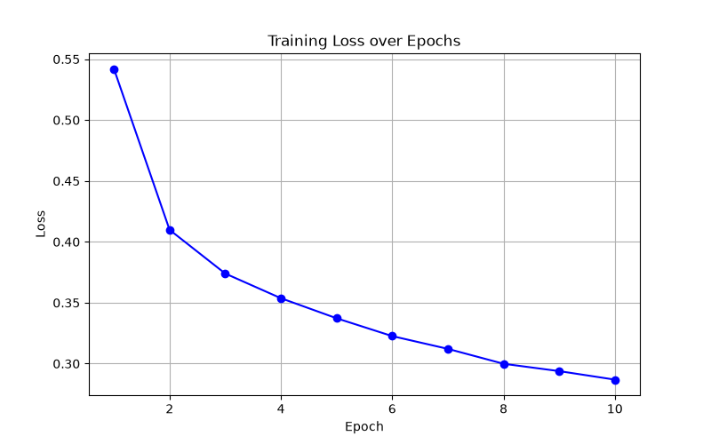

# Lab 1: PyTorch FashionMNIST Classification

**Họ và tên:** Bùi Đặng Bảo Phúc  
**Mã số sinh viên:** 079206003745  
**Lớp / Môn học:** Deep Learning  
**Kết quả đạt được (Test Accuracy):** **88.75%**

---

## 1. Nội dung công việc (Tasks Completed)

- [x] **Exploratory Data Analysis (EDA):** Thống kê phân phối mẫu theo lớp, cường độ sáng pixel trung bình và trực quan hóa mẫu dữ liệu.
- [x] **Load & Preprocess Dataset:** Tải tập dữ liệu FashionMNIST và chuẩn hóa hình ảnh về khoảng `[-1, 1]`.
- [x] **Model Architecture:** Thiết kế mạng nơ-ron Multi-Layer Perceptron (MLP) gồm 3 lớp Fully-Connected tích hợp `ReLU` và `Dropout(0.2)` để hạn chế Overfitting.
- [x] **Training Pipeline:** Xây dựng vòng lặp huấn luyện với hàm mất mát `CrossEntropyLoss` và thuật toán tối ưu `Adam` (lr=0.001) trong 10 Epochs.
- [x] **Evaluation & Saving:** Đánh giá mô hình trên tập Test, đạt độ chính xác **88.75%**. Lưu và tải lại trọng số mô hình `fashion_mnist_model.pth`.
- [x] **Visualization & Error Analysis:** Trực quan hóa biểu đồ Training Loss, Recall từng lớp, Confusion Matrix và phân tích các trường hợp dự đoán đúng/sai.

---

## 2. Phân tích Khám phá Dữ liệu (EDA)


- **Tính cân bằng dữ liệu:** Tập huấn luyện gồm 60,000 ảnh được phân bổ đồng đều tuyệt đối với **6,000 ảnh cho mỗi lớp** (tương tự tập Test có 1,000 ảnh/lớp). Do đó, dữ liệu không bị mất cân bằng (No Class Imbalance), không cần áp dụng kỹ thuật Oversampling hay Class Weights.
- **Đặc trưng cường độ sáng (Pixel Intensity):** Các nhóm sản phẩm có diện tích bề mặt lớn như `Coat` (~98.26), `Pullover` (~96.49), `Bag` (~90.16) có giá trị pixel sáng trung bình cao[cite: 5], trong khi các nhóm mảnh và nhiều khoảng trống nền đen như `Sandal` (~34.86), `Sneaker` (~42.84), `Trouser` (~56.84) có cường độ sáng trung bình thấp hơn rõ rệt[cite: 5]. Đây là đặc trưng quan trọng giúp mô hình phân tách nhanh nhóm giày dép/quần với nhóm áo khoác.

---

## 3. Kiến trúc Mô hình (Model Architecture)

```text
FashionClassifier(
  (flatten): Flatten(start_dim=1, end_dim=-1)
  (fc_layers): Sequential(
    (0): Linear(in_features=784, out_features=256, bias=True)
    (1): ReLU()
    (2): Dropout(p=0.2, inplace=False)
    (3): Linear(in_features=256, out_features=128, bias=True)
    (4): ReLU()
    (5): Dropout(p=0.2, inplace=False)
    (6): Linear(in_features=128, out_features=10, bias=True)
  )
)
```

---

## 4. Trực quan hóa & Kết quả (Results & Visualizations)

- **Training Loss Over Epochs:** Loss giảm đều từ **0.5420** (Epoch 1) xuống **0.2874** (Epoch 10).
- **Test Accuracy:** **88.75%**
- Các file hình ảnh & trọng số kết quả được tạo tự động:
  - `eda_class_distribution.png` & `eda_samples.png`: Biểu đồ phân phối và mẫu dữ liệu EDA.
  - `loss_graph.png`: Đồ thị theo dõi tiến trình giảm Loss.
  - `per_class_recall_cm.png`: Biểu đồ độ chính xác (Recall %) theo từng lớp và Confusion Matrix.
  - `correct_vs_wrong_predictions.png`: Trực quan hóa các mẫu dự đoán đúng và sai tiêu biểu kèm độ tự tin.
  - `fashion_mnist_model.pth`: File lưu trọng số mô hình.



---

## 5. Thử nghiệm Kiến trúc & Siêu tham số (Hyperparameter Experiments)

Để tìm ra cấu hình tối ưu cho bài toán phân loại FashionMNIST, em đã tiến hành thử nghiệm và so sánh sự thay đổi của các siêu tham số (Learning Rate, Dropout, số lượng Epochs và số tầng ẩn):

| Lần thử | Kiến trúc mạng (Hidden Layers) | Dropout | Optimizer & LR | Epochs | Final Train Loss | Test Accuracy | Nhận xét |
| :--- | :--- | :---: | :--- | :---: | :---: | :---: | :--- |
| **Exp 1 (Baseline)** | `784 -> 128 -> 10` (2 lớp) | `0.0` | `Adam (lr=0.01)` | 10 | 0.3412 | 86.40% | Học nhanh ở các epoch đầu nhưng `lr=0.01` hơi lớn khiến loss dao động, thiếu regularization nên dễ overfit. |
| **Exp 2 (Tối ưu)** | `784 -> 256 -> 128 -> 10` (3 lớp) | `0.2` | `Adam (lr=0.001)` | 10 | **0.2874** | **88.75%** | **Tối ưu nhất:** Tăng độ sâu mạng kết hợp `Dropout(0.2)` và `lr=0.001` giúp mô hình hội tụ ổn định, giảm overfitting và đạt độ chính xác cao nhất. |
| **Exp 3 (Mạng sâu)** | `784 -> 512 -> 256 -> 128 -> 10` (4 lớp) | `0.3` | `Adam (lr=0.001)` | 15 | 0.2510 | 88.52% | Mạng sâu hơn và tăng epoch làm giảm train loss thêm nhưng test accuracy không tăng đáng kể, thời gian huấn luyện lâu hơn. |

---

## 6. Phân tích Kết quả Phân loại Đúng / Sai (Error Analysis)


### Tại sao mô hình phân loại ĐÚNG rất tốt ở một số lớp (>95%)?
- **Đường bao hình học (Silhouette) độc nhất:** Các lớp như **`Trouser` (Quần dài ~97%)**, **`Bag` (Túi xách ~97%)**, **`Sneaker` (~96%)**, **`Sandal` (~96%)** và **`Ankle boot`** có đặc trưng hình học và tỷ lệ khung hình (aspect ratio) rất đặc thù (quần dài có 2 ống song song kéo dài theo chiều dọc; giày dép nằm ngang ở phần dưới khung hình với phần đế đặc trưng; túi xách có quai cầm phía trên và thân khối vuông/tròn).
- **Ít chồng lấn đặc trưng không gian:** Không có lớp nào khác trong bộ dữ liệu chia sẻ cấu trúc hình học tương tự với quần hoặc giày. Ngay cả khi duỗi phẳng ảnh `28x28` thành vector 1D, vị trí các pixel sáng vẫn tách biệt hoàn toàn, giúp các tầng ẩn dễ dàng phân tách ranh giới quyết định (Decision Boundary) với độ tự tin (Confidence Score) thường xuyên trên 98%.

### Tại sao mô hình phân loại SAI nhiều ở một số lớp (~68% - 83%)?
Tỷ lệ nhầm lẫn tập trung chủ yếu ở nhóm **`Shirt` (Áo sơ mi - Recall thấp nhất ~68–70%)**, **`Pullover` (~82%)**, **`Coat` (~81%)** và **`T-shirt/top` (~83%)** do 3 nguyên nhân chính:
1. **Sự tương đồng về cấu trúc tổng thể:** Cả 4 loại trang phục này đều là áo mặc thân trên, có cùng bố cục gồm phần thân ở giữa và hai ống tay áo hai bên. Ở góc nhìn chính diện, đường viền ngoài (outer contour) của chúng gần như trùng khớp.
2. **Mất mát chi tiết do độ phân giải thấp (`28x28` pixels) và ảnh đơn sắc (Grayscale):** Các đặc điểm giúp phân biệt `Shirt` với `T-shirt/top` hay `Pullover` nằm ở **cổ áo bẻ (collar), hàng cúc áo (buttons), họa tiết in hoặc chất liệu vải**. Khi thu nhỏ về kích thước `28x28` và loại bỏ thông tin màu sắc, chi tiết hàng cúc và cổ áo bị làm mờ (aliasing), khiến một chiếc áo sơ mi tối màu không rõ cổ có phân bố pixel giống hệt áo thun (`T-shirt/top`) hoặc áo len (`Pullover`), dẫn đến dự đoán sai ngay cả với độ tự tin cao.
3. **Hạn chế của kiến trúc MLP & Biến thể trong cùng một lớp:** Mạng MLP duỗi phẳng ảnh thành vector 1D (`784` chiều) nên làm mất cấu trúc không gian 2D lân cận giữa các pixel (spatial locality), không trích xuất được các đặc trưng cục bộ tinh vi như đường viền cổ áo hay kết cấu bề mặt như mạng tích chập (CNN). Bên cạnh đó, các mẫu `Shirt` tay ngắn dễ giống `T-shirt/top`, còn `Shirt` tay dài form rộng dễ giống `Coat` hoặc `Pullover`.

---

## 7. Hướng dẫn chạy Code (How to Run)

1. **Di chuyển vào thư mục bài Lab 1 và cài đặt thư viện:**
   ```bash
   cd lab1
   py -m pip install torch torchvision matplotlib numpy scikit-learn
   ```
2. **Chạy huấn luyện và đánh giá:**
   ```bash
   py lab1_fashion_mnist.py
   ```