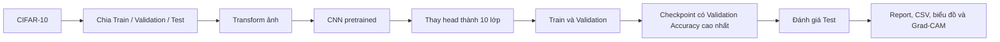

# Lab 2 — Transfer Learning trên CIFAR-10

Lab 2 xây dựng pipeline PyTorch hoàn chỉnh để so sánh bốn CNN pretrained và hai chiến lược transfer learning trên CIFAR-10. Pipeline thực hiện từ chia dữ liệu, transform, huấn luyện, chọn checkpoint bằng Validation đến đánh giá Test, xuất dự đoán từng ảnh và phân tích Grad-CAM.

## 1. Bài toán

CIFAR-10 gồm 60.000 ảnh RGB kích thước 32 × 32 thuộc 10 lớp: airplane, automobile, bird, cat, deer, dog, frog, horse, ship và truck.

| Tập | Số ảnh | Vai trò |
|---|---:|---|
| Train | 40.000 | Cập nhật trọng số |
| Validation | 10.000 | Chọn checkpoint tốt nhất |
| Test | 10.000 | Đánh giá checkpoint đã chọn |

Lab khảo sát:

- ResNet-18, ResNet-50, VGG-16 BN và DenseNet-121 pretrained trên ImageNet.
- `freeze_all`: đóng băng backbone, chỉ huấn luyện classification head mới.
- `unfreeze_last_block`: mở block cuối và classification head.
- Accuracy, macro-F1, thời gian mỗi epoch và số tham số trainable.
- Ảnh dự đoán đúng/sai, confidence, Top-3, confusion matrix và Grad-CAM.

Giải thích chi tiết về model và luồng xử lý ảnh nằm trong [docs/model.md](docs/model.md).

## 2. Kết quả chính

EXP_02, ResNet-18 với `unfreeze_last_block`, được chọn theo Validation Accuracy cao nhất. Checkpoint đạt 94,35% Validation tại epoch 13, 93,63% Test Accuracy và 0,9360 macro-F1.

EXP_06 đạt Test Accuracy 93,86%, nhưng Test không được dùng để thay đổi checkpoint đã chọn. Mỗi cấu hình hiện chỉ có một lần chạy với seed 42.

| ID | Model | Strategy | Optimizer | LR | Batch | Trainable | Best Val | Test | Macro-F1 | giây/epoch |
|---|---|---|---|---:|---:|---:|---:|---:|---:|---:|
| [EXP_01](outputs/experiments/resnet18_freeze_all_20261121_111828_636263_eb6f2e9c/report.json) | ResNet-18 | `freeze_all` | AdamW | 0,001 | 64 | 5.130 | 87,91% | 87,17% | 0,8712 | 110,9 |
| [EXP_02](outputs/experiments/resnet18_unfreeze_last_block_20261121_115234_018455_f40df826/report.json) | ResNet-18 | `unfreeze_last_block` | AdamW | 0,0001 | 64 | 8.398.858 | **94,35%** | 93,63% | 0,9360 | 152,1 |
| [EXP_03](outputs/experiments/resnet50_freeze_all_20261121_123125_013998_3428b478/report.json) | ResNet-50 | `freeze_all` | AdamW | 0,001 | 64 | 20.490 | 92,98% | 92,16% | 0,9216 | 208,5 |
| [EXP_04](outputs/experiments/vgg16_bn_freeze_all_20261121_132439_221130_f32c5c63/report.json) | VGG-16 BN | `freeze_all` | AdamW | 0,001 | 64 | 40.970 | 86,43% | 84,97% | 0,8483 | 308,7 |
| [EXP_05](outputs/experiments/densenet121_freeze_all_20261121_144340_162639_0c9b0ff0/report.json) | DenseNet-121 | `freeze_all` | AdamW | 0,001 | 64 | 10.250 | 90,06% | 89,70% | 0,8970 | 149,1 |
| [EXP_06](outputs/experiments/densenet121_unfreeze_last_block_20261121_152146_940288_daf50c6d/report.json) | DenseNet-121 | `unfreeze_last_block` | AdamW | 0,0001 | 64 | 2.170.378 | 94,23% | **93,86%** | 0,9386 | 183,4 |
| [EXT_LR_OPT](outputs/experiments/resnet18_freeze_all_20261121_164228_619907_bb622e8e/report.json) | ResNet-18 | `freeze_all` | SGD | 0,01 | 64 | 5.130 | 87,86% | 86,98% | 0,8688 | 148,2 |
| [EXT_BATCH](outputs/experiments/resnet18_freeze_all_20261121_172016_786401_88231a7d/report.json) | ResNet-18 | `freeze_all` | AdamW | 0,001 | 32 | 5.130 | 87,85% | 87,01% | 0,8695 | 114,4 |

Mở block cuối đồng thời giảm learning rate giúp Validation tăng 6,44 điểm phần trăm trên ResNet-18 và 4,17 điểm trên DenseNet-121. Hai biến thay đổi cùng lúc nên kết quả thể hiện hiệu ứng kết hợp. EXT_LR_OPT cũng thay optimizer và learning rate cùng lúc. Các kết quả này chưa tách riêng ảnh hưởng của từng biến.

## 3. Pipeline



Train dùng Resize 256, RandomCrop 224, RandomHorizontalFlip, ToTensor và chuẩn hóa ImageNet. Validation và Test dùng Resize 224, ToTensor và cùng phép chuẩn hóa, không có augmentation ngẫu nhiên.

Mỗi epoch gồm một lượt Train và một lượt Validation. Trainer lưu checkpoint khi Validation Accuracy lập mức cao mới. Sau epoch cuối, `main.py` nạp checkpoint tốt nhất và chỉ khi đó mới đánh giá Test.

## 4. Cấu trúc thư mục

```text
lab2/
├── main.py                         # Entry point cho một thực nghiệm
├── requirements.txt               # Toàn bộ dependency, gồm CUDA 12.1 và notebook
├── src/
│   ├── config.py                  # Hằng số, đường dẫn và phát hiện thiết bị
│   ├── dataset.py                 # Split và transform CIFAR-10
│   ├── model_factory.py           # Tạo model, thay head, freeze/unfreeze
│   ├── trainer.py                 # Train, Validation, TensorBoard, checkpoint
│   ├── evaluate.py                # Test metrics, predictions và biểu đồ
│   └── model_analysis.py          # Checkpoint, nhóm dự đoán và Grad-CAM
├── scripts/
│   └── run_experiments.py         # Chạy tuần tự tám cấu hình
├── notebooks/
│   ├── 01_cifar10_eda.ipynb
│   └── 02_model_evaluation.ipynb
├── tests/
├── docs/
├── data/                           # CIFAR-10 tải cục bộ
└── outputs/
    ├── experiments/<run_id>/       # Artifact của từng thực nghiệm
    ├── eda/                        # Hình từ notebook EDA
    ├── model_analysis/             # Hình và CSV phân tích checkpoint thật
    ├── verification/               # Log hồi quy và fixture kiểm tra
    └── experiment_summary.csv      # Mục lục tám thực nghiệm
```

Mỗi thư mục `outputs/experiments/<run_id>/` chứa `report.json`, `summary.csv`, `predictions.csv`, ba biểu đồ, checkpoint và TensorBoard log.

## 5. Cài đặt môi trường

Môi trường đã được xác minh trên Windows, Python 3.12, RTX 3050 Laptop 6 GB, PyTorch 2.5.1 và CUDA 12.1.

Dự án chỉ dùng một file dependency là `requirements.txt`. File này chứa runtime, thư viện đánh giá, trực quan hóa và Jupyter. Không cần cài thêm file requirements phụ.

```powershell
uv venv .venv --python 3.12 --seed
uv pip install --python .venv\Scripts\python.exe -r requirements.txt
.\.venv\Scripts\python.exe -m ipykernel install --sys-prefix --name lab2 --display-name "Python (Lab 2)"
```

Kiểm tra môi trường:

```powershell
.\.venv\Scripts\python.exe -c "import torch; print(torch.__version__); print(torch.cuda.is_available()); print(torch.cuda.get_device_name(0) if torch.cuda.is_available() else 'CPU')"
.\.venv\Scripts\python.exe main.py --help
```

`scikit-learn==1.7.2` được khóa vì bản mới hơn từng bị Windows Application Control chặn DLL trên máy đã xác minh.

## 6. Chạy dự án

Xem cấu trúc model mà không huấn luyện:

```powershell
.\.venv\Scripts\python.exe main.py --model resnet18 --strategy freeze_all --inspect-only
```

Chạy demo chính thức trên toàn bộ CIFAR-10:

```powershell
.\.venv\Scripts\python.exe main.py --model resnet18 --strategy freeze_all --epochs 15
```

Chạy fine-tuning ResNet-18:

```powershell
.\.venv\Scripts\python.exe main.py --model resnet18 --strategy unfreeze_last_block --lr 0.0001 --epochs 15
```

Chạy tuần tự tám cấu hình đã định nghĩa và bỏ qua run có artifact hợp lệ:

```powershell
.\.venv\Scripts\python.exe scripts\run_experiments.py
```

Các tham số chính:

| Tham số | Mặc định | Ý nghĩa |
|---|---:|---|
| `--model` | `resnet18` | `resnet18`, `resnet50`, `vgg16_bn`, `densenet121` |
| `--strategy` | `freeze_all` | `freeze_all` hoặc `unfreeze_last_block` |
| `--epochs` | 15 | Số epoch |
| `--batch-size` | 64 khi có CUDA | Kích thước batch |
| `--lr` | 0,001 | Learning rate |
| `--optimizer` | `adamw` | `adamw` hoặc `sgd` |
| `--seed` | 42 | Seed cho split và tính tái lập |
| `--output-dir` | `outputs/experiments` | Thư mục gốc của artifact |

Dùng `main.py --help` để xem toàn bộ tham số.

## 7. Notebook

### EDA dữ liệu

[notebooks/01_cifar10_eda.ipynb](notebooks/01_cifar10_eda.ipynb) kiểm tra split 40.000/10.000/10.000, phân bố lớp, mẫu ảnh, shape, dtype, miền pixel, thống kê RGB và ảnh trước/sau transform.

```powershell
.\.venv\Scripts\python.exe -m nbconvert --to notebook --execute --inplace --ExecutePreprocessor.timeout=600 --ExecutePreprocessor.kernel_name=lab2 notebooks\01_cifar10_eda.ipynb
```

### Đánh giá model

[notebooks/02_model_evaluation.ipynb](notebooks/02_model_evaluation.ipynb) đang cấu hình cho checkpoint EXP_02. Notebook tính loss, accuracy, precision, recall, F1, confusion matrix, các cặp lớp bị nhầm, bốn nhóm dự đoán theo đúng/sai và confidence, cùng Grad-CAM.

```powershell
.\.venv\Scripts\python.exe -m nbconvert --to notebook --execute --inplace --ExecutePreprocessor.timeout=600 --ExecutePreprocessor.kernel_name=lab2 notebooks\02_model_evaluation.ipynb
```

## 8. Đầu ra đánh giá

- `report.json` lưu cấu hình, môi trường, lịch sử huấn luyện, metrics, confusion matrix và đường dẫn artifact.
- `summary.csv` lưu một dòng tổng hợp cho mỗi run.
- `predictions.csv` lưu `sample_index`, nhãn thật, nhãn dự đoán, đúng/sai, confidence, Top-3 và xác suất 10 lớp.
- `training_history.png` so sánh Train và Validation qua các epoch.
- `class_accuracy.png` trình bày accuracy theo lớp.
- `confusion_matrix.png` trình bày các lớp bị nhầm.
- `outputs/model_analysis/` chứa phân tích sâu và Grad-CAM của checkpoint được chọn.

## 9. Kiểm tra

Chạy toàn bộ unit test:

```powershell
.\.venv\Scripts\python.exe -m unittest discover -s tests -v
```

Log nghiệm thu trước đây nằm trong `outputs/verification/`. Báo cáo nghiệm thu ghi nhận 26/26 test đã qua tại thời điểm hoàn thành Lab 2.

## 10. Tài liệu

- [Model và luồng xử lý ảnh](docs/model.md)
- [Dàn bài thuyết trình và demo](docs/presentation_outline.md)
- [Báo cáo nghiệm thu và phân tích lỗi](docs/final_acceptance.md)
- [Mô tả bài toán](docs/project_description.md)
- [Thiết kế hệ thống](docs/project_design.md)
- [Quy trình phát triển](docs/development_workflow.md)
- [Báo cáo sử dụng AI](docs/AI_usage.md)
