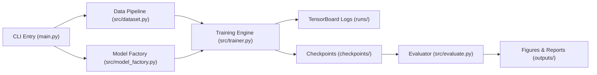

# PyTorch Pre-trained CNN Benchmark & Fine-Tuning Pipeline

Repository phuc vu bai thuc hanh **Practice 2: Hands-on practice with pre-trained neural network architectures**. He thong cung cap mot pipeline thuc nghiem transfer learning tieu chuan cong nghiep tren PyTorch de danh gia, so sanh va tinh chinh cac kien truc mang no-ron tich chap (CNN) tien huan luyen tren bo du lieu CIFAR-10.

---

## 1. Project Overview & Review

Bai thuc hanh tap trung vao viec khai thac suc manh cua cac mo hinh hoc sau tien huan luyen (Pre-trained Models) tu `torchvision.models` de giai quyet bai toan thi giac may tinh ma khong can huan luyen tu dau (from scratch).

Pham vi khao sat bao gom 3 ho kien truc CNN kinh dien tien huan luyen tren tap du lieu ImageNet-1K:
- **Residual Networks (ResNet)**: ResNet-18, ResNet-50.
- **Visual Geometry Group (VGG)**: VGG-16 tich hop Batch Normalization (`vgg16_bn`).
- **Densely Connected Networks (DenseNet)**: DenseNet-121.

He thong ho tro day du 7 buoc thuc hanh cua bai Lab: thiet lap moi truong, nap mo hinh bang Torchvision modern Weights API, kham pha cau truc tham so (Model Inspection), thay the Classification Head thich ung, tien xu ly du lieu khong ro ri (Leak-free Data Pipeline), huan luyen giam sat thoi gian thuc qua TensorBoard va danh gia chi tiet tren tap Test doc lap.

---

## 2. Problem Statement & Core Objectives

### 2.1. Bai toan Phan loai CIFAR-10
Phan loai 60,000 anh mau RGB kich thuoc 32x32 pixel thuoc 10 lop doi tuong: `airplane`, `automobile`, `bird`, `cat`, `deer`, `dog`, `frog`, `horse`, `ship`, `truck`. Du lieu duoc chia thanh:
- 40,000 mau Train
- 10,000 mau Validation
- 10,000 mau Test doc lap

### 2.2. Muc tieu Cot loi
1. **Khao sat su danh doi (Trade-off)** giua toc do hoi tu, chi phi tinh toan (dung luong VRAM, thoi gian moi epoch, so tham so huan luyen) va do chinh xac (Top-1 Accuracy, Per-class Accuracy).
2. **So sanh 2 chien luoc Chuyen giao Tri thuc**:
   - `freeze_all` (Feature Extraction): Dong bang toan bo backbone, chi huan luyen Classification Head moi.
   - `unfreeze_last_block` (Fine-Tuning): Mo khoa khoi tich chap cuoi cung kem Classification Head voi toc do hoc thap hon.
3. **Danh gia tac dong cua Sieu tham so**: Khao sat anh huong cua Learning Rate ($10^{-2}, 10^{-3}, 10^{-4}$), Batch Size (32, 64, 128) va Optimizer (AdamW, SGD with Momentum).

Chi tiet dac ta bai toan xem tai: [docs/project_description.md](docs/project_description.md).

---

## 3. System Architecture & Main Structure

He thong duoc to chuc theo kien truc module hoa mot chieu (Clean Modular Architecture), dam bao tinh tach bach va de kiem thu:



### Diem nhan Ky thuat:
- **Leak-free Data Pipeline**: Khoi tao 2 doi tuong `CIFAR10(root, train=True)` rieng biet gan voi `train_transform` va `eval_transform`. Su dung danh sach chi so hoan vi ngau nhien co dinh (`torch.randperm` seed=42) chia tap Train va Validation thong qua `torch.utils.data.Subset`. Nho do, tap Validation hoan toan khong bi ro ri Data Augmentation.
- **Dynamic Head & Weight Freezing**: Tu dong nhan dien thuoc tinh classification head tuong ung tung ho (`.fc`, `.classifier[6]`, `.classifier`) va loc chi truyen tham so co `requires_grad=True` vao Optimizer.

Chi tiet thiet ke he thong xem tai: [docs/project_design.md](docs/project_design.md).

---

## 4. Folder Structure

```
LAB_DEEP_LEARNING/
|-- checkpoints/                # Luu tru checkpoint trong so mo hinh tot nhat (.pth)
|-- data/                       # Luu tru du lieu CIFAR-10 tu dong tai ve
|-- docs/                       # Tai lieu dac ta yeu cau va thiet ke he thong
|   |-- project_description.md  # Dac ta bai toan va dac tinh ky thuat
|   |-- project_design.md       # Thiet ke kien truc module va giao dien API
|   |-- development_workflow.md # Quy trinh phat trien 7 buoc thuc hanh
|   `-- AI_usage.md             # Nhat ky ghi nhan qua trinh su dung AI ho tro
|-- outputs/                    # Ket qua thuc nghiem xuat ban
|   |-- figures/                # Bieu do danh gia chat luong cao (300 DPI)
|   `-- reports/                # Bang ket qua danh gia dang JSON va CSV
|-- runs/                       # Nhat ky su kien TensorBoard (Scalar logs)
|-- src/                        # Ma nguon he thong phan tang
|   |-- __init__.py             # Package initialization
|   |-- config.py               # Quan ly hang so, duong dan va tu dong phat hien phan cung
|   |-- dataset.py              # Pipeline nap du lieu chong ro ri va DataLoader
|   |-- model_factory.py        # Factory tao model, inspect va freeze weights
|   |-- trainer.py              # Dong co huan luyen, validation va checkpointing
|   `-- evaluate.py             # Danh gia test set, in per-class table va ve bieu do
|-- tests/                      # Kiem thu tu dong (Unit tests)
|   |-- __init__.py
|   |-- test_dataset.py         # Kiem thu tinh toan ven cua data pipeline
|   `-- test_model_factory.py   # Kiem thu thay the head va dem tham so
|-- .gitignore                  # Loai bo file rac, du lieu tho va checkpoints nang
|-- main.py                     # Entry point CLI dieu phoi toan bo pipeline
|-- README.md                   # Tai lieu huong dan van hanh trung tam
`-- requirements.txt            # Danh sach thu vien can thiet
```

---

## 5. Environment Setup & Installation

### 5.1. Yeu cau He thong
- He dieu hanh: Ubuntu Linux (hoac macOS, Windows WSL2).
- Python: Phien ban 3.10 tro len.
- Thiet bi: Tu dong tuong thich GPU CUDA (khuyen nghi NVIDIA VRAM >= 4GB) hoac CPU Fallback.
  - Thong so he thong thu nghiem: NVIDIA GeForce RTX 3050 Laptop GPU (6GB VRAM), CPU Intel Core i7-13620H (16 threads), 16GB RAM.

### 5.2. Cac buoc Cai dat tren Ubuntu/Linux

```bash
# 1. Di chuyen vao thu muc goc cua du an
cd /home/linhtd3993/workspace/projects/LAB/LAB_DEEP_LEARNING

# 2. Khoi tao moi truong ao Python
python3 -m venv .venv

# 3. Kich hoat moi truong ao
source .venv/bin/activate

# 4. Nang cap pip len phien ban moi nhat
pip install --upgrade pip

# 5. Cai dat cac thu vien can thiet tu requirements.txt
pip install -r requirements.txt
```

---

## 6. Usage & Experiment Commands (CLI Guide)

### 6.1. Bang Tham so Dong lenh (`main.py`)

| Tham so | Kieu du lieu | Mac dinh | Mo ta chuc nang |
| :--- | :--- | :--- | :--- |
| `--model` | str | `resnet18` | Kien truc mo hinh (`resnet18`, `resnet50`, `vgg16_bn`, `densenet121`). |
| `--strategy` | str | `freeze_all` | Chien luoc hoc chuyen giao: `freeze_all` hoac `unfreeze_last_block`. |
| `--lr` | float | `1e-3` | Toc do hoc ban dau cua Optimizer. |
| `--batch-size` | int | `64` | Kich thuoc mini-batch (toi uu cho GPU 6GB VRAM). |
| `--epochs` | int | `15` | So chu ky huan luyen. |
| `--optimizer` | str | `adamw` | Thuat toan toi uu: `adamw` hoac `sgd`. |
| `--weight-decay` | float | `1e-4` | He so dieu hoa L2. |
| `--subset-ratio` | float | `1.0` | Ty le du lieu su dung (0.0 < ratio <= 1.0) de kiem thu nhanh. |
| `--dry-run` | flag | `False` | Bat che do kiem thu nhanh: chay 1 batch/epoch de xac thuc pipeline. |
| `--inspect-only` | flag | `False` | Chi in cau truc mo hinh va thong ke tham so roi thoat, khong huan luyen. |
| `--seed` | int | `42` | Hat giong ngau nhien co dinh dam bao tinh tai lap ket qua. |

---

### 6.2. Cac Cau lenh Mau theo Kich ban Thuc hanh

#### Kich ban 1: Kham pha Cau truc Mang va Thong ke Tham so (Model Inspection)
Kiem tra cau truc truoc va sau khi thay the classification head cho cac ho mo hinh ma khong chay huan luyen:

```bash
# Inspect ResNet-18 duoi chien luoc freeze_all
python3 main.py --model resnet18 --strategy freeze_all --inspect-only

# Inspect ResNet-18 duoi chien luoc unfreeze_last_block
python3 main.py --model resnet18 --strategy unfreeze_last_block --inspect-only

# Inspect VGG-16 BatchNorm
python3 main.py --model vgg16_bn --strategy freeze_all --inspect-only

# Inspect DenseNet-121
python3 main.py --model densenet121 --strategy unfreeze_last_block --inspect-only
```

#### Kich ban 2: Smoke Run / Dry Run (Kiem thu nhanh Pipeline)
Chay thu nghiem 1 epoch voi tap du lieu sieu nho de xac nhan toan bo luong code, luu checkpoint va tensorboard hoat dong tron tru tren phan cung:

```bash
python3 main.py --model resnet18 --dry-run
```

#### Kich ban 3: So sanh giua cac Kien truc voi Chien luoc Dong bang Backbone (`freeze_all`)
Thuc nghiem co dinh chien luoc `freeze_all` tren 3 ho kien truc khac nhau:

```bash
# Thuc nghiem 1: ResNet-18 Feature Extraction
python3 main.py --model resnet18 --strategy freeze_all --lr 1e-3 --epochs 15

# Thuc nghiem 2: VGG-16 (with BN) Feature Extraction
python3 main.py --model vgg16_bn --strategy freeze_all --lr 1e-3 --epochs 15

# Thuc nghiem 3: DenseNet-121 Feature Extraction
python3 main.py --model densenet121 --strategy freeze_all --lr 1e-3 --epochs 15
```

#### Kich ban 4: Thuc nghiem Tinh chinh Sau (`unfreeze_last_block`)
Mo khoa khoi tich chap cuoi cung voi toc do hoc nho hon (`1e-4`) de giu on dinh trong so pre-trained:

```bash
# Fine-tuning ResNet-18 voi lr giam xuong 1e-4
python3 main.py --model resnet18 --strategy unfreeze_last_block --lr 1e-4 --epochs 15

# Fine-tuning DenseNet-121
python3 main.py --model densenet121 --strategy unfreeze_last_block --lr 1e-4 --epochs 15
```

#### Kich ban 5: Khao sat Anh huong cua Sieu tham so (Hyperparameter Tuning)
Dieu chinh toc do hoc va kich thuoc mini-batch de danh gia toc do hoi tu va do chinh xac:

```bash
# So sanh voi Learning Rate cao hon: lr = 1e-2 dung optimizer SGD
python3 main.py --model resnet18 --strategy freeze_all --optimizer sgd --lr 1e-2 --epochs 15

# Khao sat voi Batch Size nho hon: batch_size = 32
python3 main.py --model resnet18 --strategy freeze_all --batch-size 32 --lr 1e-3 --epochs 15
```

---

## 7. Monitoring with TensorBoard

He thong tu dong ghi nhat ky scalar sau moi epoch vao thu muc `runs/<experiment_id>/`.

### 7.1. Khoi chay TensorBoard Server
Mo mot terminal moi, kich hoat virtual environment va chay lenh:

```bash
tensorboard --logdir=runs --port=6006
```

### 7.2. Truy cap Giao dien Giam sat
Mo trinh duyet va truy cap: `http://localhost:6006`
Giao dien TensorBoard cung cap cac do thi truc quan thoi gian thuc:
- `Loss/train` vs. `Loss/val`: Danh gia hien tuong Overfitting / Underfitting qua tung chu ky.
- `Accuracy/train` vs. `Accuracy/val`: Theo doi toc do hoi tu do chinh xac.
- `Learning_Rate`: Theo doi toc do hoc thuc te cua optimizer.

---

## 8. Evaluation Outputs & Visualizations

Sau khi ket thuc qua trinh huan luyen, checkpoint tot nhat (`checkpoints/best_<experiment_id>.pth`) duoc nap de thuc hien danh gia mot lan duy nhat tren 10,000 mau cua tap Test doc lap.

### 8.1. Thong ke Per-class tren Terminal
Console in truc tiep bang chi so chi tiet gom cac cot: `Class Name`, `Accuracy (%)`, `Precision (%)`, `Recall (%)`, `F1-Score` cho ca 10 lop doi tuong va dong tong ket `Overall Test Accuracy`.

### 8.2. Bo 3 Bieu do Danh gia Xuat ban (300 DPI)
He thong tu dong xuat 3 bieu do chat luong cao tai `outputs/figures/`:
1. `training_history.png`: Bieu do 2 cot the hien duong cong Loss va Accuracy giua Train va Val qua cac epoch.
2. `class_accuracy.png`: Bieu do cot so sanh do chinh xac phan loai giua 10 lop cua CIFAR-10, co duong tham chieu do chinh xac trung binh.
3. `confusion_matrix.png`: Heatmap ma tran nham lan duoc chuan hoa the hien xac suat du doan va chi ro cac lop thuong xuyen bi nham lan.

---

## 9. Experimental Results & Benchmark Table

Bang tong hop ket qua thuc nghiem duoc thiet lap duoi dang khung cho (placeholder), san sang duoc cap nhat sau khi thuc hien cac lan chay tren he thong:

| Exp ID | Model Architecture | Strategy | Batch Size | Learning Rate | Total Params | Trainable Params | Best Val Acc (%) | Test Acc (%) | Avg Time/Epoch (s) |
| :---: | :--- | :--- | :---: | :---: | :---: | :---: | :---: | :---: | :---: |
| EXP_01 | ResNet-18 | `freeze_all` | 64 | 1e-3 | TBD | TBD | TBD | TBD | TBD |
| EXP_02 | ResNet-18 | `unfreeze_last_block` | 64 | 1e-4 | TBD | TBD | TBD | TBD | TBD |
| EXP_03 | ResNet-50 | `freeze_all` | 64 | 1e-3 | TBD | TBD | TBD | TBD | TBD |
| EXP_04 | VGG-16 (BN) | `freeze_all` | 64 | 1e-3 | TBD | TBD | TBD | TBD | TBD |
| EXP_05 | DenseNet-121 | `freeze_all` | 64 | 1e-3 | TBD | TBD | TBD | TBD | TBD |
| EXP_06 | DenseNet-121 | `unfreeze_last_block` | 64 | 1e-4 | TBD | TBD | TBD | TBD | TBD |

---

## 10. Documentation & Workflow Links

Tai lieu chi tiet va cac bao cao ky thuat bo tro trong thu muc `docs/`:
- **Dac ta Yeu cau va Bai toan**: [docs/project_description.md](docs/project_description.md)
- **Thiet ke Kien truc He thong**: [docs/project_design.md](docs/project_design.md)
- **Quy trinh Phat trien 7 Buoc**: [docs/development_workflow.md](docs/development_workflow.md)
- **Bao cao Su dung AI**: [docs/AI_usage.md](docs/AI_usage.md)
