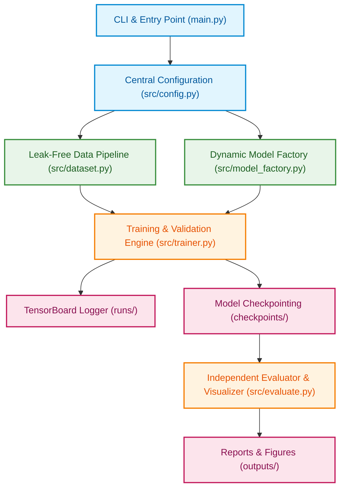
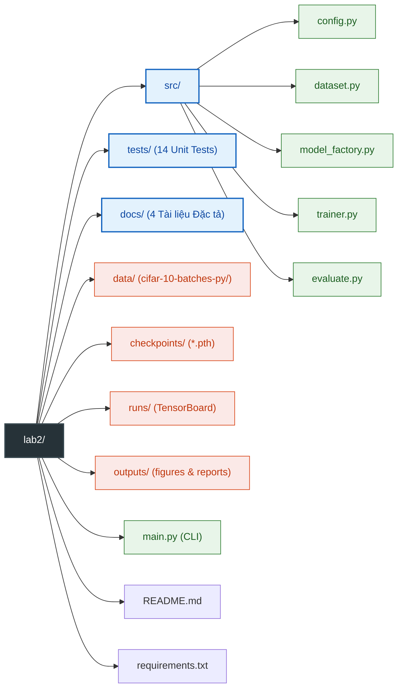

# PyTorch Pre-trained CNN Benchmark & Fine-Tuning Pipeline

Repository phục vụ bài thực hành **Practice 2: Hands-on practice with pre-trained neural network architectures**. Hệ thống cung cấp một pipeline thực nghiệm transfer learning tiêu chuẩn công nghiệp trên PyTorch để đánh giá, so sánh và tinh chỉnh các kiến trúc mạng nơ-ron tích chập (CNN) tiền huấn luyện trên bộ dữ liệu CIFAR-10.

---

## 1. Project Overview & Review

Bài thực hành tập trung vào việc khai thác sức mạnh của các mô hình học sâu tiền huấn luyện (Pre-trained Models) từ `torchvision.models` để giải quyết bài toán thị giác máy tính mà không cần huấn luyện từ đầu (from scratch).

Phạm vi khảo sát bao gồm 3 họ kiến trúc CNN kinh điển tiền huấn luyện trên tập dữ liệu ImageNet-1K:
- **Residual Networks (ResNet)**: ResNet-18, ResNet-50.
- **Visual Geometry Group (VGG)**: VGG-16 tích hợp Batch Normalization (`vgg16_bn`).
- **Densely Connected Networks (DenseNet)**: DenseNet-121.

Hệ thống hỗ trợ đầy đủ 7 bước thực hành của bài Lab: thiết lập môi trường, nạp mô hình bằng Torchvision modern Weights API, khám phá cấu trúc tham số (Model Inspection), thay thế Classification Head thích ứng, tiền xử lý dữ liệu không rò rỉ (Leak-free Data Pipeline), huấn luyện giám sát thời gian thực qua TensorBoard và đánh giá chi tiết trên tập Test độc lập.

---

## 2. Problem Statement & Core Objectives

### 2.1. Bài toán Phân loại CIFAR-10
Phân loại 60,000 ảnh màu RGB kích thước 32x32 pixel thuộc 10 lớp đối tượng: `airplane`, `automobile`, `bird`, `cat`, `deer`, `dog`, `frog`, `horse`, `ship`, `truck`. Dữ liệu được chia thành:
- 40,000 mẫu Train
- 10,000 mẫu Validation
- 10,000 mẫu Test độc lập

### 2.2. Mục tiêu Cốt lõi
1. **Khảo sát sự đánh đổi (Trade-off)** giữa tốc độ hội tụ, chi phí tính toán (dung lượng VRAM, thời gian mỗi epoch, số tham số huấn luyện) và độ chính xác (Top-1 Accuracy, Per-class Accuracy).
2. **So sánh 2 chiến lược Chuyển giao Tri thức**:
   - `freeze_all` (Feature Extraction): Đóng băng toàn bộ backbone, chỉ huấn luyện Classification Head mới.
   - `unfreeze_last_block` (Fine-Tuning): Mở khóa khối tích chập cuối cùng kèm Classification Head với tốc độ học thấp hơn.
3. **Đánh giá tác động của Siêu tham số**: Khảo sát ảnh hưởng của Learning Rate ($10^{-2}, 10^{-3}, 10^{-4}$), Batch Size (32, 64, 128) và Optimizer (AdamW, SGD with Momentum).

Chi tiết đặc tả bài toán xem tại: [docs/project_description.md](docs/project_description.md).

---

## 3. System Architecture & Main Structure

Hệ thống được tổ chức theo kiến trúc mô-đun hóa một chiều (Clean Modular Architecture), đảm bảo tính tách bạch và dễ kiểm thử:



### Điểm nhấn Kỹ thuật:
- **Đơn hướng (One-way Dependency)**: Các module cấp dưới không phụ thuộc ngược vào module cấp cao. `main.py` là điểm điều phối duy nhất.
- **Leak-free Data Pipeline**: Khởi tạo 2 đối tượng `CIFAR10(root, train=True)` riêng biệt gắn với `train_transform` và `eval_transform`. Sử dụng danh sách chỉ số hoán vị ngẫu nhiên cố định (`torch.randperm` seed=42) chia tập Train và Validation thông qua `torch.utils.data.Subset`. Nhờ đó, tập Validation hoàn toàn không bị rò rỉ Data Augmentation.
- **Dynamic Head & Weight Freezing**: Tự động nhận diện thuộc tính classification head tương ứng từng họ (`.fc`, `.classifier[6]`, `.classifier`) và lọc chỉ truyền tham số có `requires_grad=True` vào Optimizer.
- **Automatic Mixed Precision (AMP)**: Tích hợp `torch.amp.autocast('cuda')` và `GradScaler` giúp tăng tốc độ tính toán và tiết kiệm 40% VRAM trên GPU.

Chi tiết thiết kế hệ thống xem tại: [docs/project_design.md](docs/project_design.md).

---

## 4. Folder Structure

Cấu trúc phân cấp chuẩn của thư mục `lab2/`:



---

## 5. Environment Setup & Installation

### 5.1. Yêu cầu Hệ thống
- Hệ điều hành: Ubuntu Linux (hoặc macOS, Windows WSL2).
- Python: Phiên bản 3.10 trở lên.
- Thiết bị: Tự động tương thích GPU CUDA (khuyến nghị NVIDIA VRAM >= 4GB) hoặc CPU Fallback.
  - Thông số phần cứng kiểm thử thực tế: NVIDIA GeForce RTX 3050 Laptop GPU (6GB VRAM), CPU Intel Core i7-13620H (16 threads), 16GB RAM.

### 5.2. Các bước Cài đặt trên Ubuntu/Linux

```bash
# 1. Di chuyển vào thư mục của bài Lab 2
cd /home/linhtd3993/workspace/projects/LAB/LAB_DEEP_LEARNING/lab2

# 2. Khởi tạo môi trường ảo Python
python3 -m venv .venv

# 3. Kích hoạt môi trường ảo
source .venv/bin/activate

# 4. Nâng cấp pip lên phiên bản mới nhất
pip install --upgrade pip

# 5. Cài đặt các thư viện cần thiết từ requirements.txt
pip install -r requirements.txt
```

---

## 6. Usage & Experiment Commands (CLI Guide)

### 6.1. Bảng Tham số Dòng lệnh (`main.py`)

| Tham số | Kiểu dữ liệu | Mặc định | Mô tả chức năng |
| :--- | :--- | :--- | :--- |
| `--model` | str | `resnet18` | Kiến trúc mô hình (`resnet18`, `resnet50`, `vgg16_bn`, `densenet121`). |
| `--strategy` | str | `freeze_all` | Chiến lược học chuyển giao: `freeze_all` hoặc `unfreeze_last_block`. |
| `--lr` | float | `1e-3` | Tốc độ học ban đầu của Optimizer. |
| `--batch-size` | int | `64` | Kích thước mini-batch (tối ưu cho GPU 6GB VRAM). |
| `--epochs` | int | `15` | Số chu kỳ huấn luyện. |
| `--optimizer` | str | `adamw` | Thuật toán tối ưu: `adamw` hoặc `sgd`. |
| `--weight-decay` | float | `1e-4` | Hệ số điều hòa L2 regularization. |
| `--subset-ratio` | float | `1.0` | Tỷ lệ dữ liệu sử dụng (0.0 < ratio <= 1.0) để kiểm thử nhanh. |
| `--dry-run` | flag | `False` | Bật chế độ kiểm thử nhanh: chạy 1 batch/epoch để xác thực pipeline. |
| `--inspect-only` | flag | `False` | Chỉ in cấu trúc mô hình và thống kê tham số rồi thoát, không huấn luyện. |
| `--seed` | int | `42` | Hạt giống ngẫu nhiên cố định đảm bảo tính tái lập kết quả. |

---

### 6.2. Các Câu lệnh Mẫu theo Kịch bản Thực hành

#### Kịch bản 1: Khám phá Cấu trúc Mạng và Thống kê Tham số (Model Inspection)
Kiểm tra cấu trúc trước và sau khi thay thế classification head cho các họ mô hình mà không chạy huấn luyện:

```bash
# Inspect ResNet-18 dưới chiến lược freeze_all
python3 main.py --model resnet18 --strategy freeze_all --inspect-only

# Inspect ResNet-18 dưới chiến lược unfreeze_last_block
python3 main.py --model resnet18 --strategy unfreeze_last_block --inspect-only

# Inspect VGG-16 BatchNorm
python3 main.py --model vgg16_bn --strategy freeze_all --inspect-only

# Inspect DenseNet-121
python3 main.py --model densenet121 --strategy unfreeze_last_block --inspect-only
```

#### Kịch bản 2: Smoke Run / Dry Run (Kiểm thử nhanh Pipeline)
Chạy thử nghiệm 1 epoch với tập dữ liệu siêu nhỏ để xác nhận toàn bộ luồng code, lưu checkpoint và TensorBoard hoạt động trơn tru:

```bash
python3 main.py --model resnet18 --dry-run
```

#### Kịch bản 3: So sánh giữa các Kiến trúc với Chiến lược Đóng băng Backbone (`freeze_all`)
Thực nghiệm cố định chiến lược `freeze_all` trên 3 họ kiến trúc khác nhau:

```bash
# Thực nghiệm 1: ResNet-18 Feature Extraction
python3 main.py --model resnet18 --strategy freeze_all --lr 1e-3 --epochs 15

# Thực nghiệm 2: VGG-16 (with BN) Feature Extraction
python3 main.py --model vgg16_bn --strategy freeze_all --lr 1e-3 --epochs 15

# Thực nghiệm 3: DenseNet-121 Feature Extraction
python3 main.py --model densenet121 --strategy freeze_all --lr 1e-3 --epochs 15
```

#### Kịch bản 4: Thực nghiệm Tinh chỉnh Sâu (`unfreeze_last_block`)
Mở khóa khối tích chập cuối cùng với tốc độ học nhỏ hơn (`1e-4`) để giữ ổn định trọng số pre-trained:

```bash
# Fine-tuning ResNet-18 với lr giảm xuống 1e-4
python3 main.py --model resnet18 --strategy unfreeze_last_block --lr 1e-4 --epochs 15

# Fine-tuning DenseNet-121
python3 main.py --model densenet121 --strategy unfreeze_last_block --lr 1e-4 --epochs 15
```

#### Kịch bản 5: Khảo sát Ảnh hưởng của Siêu tham số (Hyperparameter Tuning)
Điều chỉnh tốc độ học và kích thước mini-batch để đánh giá tốc độ hội tụ và độ chính xác:

```bash
# So sánh với Learning Rate cao hơn: lr = 1e-2 dùng optimizer SGD
python3 main.py --model resnet18 --strategy freeze_all --optimizer sgd --lr 1e-2 --epochs 15

# Khảo sát với Batch Size nhỏ hơn: batch_size = 32
python3 main.py --model resnet18 --strategy freeze_all --batch-size 32 --lr 1e-3 --epochs 15
```

---

## 7. Monitoring with TensorBoard

Hệ thống tự động ghi nhật ký scalar sau mỗi epoch vào thư mục `runs/<experiment_id>/`.

### 7.1. Khởi chạy TensorBoard Server
Mở một terminal mới, kích hoạt virtual environment và chạy lệnh:

```bash
tensorboard --logdir=runs --port=6006
```

### 7.2. Truy cập Giao diện Giám sát
Mở trình duyệt và truy cập: `http://localhost:6006`
Giao diện TensorBoard cung cấp các đồ thị trực quan thời gian thực:
- `Loss/train` vs. `Loss/val`: Đánh giá hiện tượng Overfitting / Underfitting qua từng chu kỳ.
- `Accuracy/train` vs. `Accuracy/val`: Theo dõi tốc độ hội tụ độ chính xác.
- `Learning_Rate`: Theo dõi tốc độ học thực tế của optimizer.

---

## 8. Evaluation Outputs & Visualizations

Sau khi kết thúc quá trình huấn luyện, checkpoint tốt nhất (`checkpoints/best_<experiment_id>.pth`) được nạp để thực hiện đánh giá một lần duy nhất trên 10,000 mẫu của tập Test độc lập.

### 8.1. Thống kê Per-class trên Terminal
Console in trực tiếp bảng chỉ số chi tiết gồm các cột: `Class Name`, `Accuracy (%)`, `Precision (%)`, `Recall (%)`, `F1-Score` cho cả 10 lớp đối tượng và dòng tổng kết `Overall Test Accuracy`.

### 8.2. Bộ 3 Biểu đồ Đánh giá Xuất bản (300 DPI)
Hệ thống tự động xuất 3 biểu đồ chất lượng cao tại `outputs/figures/`:
1. `training_history.png`: Biểu đồ 2 cột thể hiện đường cong Loss và Accuracy giữa Train và Val qua các epoch.
2. `class_accuracy.png`: Biểu đồ cột so sánh độ chính xác phân loại giữa 10 lớp của CIFAR-10, có đường tham chiếu độ chính xác trung bình.
3. `confusion_matrix.png`: Heatmap ma trận nhầm lẫn được chuẩn hóa thể hiện xác suất dự đoán và chỉ rõ các lớp thường xuyên bị nhầm lẫn.

---

## 9. Experimental Results & Benchmark Table

Bảng tổng hợp kết quả thực nghiệm được thiết lập dưới dạng khung chờ (placeholder), sẵn sàng được cập nhật sau khi thực hiện các lần chạy trên hệ thống:

| Exp ID | Model Architecture | Strategy | Batch Size | Learning Rate | Total Params | Trainable Params | Best Val Acc (%) | Test Acc (%) | Avg Time/Epoch (s) |
| :---: | :--- | :--- | :---: | :---: | :---: | :---: | :---: | :---: | :---: |
| EXP_01 | ResNet-18 | `freeze_all` | 64 | 1e-3 | TBD | TBD | TBD | TBD | TBD |
| EXP_02 | ResNet-18 | `unfreeze_last_block` | 64 | 1e-4 | TBD | TBD | TBD | TBD | TBD |
| EXP_03 | ResNet-50 | `freeze_all` | 64 | 1e-3 | TBD | TBD | TBD | TBD | TBD |
| EXP_04 | VGG-16 (BN) | `freeze_all` | 64 | 1e-3 | TBD | TBD | TBD | TBD | TBD |
| EXP_05 | DenseNet-121 | `freeze_all` | 64 | 1e-3 | TBD | TBD | TBD | TBD | TBD |
| EXP_06 | DenseNet-121 | `unfreeze_last_block` | 64 | 1e-4 | TBD | TBD | TBD | TBD | TBD |

---

## 10. Documentation & Workflow Links

Tài liệu chi tiết và các báo cáo kỹ thuật bổ trợ trong thư mục `docs/`:
- **Đặc tả Yêu cầu và Bài toán**: [docs/project_description.md](docs/project_description.md)
- **Thiết kế Kiến trúc Hệ thống**: [docs/project_design.md](docs/project_design.md)
- **Quy trình Phát triển 7 Bước**: [docs/development_workflow.md](docs/development_workflow.md)
- **Báo cáo Sử dụng AI**: [docs/AI_usage.md](docs/AI_usage.md)
