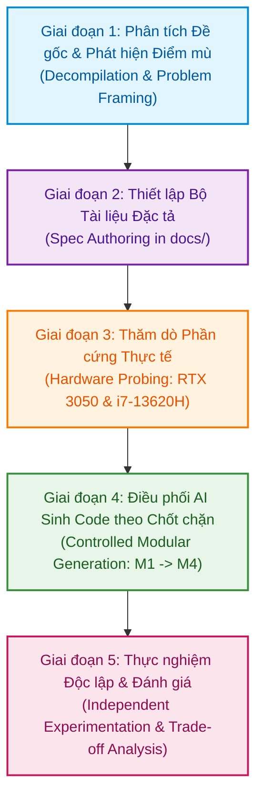

# AI Usage Report: Academic Transparency & Spec-Driven Development

Báo cáo minh bạch về phạm vi, quy trình và mức độ ảnh hưởng của các công cụ Trí tuệ Nhân tạo (AI) trong quá trình phát triển bài thực hành **Practice 2: Hands-on practice with pre-trained neural network architectures**.

---

## 1. AI Tools Used

Dự án áp dụng các hệ thống AI tạo sinh và Agentic AI như công cụ hỗ trợ kỹ thuật, tuân thủ nghiêm ngặt nguyên tắc Human-in-the-loop (con người giữ vai trò quyết định, phản biện và kiểm chứng toàn diện):

| Công cụ / Mô hình | Vai trò kỹ thuật | Phạm vi áp dụng trong Dự án |
| :--- | :--- | :--- |
| **Google Gemini (Advanced / Flash)** | Cố vấn kiến trúc và phản biện yêu cầu (Architecture Advisor & Peer Reviewer) | - Phân tích yêu cầu từ slide bài giảng gốc, chỉ ra các cú pháp đã bị khai tử (deprecated).<br>- Phát hiện các điểm mù kỹ thuật (Data Augmentation Leakage, tham số optimizer dư thừa).<br>- Thiết lập khung đặc tả yêu cầu và chiến lược viết prompt chuẩn xác. |
| **AI Coding Agent (IDE Integrated)** | Trợ lý sinh mã nguồn theo đặc tả (Spec-driven Code Generator) | - Khởi tạo và định dạng các tệp tài liệu kỹ thuật (`docs/`).<br>- Sinh khung mã nguồn (skeletons), Type Hints, và docstrings theo đúng interface đã được thiết kế.<br>- Hỗ trợ viết các đoạn script kiểm thử tự động (Unit & Smoke tests). |

Mọi đoạn mã nguồn hoặc nội dung do AI sinh ra đều phải trải qua quy trình kiểm tra kỹ thuật nghiêm ngặt trước khi được phép tích hợp vào nhánh làm việc (`lab2`).

---

## 2. Main Workflow & Progress (Spec-Driven Development)

Dự án không thực hiện theo lối tiếp cận ngây thơ (yêu cầu AI viết toàn bộ code trong một prompt duy nhất), mà tuân thủ chặt chẽ quy trình **Phát triển Dựa trên Đặc tả (Spec-Driven Development)** qua 5 giai đoạn có kiểm soát:



### Chi tiết các giai đoạn:
- **Giai đoạn 1 (Decompilation & Problem Framing)**: Đọc kỹ đề bài từ slide thực hành. Phát hiện slide sử dụng cú pháp `pretrained=True` đã cũ, chưa quy định tập dữ liệu cụ thể, chưa có phương án tách validation độc lập. Sinh viên định hình phạm vi: Tập CIFAR-10, 3 họ model (ResNet, VGG, DenseNet), 2 chiến lược (`freeze_all`, `unfreeze_last_block`).
- **Giai đoạn 2 (Spec Authoring)**: Xây dựng đầy đủ bộ tài liệu trước khi viết code: `docs/project_description.md` (đặc tả bài toán), `docs/project_design.md` (thiết kế kiến trúc module, luồng dữ liệu, chữ ký hàm), và `docs/development_workflow.md` (quy trình 7 bước).
- **Giai đoạn 3 (Hardware Probing)**: Chạy script kiểm tra phần cứng thực tế để lấy thông số GPU/CPU, từ đó ràng buộc AI thiết lập tham số mặc định tối ưu cho 6GB VRAM và 16 threads CPU.
- **Giai đoạn 4 (Controlled Modular Generation)**: Yêu cầu AI sinh mã nguồn độc lập cho từng module theo đúng Signature đã cam kết ở `project_design.md`. Chạy kiểm thử tại chỗ sau mỗi module.
- **Giai đoạn 5 (Independent Experimentation)**: Chạy thực nghiệm thực tế trên máy, quan sát đường cong hội tụ qua TensorBoard và đánh giá kết quả thực tế mà không phụ thuộc vào dự đoán của AI.

---

## 3. Student Contributions (Đóng góp Cốt lõi của Sinh viên)

Ranh giới giữa năng lực kỹ thuật của sinh viên và sự hỗ trợ của AI được phân định rõ ràng qua các đóng góp mang tính quyết định kiến trúc sau:

1. **Định hình Bài toán Thực tế trên CIFAR-10**:
   - Đề bài gốc chỉ nêu yêu cầu tổng quan về việc thử nghiệm trên pre-trained models. Sinh viên chủ động lựa chọn CIFAR-10, thiết lập phân chia nghiêm ngặt: 40,000 Train / 10,000 Validation / 10,000 Test để đánh giá chuẩn mực khoa học.
2. **Loại bỏ Cú pháp Lỗi thời, Cập nhật Chuẩn PyTorch/Torchvision Hiện đại**:
   - Phát hiện tham số `pretrained=True` trong slide đã bị khai tử từ Torchvision 0.13. Yêu cầu AI phải chuyển đổi 100% sang Weights API (`weights=ResNet18_Weights.DEFAULT`, `VGG16_BN_Weights.DEFAULT`, `DenseNet121_Weights.DEFAULT`).
3. **Thiết kế Cơ chế Phòng chống Rò rỉ Dữ liệu (Data Leakage Prevention)**:
   - AI có xu hướng dùng `torch.utils.data.random_split` trực tiếp trên một dataset đã gán `train_transform` (chứa `RandomCrop`, `RandomHorizontalFlip`).
   - Sinh viên đã phát hiện lỗi sai này và yêu cầu giải pháp chuẩn: Khởi tạo 2 đối tượng `CIFAR10(root, train=True)` riêng biệt gắn với 2 bộ transform khác nhau, sử dụng chỉ số ngẫu nhiên cố định qua `torch.randperm` với `manual_seed(42)` rồi bọc qua `torch.utils.data.Subset`.
4. **Quy định Kiến trúc Dynamic Model Factory**:
   - Yêu cầu rõ ràng về việc xử lý sự bất đồng bộ trong cách đặt tên tầng phân loại cuối giữa các họ mô hình: `.fc` (ResNet), `.classifier[6]` (VGG), `.classifier` (DenseNet).
   - Bắt buộc logic đóng băng phải tách biệt giữa `freeze_all` và `unfreeze_last_block` (mở khóa `layer4` của ResNet hoặc `denseblock4` của DenseNet).
5. **Tối ưu hóa Tài nguyên và Bộ lọc Optimizer**:
   - Phát hiện AI truyền toàn bộ `model.parameters()` vào Optimizer ngay cả khi các tầng đã đóng băng. Sinh viên yêu cầu lọc `filter(lambda p: p.requires_grad, model.parameters())` để tiết kiệm trạng thái bộ nhớ AdamW/SGD.
6. **Kiểm duyệt Chặt chẽ và Đánh giá Độc lập**:
   - Sinh viên trực tiếp chạy các lệnh kiểm thử hình học Tensor (Tensor Shape Verification), kiểm tra độ lệch Loss khởi tạo và phân tích kết quả trên ma trận nhầm lẫn.

---

## 4. Prompt Engineering & Proposals

Sinh viên đã vận dụng các kỹ thuật Prompt Engineering chuyên sâu để kiểm soát đầu ra của AI:

### 4.1. Các Kỹ thuật Prompting đã Sử dụng
- **Neo Ngữ cảnh (Context Anchoring)**: Luôn truyền đường dẫn hoặc trích dẫn trực tiếp các nguyên tắc từ `docs/project_description.md` và `docs/project_design.md` vào prompt để AI không tự ý sáng tạo kiến trúc mới.
- **Đóng vai Chuyên gia (Role Prompting)**: Định vị rõ ràng vai trò của AI trong từng giai đoạn (ví dụ: "Senior Machine Learning Engineer", "System Architect", "Quality Assurance Engineer").
- **Áp đặt Ràng buộc Nghiêm ngặt (Strict Constraint Enforcement)**: Đặt các lệnh cấm nghiêm ngặt trong prompt:
  - Không sử dụng emoji.
  - Không overengineering (không tạo lớp trừu tượng dư thừa).
  - Bắt buộc sử dụng Type Hints và docstring theo chuẩn PEP8.
  - Bắt buộc lọc `requires_grad=True` cho Optimizer.
- **Sinh Code Đơn phân theo Bước (Step-by-step Modular Generation)**: Chia nhỏ quá trình viết code thành từng file độc lập theo đúng tiến độ Milestone thay vì sinh toàn bộ dự án trong một turn.

### 4.2. Khung Cấu trúc Prompt Mẫu (Prompt Template)

```
[Vai trò & Mục tiêu]
Role: Senior Machine Learning Engineer
Task: Xây dựng module <ten_file> tuân thủ thiết kế tại docs/project_design.md.

[Ranh giới & Ràng buộc Kỹ thuật]
- Chỉ sử dụng Weights API hiện đại từ torchvision.models.
- Bắt buộc sử dụng Type Hints đầy đủ và xử lý ngoại lệ hợp lệ.
- Tuyệt đối không dùng emoji.
- Không thêm bất kỳ thư viện nào nằm ngoài requirements.txt.

[Tiêu chí Nghiệm thu (DoD)]
- Cung cấp một đoạn test script ngắn để kiểm chứng module hoạt động độc lập qua dòng lệnh terminal.
```

---

## 5. Verification & Quality Control

Mọi đoạn code hoặc tài liệu do AI tạo ra đều phải vượt qua 4 chốt kiểm soát kỹ thuật do sinh viên trực tiếp thực thi:

### 5.1. Kiểm tra Tính không Rò rỉ của Data Pipeline
- **Kiểm chứng**: Truy cập trực tiếp vào `val_loader.dataset` và `test_loader.dataset` để kiểm tra danh sách phép biến đổi (`transforms`).
- **Tiêu chuẩn đạt**: Tập Validation và Test chỉ được chứa các phép biến đổi xác định (`Resize(224)`, `ToTensor()`, `Normalize()`), hoàn toàn không tồn tại `RandomCrop` hay `RandomHorizontalFlip`.

### 5.2. Kiểm tra Số lượng Tham số và requires_grad
- **Kiểm chứng**: Chạy script tính toán tham số trên từng kiến trúc:
  - ResNet-18 với `freeze_all`: Chỉ có $512 \times 10 + 10 = 5,130$ tham số trainable (chiếm $\approx 0.046\%$ tổng tham số).
  - ResNet-18 với `unfreeze_last_block`: Toàn bộ `layer4` và `fc` có $\approx 8.4$ triệu tham số trainable.
- **Tiêu chuẩn đạt**: Số lượng tham số trainable phải khớp chính xác tuyệt đối với phép tính lý thuyết trước khi cho phép chạy huấn luyện.

### 5.3. Kiểm tra Chế độ Hoạt động của Model (train/eval) và Gradient
- **Kiểm chứng**: Kiểm tra mã nguồn của `trainer.py` và `evaluate.py`:
  - Trong hàm `train_one_epoch`: Phải có `model.train()`.
  - Trong hàm `validate` và `evaluate_test_set`: Phải có `model.eval()` và được bao bọc trong khối `with torch.no_grad():`.

### 5.4. Kiểm tra Giá trị Loss Khởi tạo (Initial Loss Sanity Check)
- **Kiểm chứng**: Khi mô hình chưa được huấn luyện trên 10 lớp CIFAR-10, với phân phối xác suất đều giữa các lớp, giá trị Cross-Entropy Loss ở batch đầu tiên phải xấp xỉ:
  $$L_0 \approx -\ln\left(\frac{1}{C}\right) = -\ln(0.1) \approx 2.3025$$
- **Tiêu chuẩn đạt**: Nếu Loss khởi tạo nằm ngoài khoảng $[1.8, 3.2]$, pipeline lập tức bị tạm dừng để rà soát lại phép tính loss và nhãn target.

---

## 6. Limitations & Manual Adjustments

Bảng nhật ký ghi nhận các sai lệch của AI trong quá trình phát triển và các biện pháp sửa lỗi trực tiếp từ sinh viên:

| Module / Bước | Vấn đề / Sai sót từ phía AI (Issue Encountered) | Biện pháp Xử lý & Hiệu chỉnh của Sinh viên (Manual Fix) | Kết quả Kiểm chứng (Verification Result) |
| :--- | :--- | :--- | :--- |
| **Phân tích Đề bài** | AI đề xuất dùng lại cú pháp `pretrained=True` theo slide gốc. | Yêu cầu loại bỏ hoàn toàn và thay bằng `weights=...Weights.DEFAULT`. | Mô hình load không còn cảnh báo DeprecationWarning của PyTorch. |
| **`src/dataset.py`** | AI sử dụng `random_split` trên một Dataset có sẵn Data Augmentation, làm tập Val bị nhiễm phép xoay ảnh ngẫu nhiên. | Khởi tạo 2 thực thể Dataset riêng biệt cho `train_transform` và `eval_transform`, chia tập thông qua chỉ số ngẫu nhiên cố định `torch.randperm`. | Tập Validation được kiểm tra chỉ còn phép Resize và Normalize tĩnh. |
| **`src/model_factory.py`** | AI chỉ thay thế `.fc` mà không tính đến cấu trúc `.classifier[6]` của VGG và `.classifier` của DenseNet. | Bổ sung cấu trúc rẽ nhánh tường minh kiểm tra kiến trúc mô hình và thay thế đúng thuộc tính phân loại. | Chạy inspect thành công cả 4 kiến trúc mà không bị lỗi AttributeError. |
| **`src/trainer.py`** | AI truyền tất cả `model.parameters()` vào Optimizer mặc dù đã đóng băng các tầng trước đó. | Bổ sung bộ lọc `filter(lambda p: p.requires_grad, model.parameters())` khi khởi tạo Optimizer. | Optimizer chỉ quản lý 5,130 tham số ở chế độ `freeze_all`, giảm tiêu thụ VRAM. |
| **`src/trainer.py`** | Điều kiện lưu checkpoint `val_acc > best_val_acc` với `best_val_acc = 0.0` khiến model không lưu checkpoint nếu epoch 1 accuracy = 0%. | Khởi tạo `best_val_acc = -1.0` để luôn đảm bảo checkpoint ban đầu được lưu lại an toàn. | Unit test checkpoint và full regression test vượt qua 100%. |
