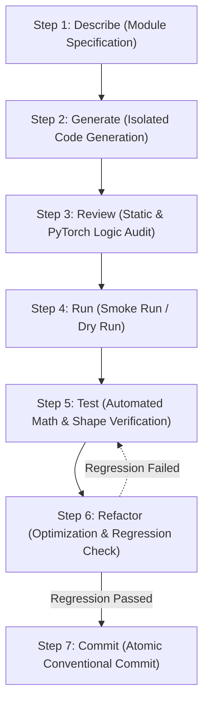

# Standard Operating Procedure: 7-Step Development Workflow

Quy trinh Phat trien Chuan (Standard Operating Procedure - SOP) cho du an **Practice 2: Hands-on practice with pre-trained neural network architectures**. Toan bo ma nguon duoc phat trien tu dau (from scratch) bat buoc phai tuan thu nghiem ngat chu trinh 7 buoc nay de dam bao tinh on dinh, chat luong ma nguon va tinh tai lap khoa hoc tren phan cung thuc te.

---

## 1. Workflow Architecture & Lifecycle

Moi module trong he thong (`config.py`, `dataset.py`, `model_factory.py`, `trainer.py`, `evaluate.py`, `main.py`) duoc xay dung va nghiem thu theo chu trinh phat trien lap (Iterative Lifecycle) gom 7 buoc tuan tu:

### Nguyen tac Cot loi:
- **Zero Premature Training**: Tuyet doi khong khoi chay huan luyen toan bo du lieu (Full Training) khi module chua vuot qua buoc chay thu nhanh (Step 4: Smoke Run) va kiem thu toan hoc (Step 5: Verification).
- **Mandatory Regression Gate**: Sau bat ky thao tac toi uu hoac lam sach ma nguon nao o buoc Refactor (Step 6), bat buoc phai chay lai toan bo bo kiem thu cua Step 5 truoc khi thuc hien Commit (Step 7).

---

## 2. Detailed 7-Step Execution Protocol

### Step 1: Describe (Dac ta Cap do Module)
- **Objective**: Khoa chat pham vi thuc thi, dinh nghia kieu du lieu dau vao/dau ra va cac rang buoc ky thuat truoc khi viet code.
- **Action Items**:
  - Doi chieu voi `docs/project_design.md` de xac dinh interface chuan: Ten ham, ten class, tham so truyen vao kem Python Type Hints va gia tri tra ve.
  - Xac dinh ro cac truong hop bien (Edge Cases): Tap du lieu rong, kich thuoc batch khong chia het, thiet bi khong co GPU.
  - Liet ke cac rang buoc phan cung can tuan thu: Gioi han VRAM 6GB, gioi han luong CPU 16 threads.
- **Exit Criteria**:
  - Bang dac ta hoac prompt yeu cau co day du Function Signatures, Type Hints, va khong co diem mo ho ve logic.

---

### Step 2: Generate (Sinh Code Doc lap theo Module)
- **Objective**: Hien thuc hoa ma nguon cho duy nhat 1 module duoc chi dinh, khong phu thuoc cheo ngoai thiet ke.
- **Action Items**:
  - Viet code tuan thu PEP8, 100% su dung Type Hints chuan (`from typing import Tuple, Dict, List, Optional, Any`).
  - Dat ten bien, ham va class bang tieng Anh chuan danh tu/dong tu ky thuat.
  - Chi su dung chu thich tieng Viet tai cac vi tri xu ly logic nghiep vu dac thu (vi du: ky thuat tach Dataset chong ro ri Data Augmentation, logic re nhanh thay the Classification Head).
  - Khong them bat ky thu vien ngoai lai nao chua co trong `requirements.txt`.
- **Exit Criteria**:
  - File ma nguon duoc luu dung vi tri trong `src/`, khong co loi cu phap (SyntaxError) va import thanh cong.

---

### Step 3: Review (Kiem duyet Tinh & Ra soat Logic PyTorch)
- **Objective**: Phat hien som cac loi logic he thong, ranh gioi gradient va ro ri du lieu qua checklist kiem duyet.
- **Action Items**:
  - Kiem tra checklist 5 diem bat buoc:
    1. **Modern Weights API**: Da loai bo hoan toan `pretrained=True` va thay bang `weights=...Weights.DEFAULT` chua?
    2. **Data Leakage Check**: Tap Validation co bi gan nham `train_transform` (chua `RandomCrop`, `RandomHorizontalFlip`) khong?
    3. **Optimizer Scope Filter**: Da su dung `filter(lambda p: p.requires_grad, model.parameters())` chua, hay dang truyen toan bo tham so dong bang vao Optimizer?
    4. **Model State & No-Grad**: Da dat `model.train()` trong vong lap huan luyen va `model.eval()` kem `torch.no_grad()` trong validation/testing chua?
    5. **Device Consistency**: Model, `inputs` va `targets` da duoc day len cung mot `device` (`.to(device)`) chua?
- **Exit Criteria**:
  - Ma nguon vuot qua tat ca 5 muc trong checklist kiem duyet ma khong co bat ky vi pham nao.

---

### Step 4: Run (Chay Thu nghiem Nhanh - Smoke Run / Dry Run)
- **Objective**: Kiem tra luong thuc thi tu dau den cuoi trong thoi gian duoi 10 giay, phat hien som loi bo nho va xung dot kich thuoc tensor.
- **Action Items**:
  - Voi `dataset.py`: Khoi tao dataloader voi tham so `dry_run=True` de chi lay vai chuc mau.
  - Voi `model_factory.py`: Khoi tao model va chay forward mot dummy tensor `torch.randn(2, 3, 224, 224)`.
  - Voi `trainer.py` va `main.py`: Chay flag `--dry-run` de thuc thi dung 1 batch train va 1 batch validation.
  - Giam sat muc tieu thu VRAM bang `nvidia-smi` de xac nhan khong co hien tuong tran bo nho (CUDA OOM).
- **Exit Criteria**:
  - Lenh thuc thi chay het chu trinh, ket thuc voi Exit Code 0 ma khong quang ra Exception.

---

### Step 5: Test (Kiem thu Tu dong & Xac minh Toan hoc)
- **Objective**: Dung cac phep tinh toan hoc va assertion de kiem chung tinh dung dan tuyet doi cua module.
- **Action Items**:
  - **Kiem thu Data Pipeline (`src/dataset.py`)**:
    - Kiem tra batch shape: `images.shape == torch.Size([B, 3, 224, 224])`, `labels.shape == torch.Size([B])`.
    - Kiem tra nhan: `torch.all((labels >= 0) & (labels <= 9)) == True`.
    - Kiem tra tinh roi nhau (Disjointness): `set(train_indices).isdisjoint(set(val_indices)) == True`.
  - **Kiem thu Model Factory (`src/model_factory.py`)**:
    - Output logits shape phai la `(B, 10)`.
    - Voi `freeze_all` tren ResNet-18: So tham so `requires_grad=True` phai bang chinh xac $512 \times 10 + 10 = 5,130$.
    - Voi `unfreeze_last_block` tren ResNet-18: So tham so `requires_grad=True` phai lon hon 5,130 va nho hon 11,181,642 (tong tham so).
  - **Kiem thu Huan luyen & Sanity Check Toan hoc (`src/trainer.py`)**:
    - Loss khoi tao (Initial Loss Check): Batch dau tien chua qua cap nhat trong so phai co Cross-Entropy Loss xap xi $-\ln(1/10) \approx 2.3025$ (sai so chap nhan trong khoang $[2.1, 2.6]$).
    - Single Batch Overfit Test: Huan luyen mo hinh tren duy nhat 1 batch trong 10-20 buoc; xac nhan Loss giam manh ve gan 0 de chung minh backpropagation va optimizer hoat dong dung.
  - **Kiem thu Danh gia & Visualizer (`src/evaluate.py`)**:
    - Kiem tra su ton tai va dung luong cua 3 file anh tai `outputs/figures/`: `training_history.png`, `class_accuracy.png`, `confusion_matrix.png` (> 0 bytes).
- **Exit Criteria**:
  - Toan bo cac bieu thuc assertion deu tra ve `True`.

---

### Step 6: Refactor (Lam sach, Toi uu hoa & Kiem tra Hoi quy)
- **Objective**: Nang cao chat luong ma nguon, loai bo doan ma thua ma khong lam thay doi hanh vi cua he thong.
- **Action Items**:
  - Xoa bo cac dong `print()` debug tam thoi, chuyen sang dung logging hoac TensorBoard summary.
  - Ap dung nguyen tac DRY (Don't Repeat Yourself): Gom cac doan ma trung lap ve ham tien ich dung chung.
  - Toi uu DataLoader: Dam bao `pin_memory=True` khi dung GPU va `num_workers=4` tren CPU i7-13620H.
  - **Bat buoc chay Regression Check**: Chay lai toan bo cac lenh kiem thu tai Step 5 de dam bao viec don dep khong tao ra loi ngam (regression bugs).
- **Exit Criteria**:
  - Ma nguon sach se, khong con bien thua, va toan bo test tai Step 5 van pass 100%.

---

### Step 7: Commit (Quan ly Phien ban Chuan Git)
- **Objective**: Dong goi thanh qua vao Git repository voi thong diep ro rang, mang tinh nguyen tu (Atomic Commit).
- **Action Items**:
  - Su dung tieu chuan Conventional Commits theo mau: `<type>(<scope>): <subject>`.
    - `feat`: Them tinh nang hoac module moi.
    - `test`: Them hoac cap nhat test script.
    - `refactor`: Lam sach hoac toi uu ma nguon.
    - `docs`: Cap nhat tai lieu.
    - `fix`: Sua loi logic hoac runtime.
  - Chi add cac file lien quan truc tiep den Milestone hien tai, khong add file du lieu lon hoac checkpoint nang.
- **Exit Criteria**:
  - `git status` sach se, commit duoc ghi nhan tren nhanh `lab2`.

---

## 3. Milestone Execution Matrix

Bang anh xa quy trinh 7 buoc cho 4 Milestones thuc te cua du an kem cau lenh xac minh cu the:

| Milestone | Pham vi Module | Cau lenh Smoke Run & Test (Step 4 & Step 5) | Mau Commit Message de xuat (Step 7) |
| :--- | :--- | :--- | :--- |
| **Milestone 1: Config & Data Pipeline** | `src/config.py` `src/dataset.py` | `python3 -c "from src.dataset import get_cifar10_dataloaders; tr, va, te = get_cifar10_dataloaders('data', dry_run=True); b = next(iter(tr)); assert b[0].shape == (64, 3, 224, 224); assert b[1].shape == (64,); print('M1 Verified Successfully')"` | `feat(data): implement leak-free CIFAR-10 data pipeline with adaptive configuration` |
| **Milestone 2: Model Factory & Inspection** | `src/model_factory.py` | `python3 -c "from src.model_factory import build_model, count_parameters; m = build_model('resnet18', 'freeze_all'); c = count_parameters(m); assert c['trainable'] == 5130; m2 = build_model('resnet18', 'unfreeze_last_block'); c2 = count_parameters(m2); assert c2['trainable'] > 5130; print('M2 Verified Successfully')"` | `feat(models): implement dynamic model factory with modern weights API and freezing strategies` |
| **Milestone 3: Training Engine & TensorBoard** | `src/trainer.py` `main.py` (Draft) | `python3 main.py --model resnet18 --dry-run` | `feat(trainer): implement training loop with mixed precision, TensorBoard logging and checkpointing` |
| **Milestone 4: Evaluation, Visualization & CLI** | `src/evaluate.py` `main.py` (Full) | `python3 main.py --model resnet18 --strategy freeze_all --epochs 1 --subset-ratio 0.05` | `feat(eval): implement test evaluation, per-class metrics reporting and 300 DPI visualizations` |
