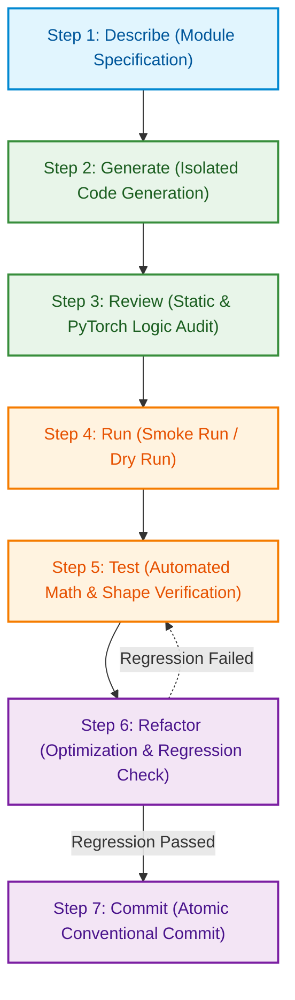

# Standard Operating Procedure: 7-Step Development Workflow

Quy trình Phát triển Chuẩn (Standard Operating Procedure - SOP) cho dự án **Practice 2: Hands-on practice with pre-trained neural network architectures**. Toàn bộ mã nguồn được phát triển từ đầu (from scratch) bắt buộc phải tuân thủ nghiêm ngặt chu trình 7 bước này để đảm bảo tính ổn định, chất lượng mã nguồn và tính tái lập khoa học trên phần cứng thực tế.

---

## 1. Workflow Architecture & Lifecycle

Mỗi module trong hệ thống (`config.py`, `dataset.py`, `model_factory.py`, `trainer.py`, `evaluate.py`, `main.py`) được xây dựng và nghiệm thu theo chu trình phát triển lặp (Iterative Lifecycle) gồm 7 bước tuần tự:

### Nguyên tắc Cốt lõi:
- **Zero Premature Training**: Tuyệt đối không khởi chạy huấn luyện toàn bộ dữ liệu (Full Training) khi module chưa vượt qua bước chạy thử nhanh (Step 4: Smoke Run) và kiểm thử toán học (Step 5: Verification).
- **Mandatory Regression Gate**: Sau bất kỳ thao tác tối ưu hoặc làm sạch mã nguồn nào ở bước Refactor (Step 6), bắt buộc phải chạy lại toàn bộ bộ kiểm thử của Step 5 trước khi thực hiện Commit (Step 7).

---

## 2. Detailed 7-Step Execution Protocol

### Step 1: Describe (Đặc tả Cấp độ Module)
- **Objective**: Khóa chặt phạm vi thực thi, định nghĩa kiểu dữ liệu đầu vào/đầu ra và các ràng buộc kỹ thuật trước khi viết code.
- **Action Items**:
  - Đối chiếu với `docs/project_design.md` để xác định interface chuẩn: Tên hàm, tên class, tham số truyền vào kèm Python Type Hints và giá trị trả về.
  - Xác định rõ các trường hợp biên (Edge Cases): Tập dữ liệu rỗng, kích thước batch không chia hết, thiết bị không có GPU.
  - Liệt kê các ràng buộc phần cứng cần tuân thủ: Giới hạn VRAM 6GB, giới hạn luồng CPU 16 threads.
- **Exit Criteria**:
  - Bảng đặc tả hoặc prompt yêu cầu có đầy đủ Function Signatures, Type Hints, và không có điểm mơ hồ về logic.

---

### Step 2: Generate (Sinh Code Độc lập theo Module)
- **Objective**: Hiện thực hóa mã nguồn cho duy nhất 1 module được chỉ định, không phụ thuộc chéo ngoài thiết kế.
- **Action Items**:
  - Viết code tuân thủ PEP8, 100% sử dụng Type Hints chuẩn (`from typing import Tuple, Dict, List, Optional, Any`).
  - Đặt tên biến, hàm và class bằng tiếng Anh chuẩn danh từ/động từ kỹ thuật.
  - Chỉ sử dụng chú thích tiếng Việt tại các vị trí xử lý logic nghiệp vụ đặc thù (ví dụ: kỹ thuật tách Dataset chống rò rỉ Data Augmentation, logic rẽ nhánh thay thế Classification Head).
  - Không thêm bất kỳ thư viện ngoại lai nào chưa có trong `requirements.txt`.
- **Exit Criteria**:
  - File mã nguồn được lưu đúng vị trí trong `src/`, không có lỗi cú pháp (SyntaxError) và import thành công.

---

### Step 3: Review (Kiểm duyệt Tĩnh & Rà soát Logic PyTorch)
- **Objective**: Phát hiện sớm các lỗi logic hệ thống, ranh giới gradient và rò rỉ dữ liệu qua checklist kiểm duyệt.
- **Action Items**:
  - Kiểm tra checklist 5 điểm bắt buộc:
    1. **Modern Weights API**: Đã loại bỏ hoàn toàn `pretrained=True` và thay bằng `weights=...Weights.DEFAULT` chưa?
    2. **Data Leakage Check**: Tập Validation có bị gán nhầm `train_transform` (chứa `RandomCrop`, `RandomHorizontalFlip`) không?
    3. **Optimizer Scope Filter**: Đã sử dụng `filter(lambda p: p.requires_grad, model.parameters())` chưa, hay đang truyền toàn bộ tham số đóng băng vào Optimizer?
    4. **Model State & No-Grad**: Đã đặt `model.train()` trong vòng lặp huấn luyện và `model.eval()` kèm `torch.no_grad()` trong validation/testing chưa?
    5. **Device Consistency**: Model, `inputs` và `targets` đã được đẩy lên cùng một `device` (`.to(device)`) chưa?
- **Exit Criteria**:
  - Mã nguồn vượt qua tất cả 5 mục trong checklist kiểm duyệt mà không có bất kỳ vi phạm nào.

---

### Step 4: Run (Chạy Thử nghiệm Nhanh - Smoke Run / Dry Run)
- **Objective**: Kiểm tra luồng thực thi từ đầu đến cuối trong thời gian dưới 10 giây, phát hiện sớm lỗi bộ nhớ và xung đột kích thước tensor.
- **Action Items**:
  - Với `dataset.py`: Khởi tạo dataloader với tham số `dry_run=True` để chỉ lấy vài chục mẫu.
  - Với `model_factory.py`: Khởi tạo model và chạy forward một dummy tensor `torch.randn(2, 3, 224, 224)`.
  - Với `trainer.py` và `main.py`: Chạy cờ `--dry-run` để thực thi đúng 1 batch train và 1 batch validation.
  - Giám sát mức tiêu thụ VRAM bằng `nvidia-smi` để xác nhận không có hiện tượng tràn bộ nhớ (CUDA OOM).
- **Exit Criteria**:
  - Lệnh thực thi chạy hết chu trình, kết thúc với Exit Code 0 mà không quăng ra Exception.

---

### Step 5: Test (Kiểm thử Tự động & Xác minh Toán học)
- **Objective**: Dùng các phép tính toán học và assertion để kiểm chứng tính đúng đắn tuyệt đối của module.
- **Action Items**:
  - **Kiểm thử Data Pipeline (`src/dataset.py`)**:
    - Kiểm tra batch shape: `images.shape == torch.Size([B, 3, 224, 224])`, `labels.shape == torch.Size([B])`.
    - Kiểm tra nhãn: `torch.all((labels >= 0) & (labels <= 9)) == True`.
    - Kiểm tra tính rời nhau (Disjointness): `set(train_indices).isdisjoint(set(val_indices)) == True`.
  - **Kiểm thử Model Factory (`src/model_factory.py`)**:
    - Output logits shape phải là `(B, 10)`.
    - Với `freeze_all` trên ResNet-18: Số tham số `requires_grad=True` phải bằng chính xác $512 \times 10 + 10 = 5,130$.
    - Với `unfreeze_last_block` trên ResNet-18: Số tham số `requires_grad=True` phải lớn hơn 5,130 và nhỏ hơn 11,181,642 (tổng tham số).
  - **Kiểm thử Huấn luyện & Sanity Check Toán học (`src/trainer.py`)**:
    - Loss khởi tạo (Initial Loss Check): Batch đầu tiên chưa qua cập nhật trọng số phải có Cross-Entropy Loss xấp xỉ $-\ln(1/10) \approx 2.3025$ (sai số chấp nhận trong khoảng $[1.8, 3.2]$).
    - Single Batch Overfit Test: Huấn luyện mô hình trên duy nhất 1 batch trong 50 bước; xác nhận Loss giảm trên 50% để chứng minh backpropagation và optimizer hoạt động đúng.
  - **Kiểm thử Đánh giá & Visualizer (`src/evaluate.py`)**:
    - Kiểm tra sự tồn tại và dung lượng của 3 file ảnh tại `outputs/figures/`: `training_history.png`, `class_accuracy.png`, `confusion_matrix.png` (> 0 bytes).
- **Exit Criteria**:
  - Toàn bộ các biểu thức assertion đều trả về `True`.

---

### Step 6: Refactor (Làm sạch, Tối ưu hóa & Kiểm tra Hồi quy)
- **Objective**: Nâng cao chất lượng mã nguồn, loại bỏ đoạn mã thừa mà không làm thay đổi hành vi của hệ thống.
- **Action Items**:
  - Xóa bỏ các dòng `print()` debug tạm thời, chuyển sang dùng logging hoặc TensorBoard summary.
  - Áp dụng nguyên tắc DRY (Don't Repeat Yourself): Gom các đoạn mã trùng lặp về hàm tiện ích dùng chung.
  - Tối ưu DataLoader: Đảm bảo `pin_memory=True` khi dùng GPU và `num_workers=4` trên CPU i7-13620H.
  - **Bắt buộc chạy Regression Check**: Chạy lại toàn bộ các lệnh kiểm thử tại Step 5 để đảm bảo việc dọn dẹp không tạo ra lỗi ngầm (regression bugs).
- **Exit Criteria**:
  - Mã nguồn sạch sẽ, không còn biến thừa, và toàn bộ test tại Step 5 vẫn pass 100%.

---

### Step 7: Commit (Quản lý Phiên bản Chuẩn Git)
- **Objective**: Đóng gói thành quả vào Git repository với thông điệp rõ ràng, mang tính nguyên tử (Atomic Commit).
- **Action Items**:
  - Sử dụng tiêu chuẩn Conventional Commits theo mẫu: `<type>(<scope>): <subject>`.
    - `feat`: Thêm tính năng hoặc module mới.
    - `test`: Thêm hoặc cập nhật test script.
    - `refactor`: Làm sạch hoặc tối ưu mã nguồn.
    - `docs`: Cập nhật tài liệu.
    - `fix`: Sửa lỗi logic hoặc runtime.
  - Chỉ add các file liên quan trực tiếp đến Milestone hiện tại, không add file dữ liệu lớn hoặc checkpoint nặng.
- **Exit Criteria**:
  - `git status` sạch sẽ, commit được ghi nhận trên nhánh `lab2`.

---

## 3. Milestone Execution Matrix

Bảng ánh xạ quy trình 7 bước cho 4 Milestones thực tế của dự án kèm câu lệnh xác minh cụ thể:

| Milestone | Phạm vi Module | Câu lệnh Smoke Run & Test (Step 4 & Step 5) | Mẫu Commit Message đề xuất (Step 7) |
| :--- | :--- | :--- | :--- |
| **Milestone 1: Config & Data Pipeline** | `src/config.py` `src/dataset.py` | `python3 -c "from src.dataset import get_cifar10_dataloaders; tr, va, te = get_cifar10_dataloaders('data', dry_run=True); b = next(iter(tr)); assert b[0].shape == (64, 3, 224, 224); assert b[1].shape == (64,); print('M1 Verified Successfully')"` | `feat(data): implement leak-free CIFAR-10 data pipeline with adaptive configuration` |
| **Milestone 2: Model Factory & Inspection** | `src/model_factory.py` | `python3 -c "from src.model_factory import build_model, count_parameters; m = build_model('resnet18', 'freeze_all'); c = count_parameters(m); assert c['trainable'] == 5130; m2 = build_model('resnet18', 'unfreeze_last_block'); c2 = count_parameters(m2); assert c2['trainable'] > 5130; print('M2 Verified Successfully')"` | `feat(models): implement dynamic model factory with modern weights API and freezing strategies` |
| **Milestone 3: Training Engine & TensorBoard** | `src/trainer.py` | `python3 -m unittest tests/test_trainer.py -v` | `feat(trainer): implement training engine with AMP, TensorBoard logging and best-checkpoint saving` |
| **Milestone 4: Evaluation, Visualization & CLI** | `src/evaluate.py` `main.py` | `python3 main.py --model resnet18 --strategy freeze_all --epochs 1 --dry-run` | `feat(eval-cli): implement independent test evaluation, 300 DPI visualizations and unified CLI entry point` |
