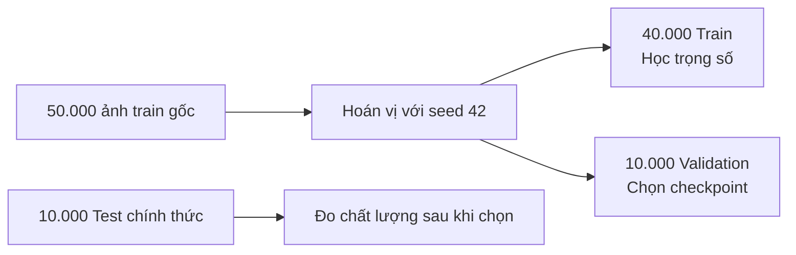
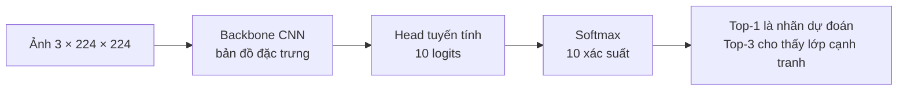
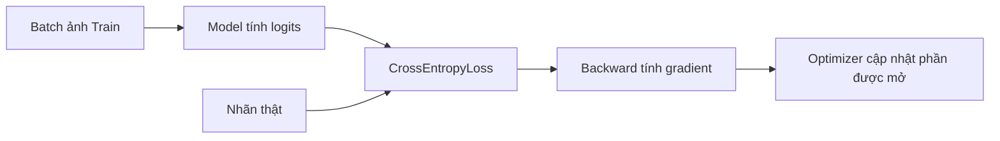

# Lab 2 · Một CNN đã học trên ImageNet nhận diện ảnh CIFAR-10 như thế nào?

Mỗi ảnh chỉ có 32 × 32 pixel. Bài toán là chọn đúng một trong mười lớp. Với cùng dữ liệu, việc cho phép CNN học lại một phần bộ trích đặc trưng giúp ích bao nhiêu, và phải trả thêm bao nhiêu thời gian huấn luyện?

---

## 1 · Mỗi tập ảnh trả lời một câu hỏi

Train và Validation lấy hai phần rời nhau của cùng một hoán vị. Tập Test có 1.000 ảnh cho mỗi lớp. Nhờ đó, khi nói model nhận đúng 82,5% ảnh mèo, ta có thể đọc trực tiếp thành 825 ảnh đúng trên 1.000 ảnh mèo.

---

## 2 · Cùng một ảnh, hai cách chuẩn bị

| Train | Validation và Test |
|---|---|
| Resize lên 256 × 256, crop ngẫu nhiên 224 × 224, lật ngang với xác suất 50% | Resize thẳng lên 224 × 224 |
| Mỗi lượt có thể cho một góc nhìn khác | Cùng ảnh cho cùng tensor khi đánh giá lại |

Hai nhánh đều đổi pixel RGB từ số nguyên 0–255 sang số thực 0–1 rồi chuẩn hóa từng kênh bằng mean và std ImageNet. Phóng to ảnh giúp khớp kích thước đầu vào của pipeline. Chi tiết thị giác vẫn đến từ 32 × 32 pixel gốc.

---

## 3 · Bằng chứng nào giúp kiểm tra rò rỉ ảnh?

| Kiểm tra | Kết quả trong Lab 2 |
|---|---|
| Chia dữ liệu trước augmentation | Train và Validation rời chỉ số và dùng hai đối tượng dataset với transform riêng |
| Áp transform đánh giá nhiều lần | Notebook EDA thu được cùng tensor |
| So hash pixel gốc của 60.000 ảnh | Không phát hiện ảnh giống hệt pixel giữa các tập |
| Theo dõi nơi cập nhật trọng số | Optimizer chỉ chạy trên Train |

Hai ảnh cùng cảnh nhưng khác crop có thể có hash khác nhau. Vì vậy kiểm tra hash chỉ trả lời câu hỏi về ảnh trùng tuyệt đối. [Mở notebook EDA](../notebooks/01_cifar10_eda.ipynb)

---

## 4 · Từ pixel đến nhãn dự đoán

Lấy ResNet-18 làm ví dụ. Các bộ lọc tích chập phản hồi với những mẫu cục bộ trong ảnh. Các block sau kết hợp phản hồi trên vùng rộng hơn. Sau phép pooling, head nhận vector 512 giá trị và tính điểm cho 10 lớp. Head có **512 × 10 + 10 = 5.130 tham số**. Khi chỉ huấn luyện head, đây chính là toàn bộ số tham số được cập nhật.

---

## 5 · Bốn kiến trúc cùng giải một bài toán

| Backbone | Đặc điểm cần nhớ | Tầng thay để dự đoán 10 lớp |
|---|---|---|
| ResNet-18 | Kết nối tắt cộng đầu vào của block với đặc trưng đã biến đổi | `fc` |
| ResNet-50 | Sâu hơn, dùng các block bottleneck | `fc` |
| VGG-16 BN | Các tầng tích chập xếp tuần tự, có BatchNorm | `classifier[6]` |
| DenseNet-121 | Trong mỗi dense block, tầng sau nhận các đặc trưng ghép từ tầng trước | `classifier` |

Cả bốn bắt đầu từ trọng số ImageNet. Ta thay tầng phân loại cũ vì CIFAR-10 có bộ nhãn riêng. [Mã khởi tạo bốn kiến trúc](../src/model_factory.py)

---

## 6 · Phần nào của mạng được phép học?

| Chiến lược trên ResNet-18 | Các block trước layer4 | layer4 | Head mới |
|---|---|---|---|
| **freeze_all** | Giữ cố định | Giữ cố định | Học |
| **unfreeze_last_block** | Giữ cố định | Học | Học |

Cách đầu dùng đặc trưng ImageNet để học ranh giới giữa mười lớp. Cách sau cho phép chính đặc trưng ở block cuối thích nghi với ảnh CIFAR-10. Số tham số được cập nhật tăng từ **5.130 lên 8.398.858**. Các lớp BatchNorm đã đóng băng cũng giữ thống kê đang dùng.

---

## 7 · Một batch cập nhật model như thế nào?

Nhãn thật đi vào phép tính loss. Model nhận tensor ảnh để dự đoán. Nếu điểm dành cho lớp đúng thấp so với các lớp cạnh tranh, loss tăng. Qua nhiều batch, optimizer điều chỉnh các tham số để giảm loss. Các run chính dùng AdamW, mỗi run đi qua toàn bộ Train 15 lần.

---

## 8 · Vì sao chọn epoch 13?

Đọc từ trái sang phải trên trục epoch. Train tiếp tục cải thiện, nhưng Validation Loss tăng về cuối. Validation Accuracy đạt đỉnh **94,35% tại epoch 13**, rồi còn **93,65% tại epoch 15**, khi Train Accuracy đạt 99,25%. Đây là dấu hiệu overfitting cuối quá trình. Trainer giữ checkpoint tại đỉnh Validation và nạp lại checkpoint đó để đánh giá Test.

---

## 9 · Tám thực nghiệm cho thấy sự đánh đổi nào?

| Run | Model và cấu hình | Best Val | Test | Macro-F1 Test | Giây/epoch |
|---|---|---:|---:|---:|---:|
| EXP_01 | ResNet-18, head | 87,91% | 87,17% | 0,8712 | 110,9 |
| **EXP_02** | **ResNet-18, mở block cuối** | **94,35%** | **93,63%** | **0,9360** | **152,1** |
| EXP_03 | ResNet-50, head | 92,98% | 92,16% | 0,9216 | 208,5 |
| EXP_04 | VGG-16 BN, head | 86,43% | 84,97% | 0,8483 | 308,7 |
| EXP_05 | DenseNet-121, head | 90,06% | 89,70% | 0,8970 | 149,1 |
| EXP_06 | DenseNet-121, mở block cuối | 94,23% | 93,86% | 0,9386 | 183,4 |
| EXT_LR_OPT | EXP_01 với SGD và LR 0,01 | 87,86% | 86,98% | 0,8688 | 148,2 |
| EXT_BATCH | EXP_01 với batch 32 | 87,85% | 87,01% | 0,8695 | 114,4 |

So EXP_01 với EXP_02, Validation tăng **6,44 điểm phần trăm**, thời gian tăng **41,2 giây/epoch**. Phép so sánh đo hiệu ứng kết hợp của mở block và giảm learning rate từ 0,001 xuống 0,0001. EXP_06 đứng đầu trên Test, còn **EXP_02 được chọn theo Validation**. Mỗi cấu hình dùng một seed. [Bảng thực nghiệm](../outputs/experiment_summary.csv)

---

## 10 · 9.363 dự đoán đúng, 637 dự đoán sai

Trên 10.000 ảnh Test, EXP_02 đạt **Accuracy 93,63%**, **Loss 0,2304** và **macro-F1 0,9360**. Với từng lớp, precision hỏi “trong các ảnh được đoán là lớp này, bao nhiêu ảnh đúng?”, còn recall hỏi “trong các ảnh thật thuộc lớp này, model tìm được bao nhiêu?”. F1 kết hợp hai đại lượng. Macro-F1 cho mỗi lớp trọng số bằng nhau.

---

## 11 · Mèo và chó chiếm hơn một phần năm số lỗi

Đọc theo hàng nhãn thật và cột nhãn dự đoán. Ở hàng **cat**, 825/1.000 ảnh nằm đúng trên đường chéo và 89 ảnh rơi vào cột **dog**. Chiều ngược lại có 44 ảnh. Hai ô này chiếm **133/637 lỗi**, tương đương **20,9%**. Trong cùng tập Test, recall của airplane đạt 97,6%.

---

## 12 · Dự đoán đúng cũng có thể rất sát nút

| Ảnh Test | Nhãn thật → Top-1 | Confidence | Cách đọc |
|---|---|---:|---|
| 4 | frog → frog | ≈100% | Đúng, tự tin cao |
| 5708 | bird → bird | 29,9% | Đúng nhưng dog bám sát ở 29,4%, horse đạt 26,8% |
| 2405 | cat → frog | ≈100% | Sai theo nhãn gốc, ảnh đáng rà soát nhãn |
| 4208 | bird → dog | 32,0% | Sai, deer bám sát ở 27,8% |

Với ảnh 5708, khoảng cách giữa hai lớp đầu chỉ khoảng nửa điểm phần trăm. Với ảnh 2405, model rất tự tin nhưng nhãn CIFAR-10 ghi **cat**. Ảnh này vẫn tính vào số lỗi đã báo cáo. [Dự đoán từng ảnh](../outputs/experiments/resnet18_unfreeze_last_block_20261121_115234_018455_f40df826/predictions.csv)

---

## 13 · Grad-CAM cho thấy vùng nào liên quan đến điểm lớp?

Ảnh 4208 có một con chim trên cành. Vùng nổi bật cho lớp **dog** nằm gần thân chim và phần tiếp giáp với cành. Khi che 20% pixel có Grad-CAM cao nhất, xác suất dog giảm từ 32,0% xuống xấp xỉ 0%. Điều này gợi ý dự đoán nhạy với vùng bị che. Phép che cũng làm thay đổi ảnh đầu vào, nên chưa đủ bằng chứng để kết luận riêng cành cây gây ra lỗi.

Đối chiếu với [ảnh đúng nhưng confidence thấp số 5708](../outputs/model_analysis/best_resnet18_unfreeze_last_block_20261121_115234_018455_f40df826/gradcam_5708.png). Khi che vùng nổi bật, xác suất bird lại tăng từ 29,9% lên 55,3%. Hai ảnh cho thấy cần đọc heatmap cùng xác suất thực đo.

---

## Demo · Từ kết quả tổng hợp về một ảnh, khoảng 5 phút

1. **60 giây** · Mở [EDA](../notebooks/01_cifar10_eda.ipynb), chỉ ba kích thước split và so một ảnh trước/sau transform.
2. **45 giây** · Mở [đường cong EXP_02](../outputs/experiments/resnet18_unfreeze_last_block_20261121_115234_018455_f40df826/training_history.png), chỉ đỉnh Validation ở epoch 13 và diễn biến tới epoch 15.
3. **60 giây** · Mở [notebook đánh giá](../notebooks/02_model_evaluation.ipynb), đọc hàng cat trên confusion matrix, rồi lần sang cột dog.
4. **90 giây** · Đặt cạnh nhau [ảnh 5708](../outputs/model_analysis/best_resnet18_unfreeze_last_block_20261121_115234_018455_f40df826/gradcam_5708.png) và [ảnh 2405](../outputs/model_analysis/best_resnet18_unfreeze_last_block_20261121_115234_018455_f40df826/gradcam_2405.png). Đọc nhãn thật, Top-3, vùng nổi bật và kết quả che vùng.
5. **30 giây** · Tìm `sample_index=2405` trong [predictions.csv](../outputs/experiments/resnet18_unfreeze_last_block_20261121_115234_018455_f40df826/predictions.csv), đối chiếu với kết quả trên màn hình. [Report của checkpoint](../outputs/experiments/resnet18_unfreeze_last_block_20261121_115234_018455_f40df826/report.json)

## Kết luận

Trong tám cấu hình đã chạy, **ResNet-18 mở block cuối đạt Validation cao nhất**. Cấu hình này nhận đúng 9.363 ảnh Test và tốn trung bình 152,1 giây mỗi epoch trên máy thực nghiệm. Phân tích từng ảnh cho thấy hai giới hạn cụ thể của con số tổng hợp: model thường nhầm mèo với chó và có thể rất tự tin ở một dự đoán sai. Phạm vi kết luận là CIFAR-10 với seed 42. Khả năng tổng quát sang ảnh từ nguồn khác cần một tập đánh giá độc lập.
