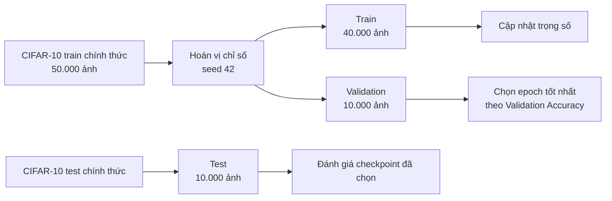
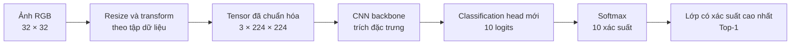
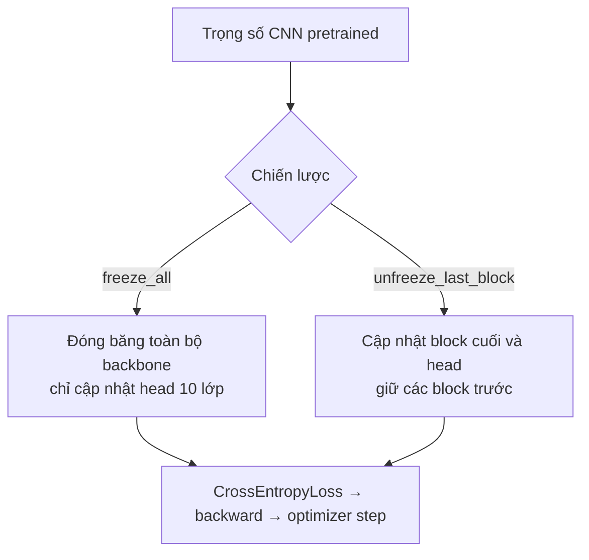

# Model và luồng xử lý ảnh trong Lab 2

Tài liệu này giải thích cách Lab 2 dùng mô hình CNN đã được huấn luyện trước để phân loại 10 lớp CIFAR-10. Phần mô tả phản ánh mã hiện tại và tám lần chạy đã lưu. [Mã dựng model](../src/model_factory.py) · [Bảng thực nghiệm](../outputs/experiment_summary.csv)

## 1. Bài toán và dữ liệu

Mỗi ảnh CIFAR-10 gốc có ba kênh màu RGB, kích thước 32 × 32 pixel. Model trả về một trong mười lớp: airplane, automobile, bird, cat, deer, dog, frog, horse, ship và truck. Từ 50.000 ảnh train chính thức, seed 42 chia 40.000 ảnh để huấn luyện và 10.000 ảnh để chọn checkpoint. 10.000 ảnh test chính thức được dùng để đánh giá sau huấn luyện. [Pipeline dữ liệu](../src/dataset.py) · [Notebook EDA](../notebooks/01_cifar10_eda.ipynb)

Train và Validation dùng hai đối tượng dataset với transform riêng. Chúng cùng đọc nguồn 50.000 ảnh nhưng lấy các chỉ số rời nhau. Validation và Test không dùng phép crop hoặc lật ảnh ngẫu nhiên.

## 2. Một ảnh đi qua model như thế nào?

### Chuẩn bị ảnh

| Bước | Train | Validation và Test |
|---|---|---|
| Kích thước | Resize 256 × 256, crop ngẫu nhiên 224 × 224 | Resize thẳng 224 × 224 |
| Biến đổi ngẫu nhiên | Lật ngang với xác suất 0,5 | Không có |
| Tensor | Đổi ảnh RGB sang tensor dạng `[3, 224, 224]` | Tương tự |
| Chuẩn hóa | Mean `[0.485, 0.456, 0.406]`, std `[0.229, 0.224, 0.225]` | Cùng hằng số |

Giá trị pixel được đổi về thang 0–1 bởi `ToTensor`, sau đó mỗi kênh được chuẩn hóa theo công thức `(giá trị − mean) / std`. Đây là các hằng số ImageNet dùng cùng trọng số pretrained. [Transform trong mã](../src/dataset.py) · [Ảnh so sánh transform](../outputs/eda/transform_comparison.png)

Backbone tạo biểu diễn đặc trưng từ ảnh. Classification head biến biểu diễn đó thành 10 điểm số, gọi là *logits*. Softmax chuyển logits thành 10 xác suất có tổng bằng 1. Model lấy lớp có xác suất cao nhất làm dự đoán, đồng thời lưu Top-3 và xác suất của cả 10 lớp trong `predictions.csv`. Xác suất cao thể hiện độ tự tin của model đối với dự đoán, không tự chứng minh dự đoán đúng. [Evaluator](../src/evaluate.py) · [Predictions EXP_02](../outputs/experiments/resnet18_unfreeze_last_block_20261121_115234_018455_f40df826/predictions.csv)

## 3. Bốn kiến trúc được dùng

Lab 2 hỗ trợ ResNet-18, ResNet-50, VGG-16 BN và DenseNet-121 từ `torchvision.models`. Cả bốn bắt đầu với trọng số pretrained mặc định. Mã thay classification head gốc bằng lớp tuyến tính có 10 đầu ra cho CIFAR-10. Với ResNet, head là `fc`. Với VGG-16 BN, đó là `classifier[6]`. Với DenseNet-121, đó là `classifier`. [Model factory](../src/model_factory.py)

| Kiến trúc | Ý tưởng nhận diện | Head được thay |
|---|---|---|
| ResNet-18, ResNet-50 | Các kết nối tắt giúp truyền thông tin qua nhiều tầng | `fc` |
| VGG-16 BN | Nhiều tầng tích chập xếp tuần tự, có BatchNorm | `classifier[6]` |
| DenseNet-121 | Các tầng nhận đặc trưng từ nhiều tầng trước | `classifier` |

Tên kiến trúc chỉ mô tả cách tổ chức các tầng. Kết quả trong Lab 2 phụ thuộc đồng thời vào chiến lược huấn luyện và cấu hình thực nghiệm. Không suy ra một kiến trúc luôn tốt hơn từ một lần chạy.

## 4. Hai cách huấn luyện trong Lab 2

**`freeze_all`** đóng băng mọi tham số pretrained, sau đó thay head. Optimizer chỉ nhận các tham số của head mới. Đây là cách dùng CNN pretrained như bộ trích đặc trưng.

**`unfreeze_last_block`** mở thêm block cuối. Với ResNet, đó là `layer4`. Với VGG-16 BN, đó là `features[34:]`. Với DenseNet-121, đó là `denseblock4` và `norm5`. Các tầng phía trước vẫn đóng băng. Trong các thực nghiệm chính, chiến lược này dùng learning rate 0,0001, còn `freeze_all` dùng 0,001. Vì chiến lược và learning rate đổi cùng lúc, mức tăng accuracy phản ánh hiệu ứng kết hợp. [Model factory](../src/model_factory.py) · [Cấu hình tám lần chạy](../scripts/run_experiments.py)

Trong mỗi batch Train, model tính logits, CrossEntropyLoss so với nhãn thật, lan truyền gradient rồi optimizer cập nhật tham số được mở. Lab dùng AdamW hoặc SGD có momentum. AMP được dùng khi CUDA khả dụng, nhằm tính toán bằng mixed precision. BatchNorm thuộc phần backbone bị đóng băng giữ thống kê chạy ở chế độ đánh giá. [Trainer](../src/trainer.py) · [Entry point](../main.py)

Sau mỗi epoch, model chạy Validation ở chế độ `eval()` với `torch.no_grad()`. Nếu Validation Accuracy cao hơn các epoch trước, trainer lưu checkpoint tốt nhất. Sau khi hoàn tất, `main.py` nạp checkpoint đó để đánh giá Test và xuất báo cáo. [Trainer](../src/trainer.py) · [Entry point](../main.py)

## 5. Kết quả có thể dùng khi giải thích

| Run | Model và chiến lược | Trainable parameters | Best Validation | Test | Thời gian trung bình/epoch |
|---|---|---:|---:|---:|---:|
| EXP_01 | ResNet-18, `freeze_all` | 5.130 | 87,91% | 87,17% | 110,9 giây |
| EXP_02 | ResNet-18, `unfreeze_last_block` | 8.398.858 | **94,35%** | 93,63% | 152,1 giây |
| EXP_06 | DenseNet-121, `unfreeze_last_block` | 2.170.378 | 94,23% | **93,86%** | 183,4 giây |

EXP_02 được chọn theo Validation Accuracy cao nhất, tại epoch 13. Test Accuracy của EXP_06 cao hơn 0,23 điểm phần trăm, nhưng kết quả Test không được dùng để đổi checkpoint đã chọn. Mỗi cấu hình chỉ chạy với một seed. [Bảng đầy đủ](../outputs/experiment_summary.csv) · [Đường cong EXP_02](../outputs/experiments/resnet18_unfreeze_last_block_20261121_115234_018455_f40df826/training_history.png)

Trên EXP_02, Train Accuracy cuối cùng đạt 99,25% trong khi Validation Accuracy cuối là 93,65%. Validation Loss tăng về cuối quá trình. Đây là dấu hiệu overfitting ở các epoch cuối và là lý do cần chọn checkpoint theo Validation thay vì mặc định lấy epoch 15. Do Train có augmentation và Validation dùng transform cố định, khoảng cách accuracy giữa hai tập cần được đọc cùng đường cong loss. [Report EXP_02](../outputs/experiments/resnet18_unfreeze_last_block_20261121_115234_018455_f40df826/report.json)

## 6. Đánh giá một dự đoán đúng hoặc sai

Notebook đánh giá chạy checkpoint đã chọn trên toàn bộ 10.000 ảnh Test, tính loss, accuracy, precision, recall, F1 và confusion matrix. Nó nhóm ví dụ theo đúng/sai và confidence cao/thấp, sau đó trình bày ảnh gốc, nhãn thật, nhãn dự đoán, Top-3 và Grad-CAM. [Notebook đánh giá](../notebooks/02_model_evaluation.ipynb) · [Ma trận nhầm lẫn](../outputs/model_analysis/best_resnet18_unfreeze_last_block_20261121_115234_018455_f40df826/confusion_matrices.png)

Grad-CAM làm nổi bật vùng ảnh có liên quan đến điểm của lớp đang xem. Có thể so vùng sáng với vật thể, các lớp cạnh tranh và sự thay đổi xác suất sau khi che vùng nổi bật. Heatmap là bằng chứng về độ nhạy của model trên ảnh cụ thể, chưa xác định chắc chắn nguyên nhân của mọi quyết định. Trong EXP_02, cặp `cat → dog` có 89 lỗi và `dog → cat` có 44 lỗi, tổng cộng 133 trong 637 dự đoán sai. [Phân tích nghiệm thu](final_acceptance.md) · [Ví dụ Grad-CAM](../outputs/model_analysis/best_resnet18_unfreeze_last_block_20261121_115234_018455_f40df826/gradcam_4208.png)

## 7. Đường dẫn để demo

1. Mở [EDA](../notebooks/01_cifar10_eda.ipynb) và chỉ ra một ảnh trước/sau transform.
2. Mở [đường cong huấn luyện EXP_02](../outputs/experiments/resnet18_unfreeze_last_block_20261121_115234_018455_f40df826/training_history.png) để giải thích lựa chọn epoch 13.
3. Mở [notebook đánh giá](../notebooks/02_model_evaluation.ipynb), xem confusion matrix, một ví dụ đúng và một ví dụ sai có Grad-CAM.
4. Mở [report JSON](../outputs/experiments/resnet18_unfreeze_last_block_20261121_115234_018455_f40df826/report.json) hoặc [predictions CSV](../outputs/experiments/resnet18_unfreeze_last_block_20261121_115234_018455_f40df826/predictions.csv) để truy ngược số liệu tới từng ảnh.

Chạy lại `main.py` với 15 epoch tạo một thí nghiệm mới và mất thời gian đáng kể. Khi demo trực tiếp, có thể trình bày artifact đã hoàn tất, giải thích lệnh chạy chính thức và mở notebook đánh giá trên checkpoint đã lưu.
