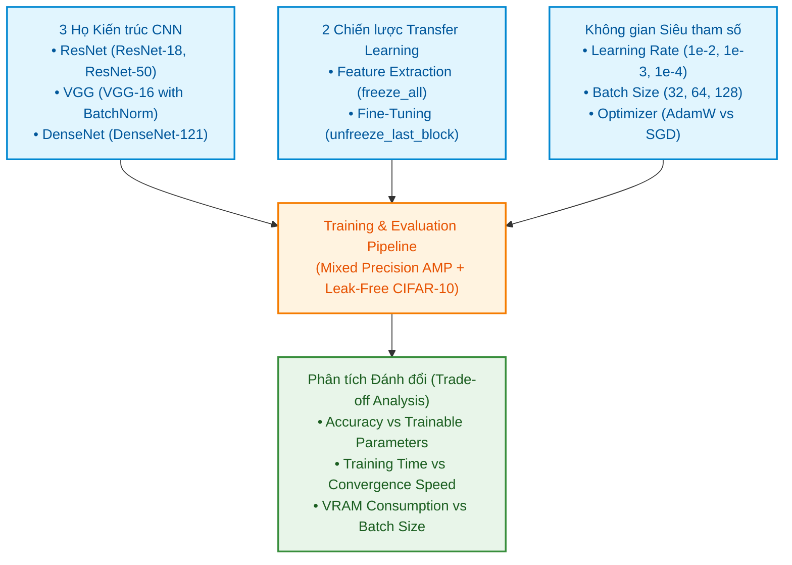
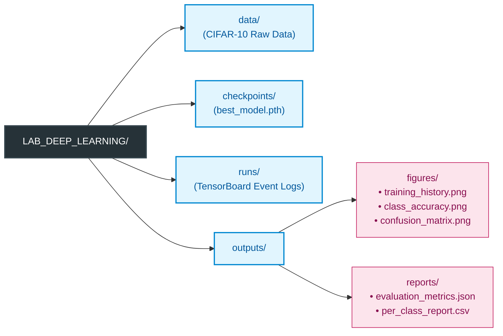

# Project Description: PyTorch Pre-trained CNN Benchmark & Fine-Tuning Pipeline

## 1. Project Name

**PyTorch Pre-trained CNN Benchmark & Fine-Tuning Pipeline**
*(Hệ thống Thực nghiệm và Đánh giá Kiến trúc Mạng Nơ-ron Tiền huấn luyện trên PyTorch)*

---

## 2. Problem Statement

### 2.1. Bài toán Tổng quan
Thực hiện bài toán phân loại ảnh đa lớp (Multi-class Image Classification) trên bộ dữ liệu tiêu chuẩn CIFAR-10.
- Tổng số mẫu: 60,000 ảnh màu RGB kích thước 32x32 pixel thuộc 10 lớp đối tượng (`airplane`, `automobile`, `bird`, `cat`, `deer`, `dog`, `frog`, `horse`, `ship`, `truck`).
- Phân chia dữ liệu độc lập:
  - Tập Huấn luyện (Train set): 40,000 ảnh.
  - Tập Kiểm định (Validation set): 10,000 ảnh (tách độc lập từ 50,000 ảnh gốc, không sử dụng để tính gradient).
  - Tập Kiểm thử (Test set): 10,000 ảnh (chuẩn hóa độc lập, chỉ đánh giá duy nhất một lần sau khi hoàn tất huấn luyện).

### 2.2. Vấn đề Cốt lõi (Core Problem)
Thiết lập một pipeline thực nghiệm chuẩn hóa, mang tính hệ thống để khảo sát sự đánh đổi (trade-off) giữa:
- Tốc độ hội tụ (Convergence Speed).
- Chi phí tài nguyên tính toán (Computational Cost): Tổng tham số mô hình, số tham số cần huấn luyện (trainable parameters), bộ nhớ VRAM tiêu thụ, và thời gian huấn luyện trên mỗi epoch.
- Độ chính xác phân loại (Top-1 Accuracy và Per-class Accuracy).



Thực nghiệm được thiết kế để so sánh 3 họ kiến trúc Convolutional Neural Network (CNN) tiền huấn luyện trên ImageNet-1K:
1. Residual Networks (ResNet): ResNet-18, ResNet-50.
2. Visual Geometry Group (VGG): VGG-16 với Batch Normalization (`vgg16_bn`).
3. Densely Connected Convolutional Networks (DenseNet): DenseNet-121.

Khảo sát dưới 2 chiến lược chuyển giao tri thức (Transfer Learning Strategies):
- **Feature Extraction (`freeze_all`)**: Đóng băng toàn bộ các tầng trích xuất đặc trưng (backbone convolutional layers), chỉ khởi tạo lại và huấn luyện duy nhất tầng phân loại cuối (Classification Head).
- **Fine-Tuning (`unfreeze_last_block`)**: Đóng băng các khối tầng đầu, mở khóa có chọn lọc khối tích chập cuối cùng (ví dụ: `layer4` của ResNet, khối dense/transition cuối của DenseNet, hoặc các tầng conv cuối của VGG) kết hợp cùng tầng phân loại mới để tinh chỉnh trọng số phù hợp với tập dữ liệu đích.

Đồng thời, hệ thống đánh giá tác động đa chiều khi biến thiên các siêu tham số: Learning Rate ($10^{-2}, 10^{-3}, 10^{-4}$), Batch Size (32, 64, 128), Optimizer (SGD with Momentum vs. AdamW), và số lượng Epochs.

---

## 3. Target User

- Sinh viên ngành Khoa học Dữ liệu, Trí tuệ Nhân tạo và Kỹ sư Machine Learning / Deep Learning cần một bộ khung (framework / template) thực nghiệm Transfer Learning tiêu chuẩn công nghiệp.
- Đặc tính cốt lõi đáp ứng cho người dùng:
  - **Tính tái lập cao (High Reproducibility)**: Cố định seed ngẫu nhiên cho PyTorch, CuDNN, NumPy và Python built-in random.
  - **Mã nguồn sạch và hướng mô-đun (Clean, Modular Codebase)**: Tách biệt rõ ràng giữa Data Loader, Model Factory, Trainer, Evaluator và Visualizer.
  - **Tương tác linh hoạt qua Dòng lệnh (CLI Driven)**: Cho phép cấu hình mọi thực nghiệm mà không cần sửa trực tiếp mã nguồn.

---

## 4. Input & Output Specification

### 4.1. Input Specification
1. **Dataset**: CIFAR-10 tự động tải xuống và lưu trữ tại thư mục `data/` thông qua `torchvision.datasets.CIFAR10`.
2. **CLI Parameters**:
   - `--model`: Kiến trúc mô hình (`resnet18`, `resnet50`, `vgg16_bn`, `densenet121`). Mặc định: `resnet18`.
   - `--strategy`: Chiến lược học chuyển giao (`freeze_all`, `unfreeze_last_block`). Mặc định: `freeze_all`.
   - `--lr`: Tốc độ học ban đầu (Learning Rate). Mặc định: `1e-3`.
   - `--batch-size`: Kích thước mini-batch (tự động thích ứng với phần cứng). Mặc định: `64`.
   - `--epochs`: Số lượng chu kỳ huấn luyện. Mặc định: `15`.
   - `--optimizer`: Thuật toán tối ưu (`adamw`, `sgd`). Mặc định: `adamw`.
   - `--weight-decay`: Hệ số điều hòa L2. Mặc định: `1e-4`.
   - `--num-workers`: Số lượng luồng đọc dữ liệu song song của DataLoader. Mặc định: `4` (trên Linux).
   - `--subset-ratio`: Tỷ lệ tập dữ liệu sử dụng để chạy thử nghiệm nhanh (0.0 < ratio <= 1.0). Mặc định: `1.0`.
   - `--dry-run`: Cờ kiểm thử nhanh (chạy 1 epoch trên tập dữ liệu nhỏ) để xác thực pipeline trước khi huấn luyện quy mô lớn.
   - `--seed`: Giá trị hạt giống ngẫu nhiên để tái lập kết quả. Mặc định: `42`.

### 4.2. Output Specification & Directory Layout
Cấu trúc thư mục lưu trữ đầu ra được phân bổ thông minh, tách biệt rõ ràng:



Chi tiết các tệp tin đầu ra:
- **Model Checkpoint** (`checkpoints/best_<model>_<strategy>.pth`): Chứa `model_state_dict`, `optimizer_state_dict`, `epoch`, `val_acc`, và cấu hình thực nghiệm.
- **TensorBoard Event Logs** (`runs/`): Ghi nhận scalar theo từng step và epoch: `Loss/train`, `Loss/val`, `Accuracy/train`, `Accuracy/val`, `Learning_Rate`.
- **Test Metrics Report**:
  - `outputs/reports/evaluation_metrics.json`: Overall Test Loss, Overall Test Accuracy, Inference Latency per Image, Tổng tham số và Trainable Parameters.
  - `outputs/reports/per_class_report.csv`: Precision, Recall, F1-Score và Accuracy cho từng lớp trong 10 lớp đối tượng.
- **Figures (300 DPI PNG)**:
  - `training_history.png`: Biểu đồ 2 cột thể hiện đường cong Loss và Accuracy giữa Train và Validation qua từng epoch.
  - `class_accuracy.png`: Biểu đồ cột so sánh độ chính xác giữa 10 lớp trên tập Test, đánh dấu ngưỡng độ chính xác trung bình.
  - `confusion_matrix.png`: Ma trận nhầm lẫn được chuẩn hóa (normalized heatmap) thể hiện tỷ lệ dự đoán đúng và các cặp lớp dễ bị nhầm lẫn.

---

## 5. Core Features

### 5.1. Model Architecture Inspection (Khám phá và Phân tích Kiến trúc)
- Tự động in cấu trúc toàn bộ mạng và trích xuất phân bổ tham số.
- Tính toán chính xác:
  - $N_{\text{total}}$: Tổng số lượng tham số của mô hình.
  - $N_{\text{trainable}}$: Số lượng tham số đang bật `requires_grad=True`.
  - $N_{\text{frozen}}$: Số lượng tham số bị đóng băng (`requires_grad=False`).
- Cung cấp bảng tổng hợp tham số trước và sau khi áp dụng chiến lược đóng băng/mở khóa.

### 5.2. Dynamic Model Adaptation (Biến đổi Tuyến tính và Thay thế Head)
- Sử dụng Torchvision Weights API hiện đại (`weights=...Weights.DEFAULT`, loại bỏ `pretrained=True`).
- Tích hợp cơ chế ánh xạ tự động đến Classification Head phù hợp với từng họ kiến trúc:
  - **Họ ResNet**: Thay thế lớp Fully Connected tuyến tính cuối:
    ```python
    in_features = model.fc.in_features
    model.fc = nn.Linear(in_features, num_classes=10)
    ```
  - **Họ VGG**: Thay thế lớp tuyến tính cuối trong bộ classifier (`.classifier[6]`):
    ```python
    in_features = model.classifier[6].in_features
    model.classifier[6] = nn.Linear(in_features, num_classes=10)
    ```
  - **Họ DenseNet**: Thay thế lớp phân loại tuyến tính (`.classifier`):
    ```python
    in_features = model.classifier.in_features
    model.classifier = nn.Linear(in_features, num_classes=10)
    ```

### 5.3. Flexible Weight Freezing Management (Quản lý Trọng số Linh hoạt)
- Chiến lược `freeze_all`:
  - Thiết lập `param.requires_grad = False` cho toàn bộ các tham số thuộc backbone.
  - Chỉ mở `requires_grad = True` cho Classification Head vừa được thay thế.
- Chiến lược `unfreeze_last_block`:
  - Đóng băng các khối tầng nhẹ ban đầu để bảo toàn đặc trưng tổng quát (cạnh, góc, vân hoa).
  - Mở khóa các tham số thuộc khối tích chập cuối cùng (`model.layer4` ở ResNet, các tầng conv cuối ở VGG-16, hoặc `model.features.denseblock4` và `model.features.norm5` ở DenseNet-121) cùng Classification Head.
- **Bộ lọc Optimizer chuẩn xác**: Chỉ đưa các tham số có `requires_grad=True` vào Optimizer để tiết kiệm bộ nhớ optimizer state và tránh tính toán gradient dư thừa:
  ```python
  trainable_params = filter(lambda p: p.requires_grad, model.parameters())
  optimizer = optim.AdamW(trainable_params, lr=args.lr, weight_decay=args.weight_decay)
  ```

### 5.4. Leak-free Data Pipeline (Xử lý Dữ liệu Chuẩn xác và Chống Rò rỉ)
- Sử dụng giá trị trung bình và độ lệch chuẩn chuẩn hóa của tập dữ liệu ImageNet:
  - Mean: `[0.485, 0.456, 0.406]`
  - Standard Deviation: `[0.229, 0.224, 0.225]`
- Đảm bảo tính chất không rò rỉ dữ liệu (Data Leakage Prevention):
  - Tạo 2 đối tượng Dataset độc lập từ `torchvision.datasets.CIFAR10`: Một đối tượng gắn tập biến đổi huấn luyện (`train_transforms`), một đối tượng gắn tập biến đổi đánh giá (`eval_transforms`).
  - Chia tập Train/Validation thông qua phân tách chỉ số ngẫu nhiên cố định seed (`torch.utils.data.Subset`), giúp tập Validation hoàn toàn không bị ảnh hưởng bởi các phép biến đổi ngẫu nhiên (Data Augmentation).
- Phép biến đổi:
  - Train: `Resize((256, 256))` -> `RandomCrop((224, 224))` -> `RandomHorizontalFlip(p=0.5)` -> `ToTensor()` -> `Normalize(mean, std)`.
  - Validation/Test: `Resize((224, 224))` -> `ToTensor()` -> `Normalize(mean, std)`.

### 5.5. Comprehensive Monitoring & Diagnostics (Giám sát và Chẩn đoán Toàn diện)
- Theo dõi thời gian thực trên TensorBoard (`SummaryWriter`).
- Tính toán thời gian thực thi trung bình mỗi epoch và throughput (samples/second).
- Tính toán ma trận nhầm lẫn đầy đủ (10x10) trên tập Test và phân tích các cặp nhãn dễ gây lỗi (ví dụ: cat vs. dog, automobile vs. truck).

---

## 6. Technology Stack & Hardware Probing

### 6.1. Technology Stack
- **Ngôn ngữ lập trình**: Python 3.10+
- **Deep Learning Framework**: PyTorch (>= 2.0), Torchvision (>= 0.15) với modern Weights API.
- **Xử lý Số học và Đánh giá**: NumPy, Scikit-learn (tính confusion matrix, classification report).
- **Trực quan hóa và Đồ họa**: Matplotlib (>= 3.7), Seaborn (>= 0.12), TensorBoard.
- **Tiện ích Tiến trình**: tqdm.

### 6.2. Thông số Phần cứng Thực tế (Actual Hardware Probing Results)
Kết quả kiểm tra trực tiếp từ hệ thống thực thi:
- **Hệ điều hành**: Ubuntu Linux x86_64
- **CPU**: 13th Gen Intel(R) Core(TM) i7-13620H (10 physical cores: 6 Performance-cores + 4 Efficient-cores, 16 logic threads)
- **Bộ nhớ RAM Hệ thống**: 14.82 GB (~16 GB)
- **GPU Chuyên dụng**: NVIDIA GeForce RTX 3050 Laptop GPU
  - Dung lượng VRAM: 6,144 MiB (6.0 GB VRAM)
  - Driver Version: 595.99.02
  - Hỗ trợ CUDA Runtime: 12.x / 13.x

### 6.3. Cấu hình Đề xuất Tối ưu theo Phần cứng (Hardware-Tailored Defaults)
Dựa trên thông số 6GB VRAM và CPU 16 threads, hệ thống thiết lập các thông số mặc định tối ưu như sau:

| Thông số | Chế độ CUDA GPU (RTX 3050 6GB) | Chế độ CPU Fallback | Giải thích kỹ thuật |
| :--- | :--- | :--- | :--- |
| **Thiết bị (`--device`)** | `cuda:0` | `cpu` | Tự động nhận diện thông qua `torch.cuda.is_available()`. |
| **Batch Size (`--batch-size`)** | `64` | `32` | 64 là mức an toàn cao trên 6GB VRAM khi ảnh được upscale lên 224x224 (tránh lỗi CUDA Out Of Memory đối với VGG-16 và DenseNet-121). Với ResNet-18 có thể tăng lên 128. |
| **Num Workers (`--num-workers`)** | `4` | `2` | Khai thác đa luồng của CPU i7-13620H (16 threads) để đọc dữ liệu, đồng thời tránh overhead do IPC giữa các worker. |
| **Pin Memory (`--pin-memory`)** | `True` | `False` | Khóa trang bộ nhớ máy chủ giúp tăng tốc độ truyền dữ liệu từ RAM lên VRAM qua PCIe. |
| **Mixed Precision (`--amp`)** | Khuyến nghị bật (`fp16`) | `False` | Sử dụng `torch.amp.autocast('cuda')` để tiết kiệm 40% VRAM và tăng tốc độ tính toán trên Tensor Cores của kiến trúc Ampere. |
| **Danh sách Model hỗ trợ** | `resnet18`, `resnet50`, `vgg16_bn`, `densenet121` | `resnet18` | Trên CPU khuyến nghị sử dụng kiến trúc nhẹ (`resnet18`) kết hợp cờ `--subset-ratio 0.1` để kiểm thử nhanh. |

---

## 7. Evaluation Metrics & Experimental Protocol

### 7.1. Tập Chỉ số Đánh giá (Evaluation Metrics)
1. **Cross-Entropy Loss**:
   $$L = -\frac{1}{N} \sum_{i=1}^{N} \log \left(\frac{e^{z_{i, y_i}}}{\sum_{j=1}^{C} e^{z_{i, j}}}\right)$$
   Ghi nhận sau mỗi epoch trên cả tập Train và tập Validation.
2. **Top-1 Overall Accuracy (%)**:
   $$\text{Accuracy} = \frac{\sum_{c=1}^{C} \text{TP}_c}{N_{\text{total}}} \times 100\%$$
3. **Per-class Accuracy, Precision, Recall, F1-Score**:
   $$\text{Accuracy}_c = \frac{\text{TP}_c}{\text{TP}_c + \text{FN}_c} \times 100\%$$
   Thể hiện năng lực nhận diện riêng biệt trên từng lớp đối tượng.
4. **Normalized Confusion Matrix**:
   $$M_{i, j} = \frac{C_{i, j}}{\sum_{k} C_{i, k}}$$
   Biểu thị xác suất mẫu thuộc lớp thực tế $i$ được dự đoán là lớp $j$.
5. **Efficiency & Computational Overhead**:
   - Thời gian huấn luyện mỗi epoch ($t_{\text{epoch}}$, tính bằng giây).
   - Thời gian suy diễn trung bình mỗi ảnh trên tập Test ($t_{\text{inf}}$, tính bằng miligiây).
   - Số lượng tham số huấn luyện và kích thước checkpoint (.pth) trên ổ đĩa.

### 7.2. Quy trình Thực nghiệm Chuẩn (Standard Experimental Protocol)
1. **Khởi tạo và Tái lập (Initialization & Seeding)**:
   - Thiết lập seed cố định: `torch.manual_seed(42)`, `np.random.seed(42)`, `torch.backends.cudnn.deterministic = True`.
2. **Nạp và Biến đổi Mô hình (Model Loading & Adaptation)**:
   - Sử dụng trọng số mặc định hiện đại từ Torchvision (ví dụ: `models.ResNet18_Weights.DEFAULT`).
   - Áp dụng cơ chế đóng băng theo tham số `--strategy`.
   - Thay thế lớp phân loại cuối sang 10 lớp đầu ra.
3. **Vòng lặp Huấn luyện và Kiểm định (Train/Val Loop)**:
   - Mỗi epoch thực hiện huấn luyện trên 40,000 ảnh Train.
   - Đánh giá ngay lập tức trên 10,000 ảnh Validation.
   - Ghi nhật ký vào TensorBoard.
4. **Chọn lựa Checkpoint Tốt nhất (Model Checkpointing)**:
   - Theo dõi Validation Accuracy. Chỉ lưu đè trọng số vào `checkpoints/best_<model>_<strategy>.pth` khi Validation Accuracy đạt kỷ lục mới (Early-saving policy).
5. **Đánh giá Cuối cùng trên Tập Kiểm thử Độc lập (Final Independent Testing)**:
   - Tải lại checkpoint tốt nhất đã lưu.
   - Thực hiện suy diễn trên 10,000 ảnh Test chưa từng xuất hiện trong quá trình huấn luyện hoặc chọn mô hình.
   - Xuất toàn bộ báo cáo (JSON, CSV) và 3 biểu đồ chuẩn xuất bản (300 DPI) vào thư mục `outputs/`.
