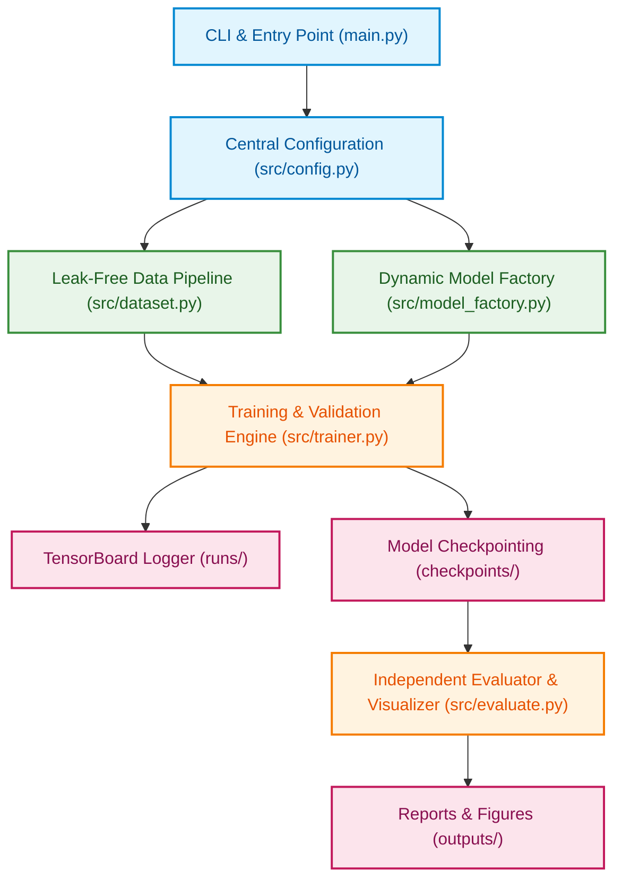
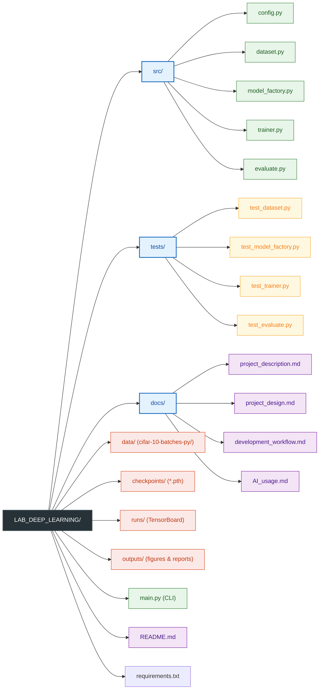
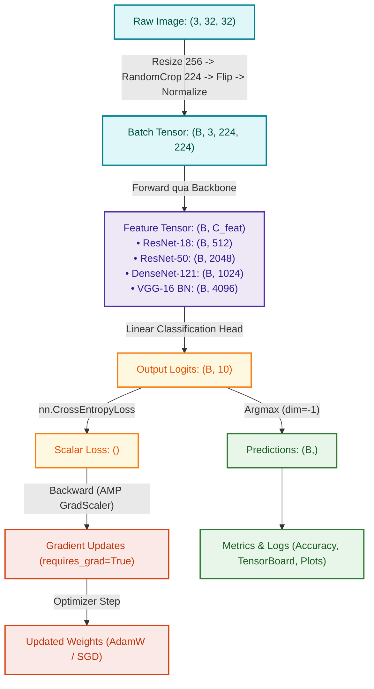
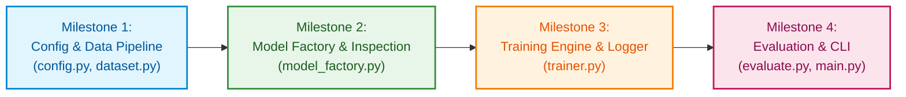

# Project Design: PyTorch Pre-trained CNN Benchmark & Fine-Tuning Pipeline

## 1. System Architecture

Hệ thống được thiết kế theo mô hình Modular và Clean Architecture, tối ưu hóa cho quy trình thực nghiệm Deep Learning. Các thành phần tương tác một chiều, phân tách rõ ràng giữa quản lý cấu hình, nạp dữ liệu, tạo dựng mô hình, động cơ huấn luyện và đánh giá trực quan.

### 1.1. Sơ đồ Kiến trúc Tổng quan



### 1.2. Nguyên tắc Tương tác giữa các Thành phần
- **Đơn hướng (One-way Dependency)**: Các module cấp thấp không phụ thuộc ngược vào module cấp cao. `main.py` điều phối toàn bộ luồng công việc thông qua các interface chuẩn.
- **Tách biệt Trạng thái (Stateless Factories)**: `dataset.py` và `model_factory.py` hoạt động như các hàm khởi tạo độc lập, không lưu trữ trạng thái huấn luyện toàn cục.
- **Quản lý Tập trung (Single Source of Truth)**: Mọi tham số mặc định, siêu tham số phần cứng và đường dẫn đều do `config.py` quản lý.

---

## 2. Module Breakdown

Hệ thống bao gồm 6 module chính được tổ chức gọn gàng trong thư mục `src/` và file thực thi `main.py` tại thư mục gốc:

### 2.1. `src/config.py` (Central Configuration & Environment Probing)
- **Nhiệm vụ**: Quản lý tập trung toàn bộ hằng số, đường dẫn thư mục và tự động phát hiện phần cứng.
- **Nội dung chi tiết**:
  - Hằng số ImageNet: `IMAGENET_MEAN = [0.485, 0.456, 0.406]`, `IMAGENET_STD = [0.229, 0.224, 0.225]`.
  - Danh sách 10 lớp CIFAR-10 theo thứ tự chuẩn: `['airplane', 'automobile', 'bird', 'cat', 'deer', 'dog', 'frog', 'horse', 'ship', 'truck']`.
  - Đường dẫn tuyệt đối/tương đối đến các thư mục làm việc: `data/`, `checkpoints/`, `runs/`, `outputs/figures/`, `outputs/reports/`.
  - Hàm `get_device()`: Tự động phát hiện `cuda` (ưu tiên số 1), `mps` (trên macOS), hoặc `cpu` (fallback).
  - Tích hợp thông số đo lường phần cứng thực tế: Cài đặt giá trị mặc định `batch_size=64`, `num_workers=4`, `pin_memory=True` khi phát hiện GPU NVIDIA (RTX 3050 6GB) và CPU đa lõi.

### 2.2. `src/dataset.py` (Leak-Free Data Pipeline)
- **Nhiệm vụ**: Tải xuống tập dữ liệu CIFAR-10, áp dụng phép biến đổi hình ảnh chuẩn và tạo các `DataLoader` riêng biệt cho Train, Validation, Test.
- **Chi tiết xử lý**:
  - `train_transform`: `Resize((256, 256))` -> `RandomCrop((224, 224))` -> `RandomHorizontalFlip(p=0.5)` -> `ToTensor()` -> `Normalize(mean, std)`.
  - `eval_transform`: `Resize((224, 224))` -> `ToTensor()` -> `Normalize(mean, std)`.
  - Cơ chế chống rò rỉ dữ liệu (Leak-free Protocol): Khởi tạo 2 đối tượng `CIFAR10(root, train=True)` riêng biệt gắn với 2 bộ transform tương ứng. Sử dụng chỉ số ngẫu nhiên cố định `torch.randperm` (seed=42) để cắt 40,000 mẫu Train và 10,000 mẫu Validation. Tập Test (10,000 mẫu) lấy từ `CIFAR10(root, train=False)`.
  - Hỗ trợ tham số `subset_ratio` (0.0 < ratio <= 1.0) và cờ `dry_run` để cắt nhanh tập mẫu phục vụ kiểm thử hệ thống.

### 2.3. `src/model_factory.py` (Dynamic Model Factory & Inspection)
- **Nhiệm vụ**: Khởi tạo mô hình pre-trained, phân tích cấu trúc tham số, thay thế classification head và quản lý chiến lược đóng băng trọng số.
- **Chi tiết xử lý**:
  - Tích hợp Torchvision Modern Weights API: Sử dụng `ResNet18_Weights.DEFAULT`, `ResNet50_Weights.DEFAULT`, `VGG16_BN_Weights.DEFAULT`, `DenseNet121_Weights.DEFAULT`.
  - Hàm `count_parameters(model)` và `inspect_model(model)`: Tính toán và in bảng thống kê Total Parameters, Trainable Parameters, Frozen Parameters và tỷ lệ phần trăm tham số được huấn luyện.
  - Thay thế Classification Head động (Dynamic Head Replacement):
    - ResNet: Thay `model.fc` thành `nn.Linear(in_features, 10)`.
    - VGG: Thay `model.classifier[6]` thành `nn.Linear(in_features, 10)`.
    - DenseNet: Thay `model.classifier` thành `nn.Linear(in_features, 10)`.
  - Chiến lược đóng băng (Freezing Strategies):
    - `freeze_all`: Đóng băng toàn bộ backbone (`requires_grad = False`), chỉ mở khóa classification head mới.
    - `unfreeze_last_block`: Mở khóa thêm `model.layer4` (ResNet), các tầng convolution cuối (VGG), hoặc `model.features.denseblock4` và `norm5` (DenseNet).

### 2.4. `src/trainer.py` (Training Engine & TensorBoard Logger)
- **Nhiệm vụ**: Điều phối quá trình huấn luyện và kiểm định mô hình theo từng epoch.
- **Chi tiết xử lý**:
  - Tích hợp Automatic Mixed Precision (`torch.amp.autocast('cuda')`) và `GradScaler` giúp tiết kiệm bộ nhớ VRAM và tăng tốc độ tính toán trên GPU.
  - Ghi nhận nhật ký vào TensorBoard qua `SummaryWriter`: theo dõi `Loss/train`, `Loss/val`, `Accuracy/train`, `Accuracy/val`, và `Learning_Rate` theo từng epoch.
  - Theo dõi thời gian huấn luyện trên từng epoch ($t_{\text{epoch}}$) và tốc độ xử lý mẫu (samples/sec).
  - Tự động lưu checkpoint tốt nhất (`checkpoints/best_<experiment_name>.pth`) dựa trên chỉ số Validation Accuracy cao nhất.

### 2.5. `src/evaluate.py` (Evaluator & Visualization Engine)
- **Nhiệm vụ**: Nạp checkpoint tốt nhất để đánh giá độc lập trên 10,000 ảnh Test; xuất báo cáo và biểu đồ đánh giá chất lượng cao.
- **Chi tiết xử lý**:
  - Tính toán Top-1 Overall Test Accuracy và Per-class Accuracy cho cả 10 lớp đối tượng.
  - In bảng tổng hợp Per-class Precision, Recall, F1-Score ra màn hình console.
  - Tính toán và xuất 3 biểu đồ chuẩn xuất bản 300 DPI tại `outputs/figures/`:
    1. `training_history.png`: Biểu đồ kép (Dual Subplots) thể hiện đường cong Loss và Accuracy giữa Train và Val qua từng epoch.
    2. `class_accuracy.png`: Biểu đồ cột thể hiện độ chính xác của từng lớp trên tập Test, kèm đường ngưỡng độ chính xác trung bình.
    3. `confusion_matrix.png`: Heatmap ma trận nhầm lẫn được chuẩn hóa thể hiện rõ các cặp lớp bị phân loại sai.

### 2.6. `main.py` (CLI Interface & Pipeline Orchestrator)
- **Nhiệm vụ**: Điểm khởi chạy duy nhất của ứng dụng, phân tích các tham số dòng lệnh (qua `argparse`) và liên kết các module thực thi theo yêu cầu của người dùng mà không cần can thiệp vào mã nguồn.

---

## 3. Folder Structure

Cấu trúc phân cấp cây thư mục chuẩn của toàn bộ dự án:



---

## 4. Data Flow

Luồng biến đổi dữ liệu, kích thước Tensor (Tensor Shapes) tại từng chặng và luồng đạo hàm lan truyền ngược được thể hiện qua sơ đồ chi tiết:



### 4.1. Chi tiết Kích thước Tensor tại từng Chặng
1. **Raw Image**: Ảnh gốc CIFAR-10 có định dạng RGB, kích thước `(3, 32, 32)` với giá trị điểm ảnh kiểu `uint8` $[0, 255]$.
2. **Transform & Batch Collation**:
   - Ảnh được đưa về kích thước `(3, 224, 224)` phù hợp với tiêu chuẩn ImageNet pre-trained backbones và chuẩn hóa theo ImageNet mean/std.
   - Batch gồm $B$ ảnh ghép lại thành Tensor `(B, 3, 224, 224)` với kiểu dữ liệu `torch.float32`. Nhãn (Labels) là Tensor 1 chiều `(B,)` với kiểu `torch.int64`. Với GPU RTX 3050 6GB, kích thước mặc định $B = 64$.
3. **Backbone Feature Extraction**:
   - Khi đi qua các tầng Convolution của Backbone, ảnh được trích xuất thành Feature Map trước khi đưa qua Global Average Pooling (hoặc AdaptiveAvgPool2d).
   - Vector đặc trưng thu được sau khi duỗi thẳng (flatten):
     - ResNet-18: `(B, 512)`
     - ResNet-50: `(B, 2048)`
     - DenseNet-121: `(B, 1024)`
     - VGG-16 with BN: `(B, 4096)` (sau khi đi qua các tầng fully-connected đầu của classifier).
4. **Classification Head**:
   - Tuyến tính hóa về không gian 10 lớp qua phép nhân ma trận $W \cdot X + b$:
     $$\text{Logits} = (B, \text{in\_features}) \times (\text{in\_features}, 10) = (B, 10)$$
5. **Loss Computation & Backpropagation**:
   - Loss được tính thông qua `nn.CrossEntropyLoss`: kết quả là một Tensor vô hướng `()`.
   - Gradient chỉ được lan truyền ngược và tích lũy trên các tham số có `requires_grad=True`.

---

## 5. Interface Design (Function & Class Signatures)

Dưới đây là khai báo interface chuẩn với Type Hints và docstring đầy đủ cho các module lõi:

### 5.1. `src/dataset.py`

```python
from typing import Tuple
from torch.utils.data import DataLoader
from torchvision import transforms

def get_transforms() -> Tuple[transforms.Compose, transforms.Compose]:
    """Khởi tạo các phép biến đổi hình ảnh chuẩn cho Train và Validation/Test.
    
    Returns:
        Tuple gồm (train_transform, eval_transform).
    """
    ...

def get_cifar10_dataloaders(
    data_dir: str,
    batch_size: int = 64,
    num_workers: int = 4,
    subset_ratio: float = 1.0,
    dry_run: bool = False,
    seed: int = 42
) -> Tuple[DataLoader, DataLoader, DataLoader]:
    """Tải tập dữ liệu CIFAR-10 và phân chia thành Train (40k), Val (10k), Test (10k).
    
    Args:
        data_dir: Thư mục lưu trữ dữ liệu.
        batch_size: Kích thước mini-batch.
        num_workers: Số lượng tiến trình con đọc dữ liệu.
        subset_ratio: Tỷ lệ mẫu sử dụng (kiểm thử nhanh trên tập nhỏ).
        dry_run: Nếu True, chỉ lấy 100 mẫu mỗi tập để kiểm thử nhanh.
        seed: Giá trị hạt giống để đảm bảo tính tái lập khi chia tập train/val.
        
    Returns:
        Tuple gồm (train_loader, val_loader, test_loader).
    """
    ...
```

### 5.2. `src/model_factory.py`

```python
from typing import Dict, Any
import torch.nn as nn

def count_parameters(model: nn.Module) -> Dict[str, int]:
    """Đếm và thống kê số lượng tham số trong mô hình.
    
    Args:
        model: Mô hình PyTorch cần phân tích.
        
    Returns:
        Dictionary chứa 'total', 'trainable', và 'frozen' parameters.
    """
    ...

def inspect_model(model: nn.Module, model_name: str) -> None:
    """In cấu trúc phân tầng và bảng thống kê tham số của mô hình ra console.
    
    Args:
        model: Mô hình PyTorch cần in.
        model_name: Tên định danh của mô hình.
    """
    ...

def build_model(
    model_name: str = "resnet18",
    strategy: str = "freeze_all",
    num_classes: int = 10
) -> nn.Module:
    """Khởi tạo mô hình pre-trained, thay thế classification head và áp dụng chiến lược đóng băng.
    
    Args:
        model_name: Tên kiến trúc ('resnet18', 'resnet50', 'vgg16_bn', 'densenet121').
        strategy: Chiến lược đóng băng trọng số ('freeze_all', 'unfreeze_last_block').
        num_classes: Số lượng lớp đầu ra (mặc định 10 cho CIFAR-10).
        
    Returns:
        nn.Module đã được biến đổi và thiết lập requires_grad hợp lệ.
    """
    ...
```

### 5.3. `src/trainer.py`

```python
from typing import Dict, List, Tuple
import torch
import torch.nn as nn
from torch.utils.data import DataLoader
from torch.optim import Optimizer

class Trainer:
    """Lớp quản lý động cơ huấn luyện, kiểm định và ghi log TensorBoard."""
    
    def __init__(
        self,
        model: nn.Module,
        train_loader: DataLoader,
        val_loader: DataLoader,
        optimizer: Optimizer,
        criterion: nn.Module,
        device: torch.device,
        epochs: int = 15,
        checkpoint_dir: str = "checkpoints",
        log_dir: str = "runs",
        experiment_name: str = "exp",
        use_amp: bool = True
    ) -> None:
        """Khởi tạo Trainer với đầy đủ các thành phần cần thiết."""
        ...

    def train_one_epoch(self, epoch: int) -> Tuple[float, float]:
        """Thực thi huấn luyện trong 1 epoch.
        
        Args:
            epoch: Chỉ số epoch hiện tại.
            
        Returns:
            Tuple gồm (train_loss, train_accuracy).
        """
        ...

    def validate(self, epoch: int) -> Tuple[float, float]:
        """Thực thi kiểm định mô hình trên tập validation.
        
        Args:
            epoch: Chỉ số epoch hiện tại.
            
        Returns:
            Tuple gồm (val_loss, val_accuracy).
        """
        ...

    def fit(self) -> Dict[str, List[float]]:
        """Chạy toàn bộ quá trình huấn luyện và kiểm định qua tất cả các epoch.
        
        Returns:
            Dictionary lưu lịch sử gồm 'train_loss', 'val_loss', 'train_acc', 'val_acc'.
        """
        ...

    def save_checkpoint(self, epoch: int, val_acc: float, is_best: bool = False) -> str:
        """Lưu checkpoint trọng số mô hình xuống ổ đĩa.
        
        Args:
            epoch: Epoch hiện tại.
            val_acc: Độ chính xác validation đạt được.
            is_best: Cờ đánh dấu checkpoint có val_acc cao nhất.
            
        Returns:
            Đường dẫn đến file checkpoint đã lưu.
        """
        ...
```

### 5.4. `src/evaluate.py`

```python
from typing import Dict, Any, List
import numpy as np
import torch
import torch.nn as nn
from torch.utils.data import DataLoader

def evaluate_test_set(
    model: nn.Module,
    test_loader: DataLoader,
    criterion: nn.Module,
    device: torch.device,
    class_names: List[str]
) -> Dict[str, Any]:
    """Đánh giá toàn diện mô hình trên tập Test độc lập.
    
    Returns:
        Dict chứa 'test_loss', 'overall_acc', 'per_class_acc', và 'confusion_matrix'.
    """
    ...

def plot_training_history(history: Dict[str, List[float]], output_path: str) -> None:
    """Vẽ biểu đồ loss và accuracy giữa train và val theo từng epoch (300 DPI)."""
    ...

def plot_per_class_accuracy(per_class_acc: Dict[str, float], output_path: str) -> None:
    """Vẽ biểu đồ cột thể hiện độ chính xác của từng lớp trên tập Test (300 DPI)."""
    ...

def plot_confusion_matrix(cm: np.ndarray, class_names: List[str], output_path: str) -> None:
    """Vẽ heatmap ma trận nhầm lẫn chuẩn hóa trên tập Test (300 DPI)."""
    ...
```

---

## 6. Implementation Milestones

Quá trình hiện thực hóa hệ thống được chia thành 4 cột mốc tuần tự:



### Milestone 1: Config & Data Pipeline (`src/config.py`, `src/dataset.py`)
- **Mục tiêu**: Hoàn thiện module cấu hình và pipeline dữ liệu chống rò rỉ cho CIFAR-10.
- **DoD (Có thể kiểm chứng)**:
  - Chạy lệnh: `python3 -c "from src.dataset import get_cifar10_dataloaders; tr, va, te = get_cifar10_dataloaders('data', dry_run=True); b = next(iter(tr)); print(b[0].shape, len(tr.dataset), len(va.dataset), len(te.dataset))"`
  - Output đạt yêu cầu: In ra Tensor kích thước `torch.Size([64, 3, 224, 224])`, số mẫu đúng tỷ lệ 40,000 / 10,000 / 10,000 (hoặc mẫu dry_run). Không bị xung đột dependencies.

### Milestone 2: Model Factory & Parameter Inspection (`src/model_factory.py`)
- **Mục tiêu**: Hoàn thiện factory khởi tạo mô hình pre-trained, inspect tham số, thay thế classification head và logic đóng băng trọng số.
- **DoD (Có thể kiểm chứng)**:
  - Chạy lệnh: `python3 -c "from src.model_factory import build_model, count_parameters; m = build_model('resnet18', 'freeze_all'); c = count_parameters(m); assert c['trainable'] == 5130; print('Pass ResNet18 Freeze All:', c)"`
  - Output đạt yêu cầu: Chạy thành công với 4 kiến trúc (`resnet18`, `resnet50`, `vgg16_bn`, `densenet121`) trên cả 2 chiến lược `freeze_all` và `unfreeze_last_block`.

### Milestone 3: Training Engine & TensorBoard (`src/trainer.py`)
- **Mục tiêu**: Hoàn thiện lớp `Trainer`, tích hợp `GradScaler` (AMP), tính toán thời gian chạy mỗi epoch, tự động lưu checkpoint tốt nhất và ghi log vào TensorBoard.
- **DoD (Có thể kiểm chứng)**:
  - Chạy lệnh test nhanh: `python3 main.py --model resnet18 --epochs 1 --dry-run`
  - Output đạt yêu cầu: Chạy qua 1 epoch không lỗi, tạo thành công tệp `checkpoints/best_resnet18_freeze_all.pth` và tệp log TensorBoard trong `runs/`.

### Milestone 4: Evaluation, Visualization & CLI Complete (`src/evaluate.py`, `main.py`)
- **Mục tiêu**: Hoàn thiện đánh giá trên tập Test, tính ma trận nhầm lẫn, xuất 3 biểu đồ 300 DPI và hoàn tất giao diện dòng lệnh CLI đầy đủ.
- **DoD (Có thể kiểm chứng)**:
  - Chạy lệnh: `python3 main.py --model resnet18 --strategy freeze_all --epochs 2 --subset-ratio 0.05`
  - Output đạt yêu cầu: Huấn luyện xong, tự động đánh giá test set, in bảng Per-class Accuracy, và xuất đủ 3 file ảnh chất lượng cao: `outputs/figures/training_history.png`, `outputs/figures/class_accuracy.png`, `outputs/figures/confusion_matrix.png`.

---

## 7. Technical Risks & Mitigations

Dưới đây là 5 rủi ro kỹ thuật cốt lõi trong các bài toán Transfer Learning và các giải pháp phòng ngừa được tích hợp trực tiếp vào bản thiết kế:

### Rủi ro 1: Data Augmentation Leakage khi phân chia tập Train/Val
- **Nguyên nhân**: Nếu áp dụng Data Augmentation lên toàn bộ Dataset rồi dùng `random_split`, tập Validation sẽ bị ảnh hưởng bởi các phép biến đổi ngẫu nhiên (RandomCrop, Flip), làm sai lệch độ đo đánh giá thực tế.
- **Giải pháp thiết kế**: Khởi tạo 2 đối tượng `CIFAR10(root, train=True)` riêng biệt. Một đối tượng gắn với `train_transform`, đối tượng còn lại gắn với `eval_transform`. Sử dụng phép sinh hoán vị ngẫu nhiên cố định `torch.randperm(50000, generator=torch.Generator().manual_seed(42))` để tạo danh sách chỉ số (indices). Sau đó truyền các chỉ số này vào `torch.utils.data.Subset` để đảm bảo 2 tập hoàn toàn độc lập về cả dữ liệu lẫn phép biến đổi.

### Rủi ro 2: Truyền nhầm tham số đóng băng vào Optimizer hoặc sai lệch trạng thái BatchNorm
- **Nguyên nhân**: Khi đóng băng các tầng nhưng vẫn truyền toàn bộ `model.parameters()` vào Optimizer sẽ gây lãng phí bộ nhớ VRAM cho các biến trạng thái (như momentum, v của AdamW) và làm chậm tốc độ cập nhật trọng số. Ngoài ra, BatchNorm ở các tầng đóng băng có thể bị cập nhật running mean/var nếu quên chuyển trạng thái.
- **Giải pháp thiết kế**:
  - Khi khởi tạo Optimizer, chỉ truyền bộ lọc:
    ```python
    trainable_params = filter(lambda p: p.requires_grad, model.parameters())
    optimizer = optim.AdamW(trainable_params, lr=lr, weight_decay=weight_decay)
    ```
  - Trong chiến lược `freeze_all`, các tầng backbone luôn được giữ nguyên tính toán forward mà không lưu đồ thị đạo hàm.

### Rủi ro 3: Bất đồng bộ thuộc tính Classification Head giữa các họ kiến trúc
- **Nguyên nhân**: Mỗi kiến trúc CNN trong Torchvision sử dụng tên thuộc tính khác nhau cho tầng phân loại cuối (`.fc` trong ResNet, `.classifier[6]` trong VGG, `.classifier` trong DenseNet).
- **Giải pháp thiết kế**: Module `model_factory.py` sử dụng cấu trúc rẽ nhánh tường minh (`if/elif`) kèm cơ chế kiểm tra kiểu lớp (`isinstance`) và in lỗi rõ ràng nếu tên mô hình không nằm trong danh sách hỗ trợ.

### Rủi ro 4: Tràn bộ nhớ VRAM (CUDA OOM) hoặc quá tải RAM khi upscale ảnh lên 224x224
- **Nguyên nhân**: Ảnh CIFAR-10 gốc có kích thước 32x32. Khi phóng to lên 224x224, lượng bộ nhớ cho mỗi batch tăng khoảng 49 lần. Trên GPU RTX 3050 (6GB VRAM), nếu chọn batch size 128 hoặc 256 với model VGG-16 sẽ lập tức gây lỗi `CUDA out of memory`.
- **Giải pháp thiết kế**:
  - Phép resize được thực hiện on-the-fly trong DataLoader theo từng batch nhỏ thay vì phóng to toàn bộ dataset trên RAM.
  - Cài đặt `batch_size=64` làm giá trị mặc định tối ưu cho 6GB VRAM.
  - Kích hoạt `torch.amp.autocast('cuda')` (Mixed Precision FP16) để giảm 40% dung lượng VRAM.
  - Hỗ trợ tham số `--subset-ratio` và `--dry-run` để kiểm thử nhanh trên tài nguyên giới hạn.

### Rủi ro 5: Ghi đè file Checkpoint và xung đột Log TensorBoard khi chạy liên tiếp nhiều thực nghiệm
- **Nguyên nhân**: Nếu tất cả các lần chạy đều lưu vào `best_model.pth` hoặc ghi chung một thư mục `runs/`, các thực nghiệm so sánh giữa ResNet, VGG và DenseNet sẽ ghi đè lên nhau, làm mất dữ liệu thực nghiệm.
- **Giải pháp thiết kế**:
  - Định danh thực nghiệm được tạo tự động theo cú pháp chuẩn: `<model_name>_<strategy>_lr<lr>_bs<bs>_<timestamp>`.
  - Checkpoint được lưu rõ ràng thành: `checkpoints/best_<experiment_id>.pth`.
  - Thư mục log TensorBoard được tách riêng: `runs/<experiment_id>/`.
