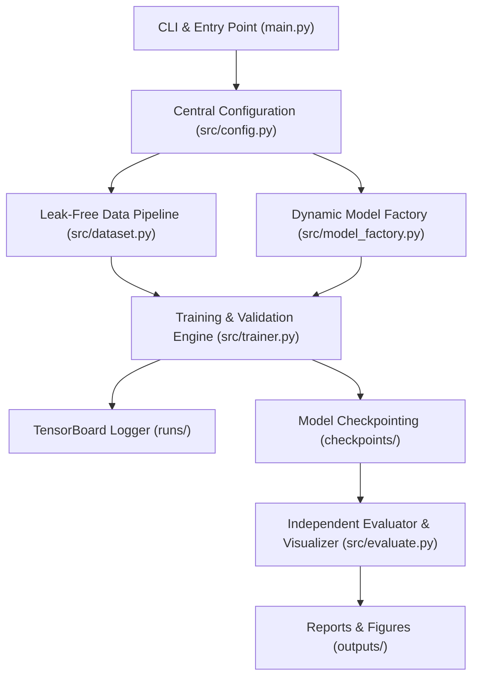

# Project Design: PyTorch Pre-trained CNN Benchmark & Fine-Tuning Pipeline

## 1. System Architecture

He thong duoc thiet ke theo mo hinh Modular va Clean Architecture, toi uu hoa cho quy trinh thuc nghiem Deep Learning. Cac thanh phan tuong tac mot chieu, phan tach ro rang giua quan ly cau hinh, nap du lieu, tao dung mo hinh, dong co huan luyen va danh gia truc quan.

### 1.1. So do Kien truc Tong quan



### 1.2. Nguyen tac Tuong tac giua cac Thanh phan
- **Don huong (One-way Dependency)**: Cac module cap thap khong phu thuoc nguoc vao module cap cao. `main.py` dieu phoi toan bo luong cong viec thong qua cac interface chuan.
- **Tach biet Trang thai (Stateless Factories)**: `dataset.py` va `model_factory.py` hoat dong nhu cac ham khoi tao doc lap, khong luu tru trang thai huan luyen toan cuc.
- **Quan ly Tap trung (Single Source of Truth)**: Moi tham so mac dinh, sieu tham so phan cung va duong dan deu do `config.py` quan ly.

---

## 2. Module Breakdown

He thong bao gom 6 module chinh duoc to chuc gon gang trong thu muc `src/` va file thuc thi `main.py` tai thu muc goc:

### 2.1. `src/config.py` (Central Configuration & Environment Probing)
- **Nhiem vu**: Quan ly tap trung toan bo hang so, duong dan thu muc va tu dong phat hien phan cung.
- **Noi dung chi tiet**:
  - Hang so ImageNet: `IMAGENET_MEAN = [0.485, 0.456, 0.406]`, `IMAGENET_STD = [0.229, 0.224, 0.225]`.
  - Danh sach 10 lop CIFAR-10 theo thu tu chuan: `['airplane', 'automobile', 'bird', 'cat', 'deer', 'dog', 'frog', 'horse', 'ship', 'truck']`.
  - Duong dan tuyet doi/tuong doi den cac thu muc lam viec: `data/`, `checkpoints/`, `runs/`, `outputs/figures/`, `outputs/reports/`.
  - Ham `get_device()`: Tu dong phat hien `cuda` (uu tien so 1), `mps` (tren macOS), hoac `cpu` (fallback).
  - Tich hop thong so do luong phan cung thuc te: Cai dat gia tri mac dinh `batch_size=64`, `num_workers=4`, `pin_memory=True` khi phat hien GPU NVIDIA (RTX 3050 6GB) va CPU da loi.

### 2.2. `src/dataset.py` (Leak-Free Data Pipeline)
- **Nhiem vu**: Tai xuong tap du lieu CIFAR-10, ap dung phep bien doi hinh anh chuan va tao cac `DataLoader` rieng biet cho Train, Validation, Test.
- **Chi tiet xu ly**:
  - `train_transform`: `Resize((256, 256))` -> `RandomCrop((224, 224))` -> `RandomHorizontalFlip(p=0.5)` -> `ToTensor()` -> `Normalize(mean, std)`.
  - `eval_transform`: `Resize((224, 224))` -> `ToTensor()` -> `Normalize(mean, std)`.
  - Co che chong ro ri du lieu (Leak-free Protocol): Khoi tao 2 doi tuong `CIFAR10(root, train=True)` rieng biet gan voi 2 bo transform tuong ung. Su dung chi so ngau nhien co dinh `torch.randperm` (seed=42) de cat 40,000 mau Train va 10,000 mau Validation. Tap Test (10,000 mau) lay tu `CIFAR10(root, train=False)`.
  - Ho tro tham so `subset_ratio` (0.0 < ratio <= 1.0) va co `dry_run` de cat nhanh tap mau phuc vu kiem thu he thong.

### 2.3. `src/model_factory.py` (Dynamic Model Factory & Inspection)
- **Nhiem vu**: Khoi tao mo hinh pre-trained, phan tich cau truc tham so, thay the classification head va quan ly chien luoc dong bang trong so.
- **Chi tiet xu ly**:
  - Tich hop Torchvision Modern Weights API: Su dung `ResNet18_Weights.DEFAULT`, `ResNet50_Weights.DEFAULT`, `VGG16_BN_Weights.DEFAULT`, `DenseNet121_Weights.DEFAULT`.
  - Ham `count_parameters(model)` va `inspect_model(model)`: Tinh toan va in bang thong ke Total Parameters, Trainable Parameters, Frozen Parameters va ty le phan tram tham so duoc huan luyen.
  - Dynamic Head Replacement:
    - ResNet: Thay `model.fc` thanh `nn.Linear(in_features, 10)`.
    - VGG: Thay `model.classifier[6]` thanh `nn.Linear(in_features, 10)`.
    - DenseNet: Thay `model.classifier` thanh `nn.Linear(in_features, 10)`.
  - Freezing Strategies:
    - `freeze_all`: Dong bang toan bo backbone (`requires_grad = False`), chi mo khoa classification head moi.
    - `unfreeze_last_block`: Mo khoa them `model.layer4` (ResNet), cac tang convolution cuoi (VGG), hoac `model.features.denseblock4` va `norm5` (DenseNet).

### 2.4. `src/trainer.py` (Training Engine & TensorBoard Logger)
- **Nhiem vu**: Dieu phoi qua trinh huan luyen va kiem dinh mo hinh theo tung epoch.
- **Chi tiet xu ly**:
  - Tich hop `torch.cuda.amp.autocast()` va `GradScaler` giup tiet kiem bo nho VRAM va tang toc do tinh toan tren GPU.
  - Ghi nhan nhat ky vao TensorBoard qua `SummaryWriter`: theo doi `Loss/train`, `Loss/val`, `Accuracy/train`, `Accuracy/val`, va `Learning_Rate` theo tung epoch.
  - Theo doi thoi gian huan luyen tren tung epoch ($t_{\text{epoch}}$) va toc do xu ly mau (samples/sec).
  - Tu dong luu checkpoint tot nhat (`checkpoints/best_<model>_<strategy>.pth`) dua tren chi so Validation Accuracy cao nhat.

### 2.5. `src/evaluate.py` (Evaluator & Visualization Engine)
- **Nhiem vu**: Tai checkpoint tot nhat de danh gia doc lap tren 10,000 anh Test; xuat bao cao va bieu do danh gia chat luong cao.
- **Chi tiet xu ly**:
  - Tinh toan Top-1 Overall Test Accuracy va Per-class Accuracy cho ca 10 lop doi tuong.
  - In bang tong hop Per-class Precision, Recall, F1-Score ra man hinh console.
  - Tinh toan va xuat 3 bieu do chuan xuat ban 300 DPI tai `outputs/figures/`:
    1. `training_history.png`: Bieu do kep (Dual Subplots) the hien duong cong Loss va Accuracy giua Train va Val qua tung epoch.
    2. `class_accuracy.png`: Bieu do cot the hien do chinh xac cua tung lop tren tap Test, kem duong nguong do chinh xac trung binh.
    3. `confusion_matrix.png`: Heatmap ma tran nham lan duoc chuan hoa the hien ro cac cap lop bi phan loai sai.

### 2.6. `main.py` (CLI Interface & Pipeline Orchestrator)
- **Nhiem vu**: Diem khoi chay duy nhat cua ung dung, phan tich cac tham so dong lenh (qua `argparse`) va lien ket cac module thuc thi theo yeu cau cua nguoi dung ma khong can can thiep vao ma nguon.

---

## 3. Folder Structure

Cau truc cay thu muc chuan cua toan bo du an:

```
LAB_DEEP_LEARNING/
|-- checkpoints/                # Thu muc luu tru model checkpoints (.pth)
|   `-- .gitkeep
|-- data/                       # Thu muc luu tru dataset CIFAR-10
|   `-- .gitkeep
|-- docs/                       # Tai lieu dac ta yeu cau va thiet ke he thong
|   |-- project_description.md
|   `-- project_design.md
|-- outputs/
|   |-- figures/                # Do hoa danh gia 300 DPI
|   |   `-- .gitkeep
|   `-- reports/                # Bao cao ket qua dang json va csv
|       `-- .gitkeep
|-- runs/                       # Nhat ky TensorBoard event logs
|   `-- .gitkeep
|-- src/                        # Ma nguon module hoa he thong
|   |-- __init__.py
|   |-- config.py               # Quan ly cau hinh, hang so va thiet bi
|   |-- dataset.py              # Xu ly du lieu va DataLoader
|   |-- evaluate.py             # Danh gia tap Test va xuat bieu do
|   |-- model_factory.py        # Khoi tao mo hinh, inspect va freeze weights
|   `-- trainer.py              # Dong co huan luyen va TensorBoard logger
|-- tests/                      # Kiem thu tu dong (Unit tests)
|   |-- __init__.py
|   |-- test_dataset.py         # Kiem thu tinh toan ven va chong ro ri du lieu
|   `-- test_model_factory.py   # Kiem thu thay the head va dong bang trong so
|-- .gitignore                  # Loai bo cac tep tin rac, data va checkpoints lon
|-- main.py                     # Entry point CLI cua he thong
|-- README.md                   # Huong dan su dung va tong ket ket qua
`-- requirements.txt            # Danh sach thu vien can thiet
```

---

## 4. Data Flow

Luong bien doi du lieu va kich thuoc cu the cua Tensor duoc the hien qua so do va cac buoc chi tiet duoi day:

```
[Raw Image: (3, 32, 32)]
       |
       v  (Resize 256x256 -> RandomCrop 224x224 -> Flip -> Normalize)
[Batch Tensor: (B, 3, 224, 224)]
       |
       v  (Forward qua Frozen / Fine-tuned Backbone)
[Feature Tensor: (B, C_feat, 1, 1) -> Flatten]
  - ResNet-18:   (B, 512)
  - ResNet-50:   (B, 2048)
  - DenseNet-121: (B, 1024)
  - VGG-16 (BN): (B, 4096)
       |
       v  (Forward qua Linear Classification Head)
[Output Logits: (B, 10)]
       |
       +---> [CrossEntropyLoss] ---> [Scalar Loss: ()]
       |                                   |
       |                                   v (Backward qua requires_grad=True)
       |                             [Gradient Updates -> Optimizer Step]
       |
       v  (Argmax dim=-1)
[Predictions: (B,)] ---> [TensorBoard & Evaluator Metrics]
```

### 4.1. Chi tiet Kich thuoc Tensor tai tung Chang
1. **Raw Image**: Anh goc CIFAR-10 co dinh dang RGB, kich thuoc `(3, 32, 32)` voi gia tri diem anh kieu `uint8` $[0, 255]$.
2. **Transform & Batch Collation**:
   - Anh duoc dua ve kich thuoc `(3, 224, 224)` phu hop voi tieu chuan ImageNet pre-trained backbones va chuan hoa theo ImageNet mean/std.
   - Batch gom $B$ anh ghep lai thanh Tensor `(B, 3, 224, 224)` voi kieu du lieu `torch.float32`. Nhan (Labels) la Tensor 1 chieu `(B,)` voi kieu `torch.int64`. Voi GPU RTX 3050 6GB, kich thuoc mac dinh $B = 64$.
3. **Backbone Feature Extraction**:
   - Khi di qua cac tang Convolution cua Backbone, anh duoc trich xuat thanh Feature Map truoc khi dua qua Global Average Pooling (hoac AdaptiveAvgPool2d).
   - Vector dac trung thu duoc sau khi duoi thang (flatten):
     - ResNet-18: `(B, 512)`
     - ResNet-50: `(B, 2048)`
     - DenseNet-121: `(B, 1024)`
     - VGG-16 with BN: `(B, 4096)` (sau khi di qua cac tang fully-connected dau cua classifier).
4. **Classification Head**:
   - Tuyen tinh hoa ve khong gian 10 lop qua phep nhan ma tran $W \cdot X + b$:
     $$\text{Logits} = (B, \text{in\_features}) \times (\text{in\_features}, 10) = (B, 10)$$
5. **Loss Computation & Backpropagation**:
   - Loss duoc tinh thong qua `nn.CrossEntropyLoss`: ket qua la mot Tensor vo huong `()`.
   - Gradient chi duoc lan truyen nguoc va tich luy tren cac tham so co `requires_grad=True`.

---

## 5. Interface Design (Function & Class Signatures)

Duoi day la khai bao interface chuan voi Type Hints va docstring day du cho cac module loi:

### 5.1. `src/dataset.py`

```python
from typing import Tuple
from torch.utils.data import DataLoader
from torchvision import transforms

def get_transforms() -> Tuple[transforms.Compose, transforms.Compose]:
    """Khoi tao cac phep bien doi hinh anh chuan cho Train va Validation/Test.
    
    Returns:
        Tuple gom (train_transform, eval_transform).
    """
    ...

def get_cifar10_dataloaders(
    data_dir: str,
    batch_size: int = 64,
    num_workers: int = 4,
    subset_ratio: float = 1.0,
    dry_run: bool = False,
    seed: int = 42
) -> Tuple[DataLoader, DataLoader, DataLoader]:
    """Tai tap du lieu CIFAR-10 va phan chia thanh Train (40k), Val (10k), Test (10k).
    
    Args:
        data_dir: Thu muc luu tru du lieu.
        batch_size: Kich thuoc mini-batch.
        num_workers: So luong tien trinh con doc du lieu.
        subset_ratio: Ty le mau su dung (kiem thu nhanh tren tap nho).
        dry_run: Neu True, chi lay 100 mau moi tap de kiem thu nhanh.
        seed: Gia tri hat giong de dam bao tinh tai lap khi chia tap train/val.
        
    Returns:
        Tuple gom (train_loader, val_loader, test_loader).
    """
    ...
```

### 5.2. `src/model_factory.py`

```python
from typing import Dict, Any
import torch.nn as nn

def count_parameters(model: nn.Module) -> Dict[str, int]:
    """Dem va thong ke so luong tham so trong mo hinh.
    
    Args:
        model: Mo hinh PyTorch can phan tich.
        
    Returns:
        Dictionary chua 'total', 'trainable', va 'frozen' parameters.
    """
    ...

def inspect_model(model: nn.Module, model_name: str) -> None:
    """In cau truc phan tang va bang thong ke tham so cua mo hinh ra console.
    
    Args:
        model: Mo hinh PyTorch can in.
        model_name: Ten dinh danh cua mo hinh.
    """
    ...

def build_model(
    model_name: str = "resnet18",
    strategy: str = "freeze_all",
    num_classes: int = 10
) -> nn.Module:
    """Khoi tao mo hinh pre-trained, thay the classification head va ap dung chien luoc dong bang.
    
    Args:
        model_name: Ten kien truc ('resnet18', 'resnet50', 'vgg16_bn', 'densenet121').
        strategy: Chien luoc dong bang trong so ('freeze_all', 'unfreeze_last_block').
        num_classes: So luong lop dau ra (mac dinh 10 cho CIFAR-10).
        
    Returns:
        nn.Module da duoc bien doi va thiet lap requires_grad hop le.
    """
    ...
```

### 5.3. `src/trainer.py`

```python
from typing import Dict, List, Tuple
import torch
import torch.nn as nn
from torch.utils.data import DataLoader
from torch.optim import Optimizer

class Trainer:
    """Lop quan ly dong co huan luyen, kiem dinh va ghi log TensorBoard."""
    
    def __init__(
        self,
        model: nn.Module,
        train_loader: DataLoader,
        val_loader: DataLoader,
        optimizer: Optimizer,
        criterion: nn.Module,
        device: torch.device,
        epochs: int = 15,
        checkpoint_dir: str = "checkpoints",
        log_dir: str = "runs",
        experiment_name: str = "exp",
        use_amp: bool = True
    ) -> None:
        """Khoi tao Trainer voi day du cac thanh phan can thiet."""
        ...

    def train_one_epoch(self, epoch: int) -> Tuple[float, float]:
        """Thuc thi huan luyen trong 1 epoch.
        
        Args:
            epoch: Chi so epoch hien tai.
            
        Returns:
            Tuple gom (train_loss, train_accuracy).
        """
        ...

    def validate(self, epoch: int) -> Tuple[float, float]:
        """Thuc thi kiem dinh mo hinh tren tap validation.
        
        Args:
            epoch: Chi so epoch hien tai.
            
        Returns:
            Tuple gom (val_loss, val_accuracy).
        """
        ...

    def fit(self) -> Dict[str, List[float]]:
        """Chay toan bo qua trinh huan luyen va kiem dinh qua tat ca cac epoch.
        
        Returns:
            Dictionary luu lich su gom 'train_loss', 'val_loss', 'train_acc', 'val_acc'.
        """
        ...

    def save_checkpoint(self, epoch: int, val_acc: float, is_best: bool = False) -> str:
        """Luu checkpoint trong so mo hinh xuong o dia.
        
        Args:
            epoch: Epoch hien tai.
            val_acc: Do chinh xac validation dat duoc.
            is_best: Co danh dau checkpoint co val_acc cao nhat.
            
        Returns:
            Duong dan den file checkpoint da luu.
        """
        ...
```

### 5.4. `src/evaluate.py`

```python
from typing import Dict, Any, List
import numpy as np
import torch
import torch.nn as nn
from torch.utils.data import DataLoader

def evaluate_test_set(
    model: nn.Module,
    test_loader: DataLoader,
    criterion: nn.Module,
    device: torch.device,
    class_names: List[str]
) -> Dict[str, Any]:
    """Danh gia toan dien mo hinh tren tap Test doc lap.
    
    Returns:
        Dict chua 'test_loss', 'overall_acc', 'per_class_acc', va 'confusion_matrix'.
    """
    ...

def plot_training_history(history: Dict[str, List[float]], output_path: str) -> None:
    """Ve bieu do loss va accuracy giua train va val theo tung epoch (300 DPI)."""
    ...

def plot_per_class_accuracy(per_class_acc: Dict[str, float], output_path: str) -> None:
    """Ve bieu do cot the hien do chinh xac cua tung lop tren tap Test (300 DPI)."""
    ...

def plot_confusion_matrix(cm: np.ndarray, class_names: List[str], output_path: str) -> None:
    """Ve heatmap ma tran nham lan chuan hoa tren tap Test (300 DPI)."""
    ...
```

---

## 6. Implementation Milestones

Qua trinh hien thuc hoa he thong duoc chia thanh 4 cot moc tuan tu voi Tieu chi hoan thanh (Definition of Done - DoD) ro rang:

### Milestone 1: Config & Data Pipeline (`src/config.py`, `src/dataset.py`)
- **Muc tieu**: Hoan thien module cau hinh va pipeline du lieu chong ro ri cho CIFAR-10.
- **DoD (Co the kiem chung)**:
  - Chay lenh: `python3 -c "from src.dataset import get_cifar10_dataloaders; tr, va, te = get_cifar10_dataloaders('data', dry_run=True); b = next(iter(tr)); print(b[0].shape, len(tr.dataset), len(va.dataset), len(te.dataset))"`
  - Output dat yeu cau: In ra Tensor kich thuoc `torch.Size([64, 3, 224, 224])`, so mau dung ty le 40,000 / 10,000 / 10,000 (hoac mau dry_run). Khong bi xung dot dependencies.

### Milestone 2: Model Factory & Parameter Inspection (`src/model_factory.py`)
- **Muc tieu**: Hoan thien factory khoi tao mo hinh pre-trained, inspect tham so, thay the classification head va logic dong bang trong so.
- **DoD (Co the kiem chung)**:
  - Chay lenh: `python3 -c "from src.model_factory import build_model, count_parameters; m = build_model('resnet18', 'freeze_all'); c = count_parameters(m); assert c['trainable'] == 5130; print('Pass ResNet18 Freeze All:', c)"`
  - Output dat yeu cau: Chay thanh cong voi 4 kien truc (`resnet18`, `resnet50`, `vgg16_bn`, `densenet121`) tren ca 2 chien luoc `freeze_all` va `unfreeze_last_block`.

### Milestone 3: Training Engine & TensorBoard (`src/trainer.py`)
- **Muc tieu**: Hoan thien lop `Trainer`, tich hop `GradScaler` (AMP), tinh toan thoi gian chay moi epoch, tu dong luu checkpoint tot nhat va ghi log vao TensorBoard.
- **DoD (Co the kiem chung)**:
  - Chay lenh test nhanh: `python3 main.py --model resnet18 --epochs 1 --dry-run`
  - Output dat yeu cau: Chay qua 1 epoch khong loi, tao thanh cong tep `checkpoints/best_resnet18_freeze_all.pth` va tep log TensorBoard trong `runs/`.

### Milestone 4: Evaluation, Visualization & CLI Complete (`src/evaluate.py`, `main.py`)
- **Muc tieu**: Hoan thien danh gia tren tap Test, tinh ma tran nham lan, xuat 3 bieu do 300 DPI va hoan tat giao dien dong lenh CLI day du.
- **DoD (Co the kiem chung)**:
  - Chay lenh: `python3 main.py --model resnet18 --strategy freeze_all --epochs 2 --subset-ratio 0.05`
  - Output dat yeu cau: Huan luyen xong, tu dong danh gia test set, in bang Per-class Accuracy, va xuat du 3 file anh chat luong cao: `outputs/figures/training_history.png`, `outputs/figures/class_accuracy.png`, `outputs/figures/confusion_matrix.png`.

---

## 7. Technical Risks & Mitigations

Duoi day la 5 rui ro ky thuat cot loi trong cac bai toan Transfer Learning va cac giai phap phong ngua duoc tich hop truc tiep vao ban thiet ke:

### Rui ro 1: Data Augmentation Leakage khi phan chia tap Train/Val
- **Nguyen nhan**: Neu ap dung Data Augmentation len toan bo Dataset roi dung `random_split`, tap Validation se bi anh huong boi cac phep bien doi ngau nhien (RandomCrop, Flip), lam sai lech do do danh gia thuc te.
- **Giai phap thiet ke**: Khoi tao 2 doi tuong `CIFAR10(root, train=True)` rieng biet. Mot doi tuong gan voi `train_transform`, doi tuong con lai gan voi `eval_transform`. Su dung phep sinh hoan vi ngau nhien co dinh `torch.randperm(50000, generator=torch.Generator().manual_seed(42))` de tao danh sach chi so (indices). Sau do truyen cac chi so nay vao `torch.utils.data.Subset` de dam bao 2 tap hoan toan doc lap ve ca du lieu lan phep bien doi.

### Rui ro 2: Truyen nham tham so dong bang vao Optimizer hoac sai lech trang thai BatchNorm
- **Nguyen nhan**: Khi dong bang cac tang nhung van truyen toan bo `model.parameters()` vao Optimizer se gay lang phi bo nho VRAM cho cac bien trang thai (nhu momentum, v cua AdamW) va lam cham toc do cap nhat trong so. Ngoai ra, BatchNorm o cac tang dong bang co the bi cap nhat running mean/var neu quen chuyen trang thai.
- **Giai phap thiet ke**:
  - Khi khoi tao Optimizer, chi truyen bo loc:
    ```python
    trainable_params = filter(lambda p: p.requires_grad, model.parameters())
    optimizer = optim.AdamW(trainable_params, lr=lr, weight_decay=weight_decay)
    ```
  - Trong chien luoc `freeze_all`, cac tang backbone luon duoc giu nguyen tinh toan forward ma khong luu do thi dao ham.

### Rui ro 3: Bat dong bo thuoc tinh Classification Head giua cac ho kien truc
- **Nguyen nhan**: Moi kien truc CNN trong Torchvision su dung ten thuoc tinh khac nhau cho tang phan loai cuoi (`.fc` trong ResNet, `.classifier[6]` trong VGG, `.classifier` trong DenseNet).
- **Giai phap thiet ke**: Module `model_factory.py` su dung cau truc re nhanh tuong minh (`if/elif`) kem co che kiem tra kieu lop (`isinstance`) va in loi ro rang neu ten mo hinh khong nam trong danh sach ho tro.

### Rui ro 4: Tran bo nho VRAM (CUDA OOM) hoac qua tai RAM khi upscale anh len 224x224
- **Nguyen nhan**: Anh CIFAR-10 goc co kich thuoc 32x32. Khi phong to len 224x224, luong bo nho cho moi batch tang khoang 49 lan. Tren GPU RTX 3050 (6GB VRAM), neu chon batch size 128 hoac 256 voi model VGG-16 se lap tuc gay loi `CUDA out of memory`.
- **Giai phap thiet ke**:
  - Phep resize duoc thuc hien on-the-fly trong DataLoader theo tung batch nho thay vi phong to toan bo dataset tren RAM.
  - Cai dat `batch_size=64` lam gia tri mac dinh toi uu cho 6GB VRAM.
  - Kich hoat `torch.cuda.amp.autocast()` (Mixed Precision FP16) de giam 40% dung luong VRAM.
  - Ho tro tham so `--subset-ratio` va `--dry-run` de kiem thu nhanh tren tai nguyen gioi han.

### Rui ro 5: Ghi de file Checkpoint va xung dot Log TensorBoard khi chay lien tiep nhieu thuc nghiem
- **Nguyen nhan**: Neu tat ca cac lan chay deu luu vao `best_model.pth` hoac ghi chung mot thu muc `runs/`, cac thuc nghiem so sanh giua ResNet, VGG va DenseNet se ghi de len nhau, lam mat du lieu thuc nghiem.
- **Giai phap thiet ke**:
  - Dinh danh thuc nghiem duoc tao tu dong theo cu phap chuan: `<model_name>_<strategy>_lr<lr>_bs<bs>_<timestamp>`.
  - Checkpoint duoc luu ro rang thanh: `checkpoints/best_<experiment_id>.pth`.
  - Thu muc log TensorBoard duoc tach rieng: `runs/<experiment_id>/`.

