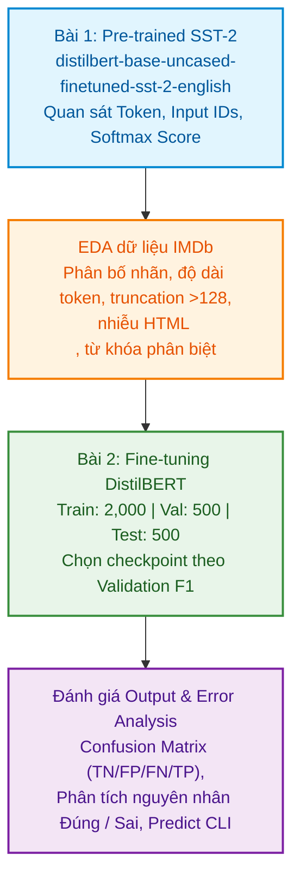

# Define — Định nghĩa Bài toán & Đặc tả Thực nghiệm Lab 3 (Hugging Face Sentiment Analysis)

## 1. Tổng quan & Mục tiêu Bài thực hành

**Tên bài thực hành:** Lab 3 — Làm quen với Hugging Face & Fine-tuning DistilBERT cho Phân tích Cảm xúc (`Sentiment Analysis`)  
**Phạm vi dữ liệu & ngôn ngữ:** Văn bản đánh giá phim tiếng Anh (`stanfordnlp/imdb` và các câu minh họa tiếng Anh).

Bài thực hành được chia thành hai phần liên thông cùng quy trình khám phá dữ liệu (**EDA**) và phân tích lỗi đầu ra (**Error Analysis**):
1. **Bài 1 (Pre-trained Tokenization & Inference):** Sử dụng mô hình đã được huấn luyện sẵn trên SST-2 (`distilbert/distilbert-base-uncased-finetuned-sst-2-english`) để quan sát cơ chế tách token WordPiece, ánh xạ `input_ids`, thêm token đặc biệt (`[CLS]` = `101`, `[SEP]` = `102`), và suy luận xác suất Softmax trên 5 câu tiếng Anh mẫu.
2. **Bài 2 (End-to-End Fine-tuning, Evaluation & Error Analysis):**
   - Khám phá dữ liệu (**EDA**) trên tập `stanfordnlp/imdb` để hiểu cấu trúc, độ cân bằng nhãn, phân bố độ dài WordPiece token, tỷ lệ mất ngữ cảnh tại `max_length = 128` và nhiễu HTML (` `).
   - Fine-tune mô hình nền `distilbert/distilbert-base-uncased` với đầu phân loại nhị phân trên tập Train (`2,000` mẫu), chọn checkpoint tối ưu bằng Validation (`500` mẫu) dựa trên `eval_f1`, và đánh giá độc lập một lần duy nhất trên tập Test (`500` mẫu).
   - Phân tích chi tiết **tại sao mô hình dự đoán ĐÚNG và tại sao dự đoán SAI** trên toàn bộ 500 mẫu Test, kèm suy luận câu mới qua CLI `predict.py`.

---

## 2. Định nghĩa Bài toán (Problem Statement)

### 2.1. Phát biểu Toán học
Cho một chuỗi văn bản đánh giá phim tiếng Anh $x$. Bộ tách từ WordPiece chuyển $x$ thành chuỗi chỉ số token có độ dài giới hạn $L \le L_{\max}$ ($L_{\max} = 128$ cho Bài 2, $256$ cho Bài 1):

$$x \xrightarrow{\text{Tokenizer}} \mathbf{t} = (t_1, t_2, \dots, t_L), \quad t_i \in \{0, \dots, V - 1\}, \quad V = 30{,}522$$

Mô hình Transformer mã hóa chuỗi $\mathbf{t}$ thành vector logits 2 chiều $\mathbf{z} = (z_0, z_1) \in \mathbb{R}^2$ tương ứng với hai nhãn cảm xúc $y \in \{0, 1\}$ (`0 = NEGATIVE`, `1 = POSITIVE`). Xác suất dự đoán được tính qua hàm Softmax:

$$P(y = c \mid x) = \frac{e^{z_c}}{e^{z_0} + e^{z_1}}, \quad c \in \{0, 1\}, \qquad \hat{y} = \arg\max_{c \in \{0, 1\}} P(y = c \mid x)$$

### 2.2. Sơ đồ Mục tiêu & Luồng Thực nghiệm

### 2.3. Phạm vi & Giới hạn Bài toán
- **Ngôn ngữ & Miền dữ liệu:** Chỉ xử lý review phim **tiếng Anh**; không đánh giá năng lực trên tiếng Việt hoặc các miền văn bản khác (y tế, tài chính, bình luận mạng xã hội đa nhãn).
- **Nhãn đầu ra:** Phân loại nhị phân thuần (`NEGATIVE` / `POSITIVE`), không có nhãn trung tính (`NEUTRAL`).
- **Giới hạn độ dài đầu vào:** Trong cấu hình báo cáo (`max_length = 128`), mọi token vượt quá vị trí 128 bị cắt bỏ (`truncation=True`). Hệ quả từ giới hạn này là đối tượng phân tích trọng tâm ở bước EDA và Error Analysis.

---

## 3. Đối tượng Sử dụng & Giá trị Thực tiễn

- **Đối tượng mục tiêu:** Sinh viên môn Deep Learning và kỹ sư NLP mới làm quen với hệ sinh thái Hugging Face (`transformers`, `datasets`, `accelerate`).
- **Giá trị kỹ thuật cốt lõi:**
  1. Hiểu rõ quy trình từ văn bản thô đến tensor (`AutoTokenizer` + `DataCollatorWithPadding`) thay vì chỉ gọi pipeline hộp đen.
  2. Thực hành chia dữ liệu chuẩn chống rò rỉ (**Leak-Free Protocol**): tách Validation hoàn toàn từ Train, chỉ đánh giá Test một lần bằng best checkpoint theo `eval_f1`.
  3. Kết nối trực tiếp **EDA** với **Error Analysis**: chứng minh bằng số liệu thực nghiệm cách đặc tính dữ liệu (85.6% mẫu Test dài >128 token, ~54–59% chứa thẻ ` `) tác động đến sai số `FP = 64` vs `FN = 24`.

---

## 4. Đặc tả Dữ liệu (`stanfordnlp/imdb`) & Chiến lược Phân chia

### 4.1. Cấu trúc Tập dữ liệu Gốc
Bộ dữ liệu `stanfordnlp/imdb` gồm 100,000 bình luận phim tiếng Anh:
- `train`: **25,000** mẫu có nhãn (`12,500 NEGATIVE`, `12,500 POSITIVE`), trung bình `233.79` từ/review (median `174.0`, max `2,470`), **58.66%** chứa thẻ HTML ` `.
- `test`: **25,000** mẫu có nhãn (`12,500 NEGATIVE`, `12,500 POSITIVE`), trung bình `228.53` từ/review (median `172.0`, max `2,278`), **58.14%** chứa thẻ HTML ` `.
- `unsupervised`: **50,000** mẫu không nhãn — **bị loại bỏ hoàn toàn**, không sử dụng trong bài thực hành.

### 4.2. Phân chia Chống Rò rỉ (Leak-Free Split với `seed = 42`)
Nhằm phù hợp với ràng buộc huấn luyện trên CPU mà vẫn giữ tính khách quan của đánh giá:
- Trộn ngẫu nhiên tập `raw['train']` với `seed = 42`, cắt tuần tự hai đoạn không giao nhau:
  - **Train (`0..1999`):** `2,000` mẫu (`1,000 NEGATIVE` / `1,000 POSITIVE`, tỷ lệ `50.0% / 50.0%`).
  - **Validation (`2000..2499`):** `500` mẫu (`243 NEGATIVE` / `257 POSITIVE`, tỷ lệ `48.6% / 51.4%`).
- Trộn ngẫu nhiên tập `raw['test']` với `seed = 42`, lấy đoạn đầu:
  - **Test (`0..499`):** `500` mẫu (`254 NEGATIVE` / `246 POSITIVE`, tỷ lệ `50.8% / 49.2%`).

| Tập dữ liệu | Số mẫu | NEGATIVE (%) | POSITIVE (%) | Độ dài token TB (DistilBERT) | Độ dài token Trung vị | Tỷ lệ `> 128` token (bị cắt) | Tỷ lệ chứa ` ` |
|---|---:|---:|---:|---:|---:|---:|---:|
| **Train** | 2,000 | 1,000 (50.0%) | 1,000 (50.0%) | 306.51 | 231.0 | **88.85%** (1,777) | 59.45% |
| **Validation** | 500 | 243 (48.6%) | 257 (51.4%) | 305.76 | 224.0 | **89.40%** (447) | 56.80% |
| **Test** | 500 | 254 (50.8%) | 246 (49.2%) | 266.78 | 205.5 | **85.60%** (428) | 54.20% |

---

## 5. Đặc tả Input & Output

### 5.1. Giao diện Dòng lệnh (CLI Parameters)
- **`exercise1_sentiment.py`**:
  - `--text` (`nargs='+'`): Danh sách câu tiếng Anh cần suy luận (mặc định 5 câu mẫu `DEFAULT_TEXTS`).
- **`exercise2_finetune.py`**:
  - `--train-size` (`2000`), `--val-size` (`500`), `--test-size` (`500`): Kích thước ba tập dữ liệu (ràng buộc `train_size + val_size <= 25000`, `test_size <= 25000`).
  - `--epochs` (`2`), `--batch-size` (`8`), `--max-length` (`128`, trong khoảng `[8, 512]`), `--seed` (`42`).
  - `--output-dir` (`outputs/finetune`), `--cpu` (ép chạy CPU).
- **`evaluate_lab3.py`**:
  - `--model` (`outputs/finetune/model`), `--output-dir` (`outputs/finetune`), `--results-dir` (tùy chọn sao chép minh chứng nhẹ sang `results/`).
  - `--train-size` (`2000`), `--val-size` (`500`), `--test-size` (`500`), `--max-length` (`128`), `--seed` (`42`), `--batch-size` (`16`), `--cpu`.
- **`predict.py`**:
  - `--model` (`outputs/finetune/model`), `--text` (`required=True`), `--max-length` (tự đọc từ `config.json` của lần chạy nếu bỏ trống), `--cpu`, `--output` (xuất JSON).

### 5.2. Đặc tả Đầu ra (Output Specification)
- **Thư mục `outputs/` (bỏ qua bởi Git vì chứa checkpoint/model nặng ~268 MB):**
  - `outputs/exercise1.json`: Danh sách `text`, `tokens`, `input_ids`, `label`, `score` của Bài 1.
  - `outputs/finetune/model/`: Trọng số `model.safetensors`, `config.json`, tokenizer files và `training_args.bin`.
  - `outputs/finetune/test_predictions.json`: Dự đoán chi tiết từng mẫu trong 500 mẫu Test (`idx`, `true_label`, `pred_label`, `outcome`, `confidence`, `token_length`, `truncated`, `visible_text`, `truncated_tail`, `text`).
- **Thư mục `results/` (minh chứng nhẹ lưu trên Git):**
  - `environment.json`, `exercise1.json`, `config.json`, `metrics.json`, `classification_report.txt`, `training_history.json`, `predictions.json`.
  - `eda_summary.json`, `error_analysis.json`.
  - 6 biểu đồ PNG: `confusion_matrix.png`, `loss_curve.png`, `eda_class_and_length.png`, `eda_text_insights.png`, `error_analysis_overview.png`, `correct_vs_wrong_cases.png`.

---

## 6. Tiêu chí Đánh giá & Giao thức Thực nghiệm

### 6.1. Các Độ đo Đánh giá (Evaluation Metrics)
Với lớp dương mặc định là `POSITIVE` (`label = 1`):

$$\text{Accuracy} = \frac{TP + TN}{TP + TN + FP + FN}$$

$$\text{Precision} = \frac{TP}{TP + FP}, \qquad \text{Recall} = \frac{TP}{TP + FN}, \qquad F_1 = \frac{2 \cdot \text{Precision} \cdot \text{Recall}}{\text{Precision} + \text{Recall}}$$

Ngoài các chỉ số tổng thể, bài thực hành đánh giá bắt buộc:
- **Per-class Precision / Recall / F1** cho cả `NEGATIVE` và `POSITIVE` (giúp phát hiện độ lệch `Recall NEGATIVE = 74.80%` so với `Recall POSITIVE = 90.24%`).
- **Confusion Matrix** (`TN=190, FP=64, FN=24, TP=222`) và **Confidence Calibration** (đối chiếu độ tự tin Softmax với xác suất đúng thực tế).
- **Truncation Impact Analysis**: So sánh trực tiếp độ chính xác giữa nhóm mẫu không bị cắt (`<= 128` token) và nhóm mẫu bị cắt (`> 128` token).

### 6.2. Giao thức Huấn luyện & Tiêu chí Hoàn thành (DoD)
1. Cố định `seed = 42` (`set_seed(42)`, `seed=42`, `data_seed=42`).
2. Đánh giá trên tập Validation sau mỗi epoch (`eval_strategy='epoch'`), lưu checkpoint tốt nhất theo `metric_for_best_model='f1'` (`load_best_model_at_end=True`).
3. Chỉ đánh giá tập Test sau khi đã nạp lại best checkpoint (**epoch 1, step 250** với `eval_f1 = 0.851782`).
4. **Definition of Done (DoD):**
   - Toàn bộ bài test tự động (`unittest discover -s tests -v`) đạt 100% pass.
   - Đầy đủ minh chứng EDA, chỉ số Test, biểu đồ phân tích Đúng/Sai và tài liệu (`define.md`, `design.md`, `report.md`, `Practice3.ipynb`, `demo.md`, `README.md`) khớp số liệu tuyệt đối.

---

## 7. Môi trường Thực thi & Ràng buộc Thực tế

- **Hệ điều hành & Phần cứng:** Windows 11 (`Windows-11-10.0.26300-SP0`), chạy hoàn toàn trên **CPU** (`CUDA khả dụng: False`).
- **Phiên bản phần mềm đã ghi nhận (`results/environment.json`):** Python `3.14.0`, `torch 2.13.0`, `transformers 4.57.1`, `datasets 4.4.1`, `accelerate 1.11.0`, `scikit-learn 1.7.2`, `matplotlib 3.10.7`, `numpy 2.3.4`.
- **Chi phí thời gian thực tế trên CPU:**
  - Huấn luyện 2 epoch trên 2,000 mẫu + 2 lần validation: **1,050.06 giây** (~17 phút 30 giây).
  - Đánh giá trên 500 mẫu Test (`trainer.predict`): **27.38 giây** (`18.26 samples/s`).
- Do chi phí CPU cao ở lần huấn luyện gốc, cấu hình mặc định của Bài 2 sử dụng `2,000 / 500 / 500` mẫu và `max_length = 128`, đồng thời tách riêng script `evaluate_lab3.py` để tái phân tích mọi mẫu Test từ mô hình đã lưu mà không cần huấn luyện lại.
