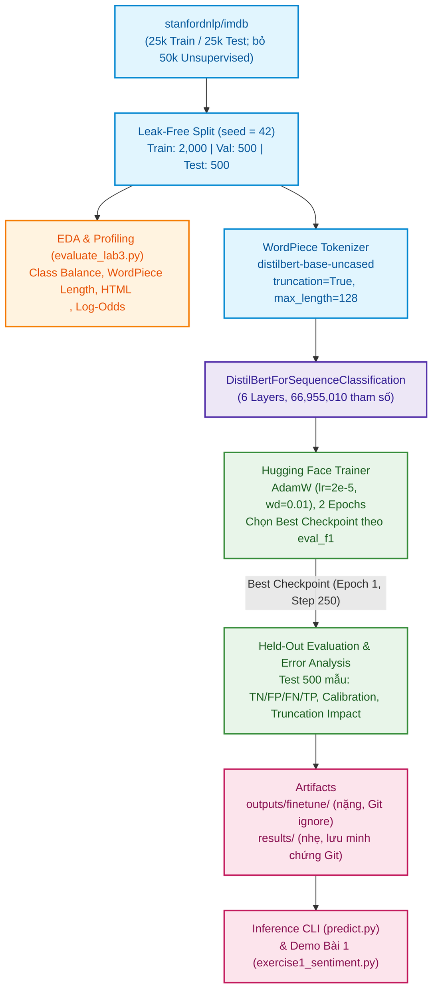
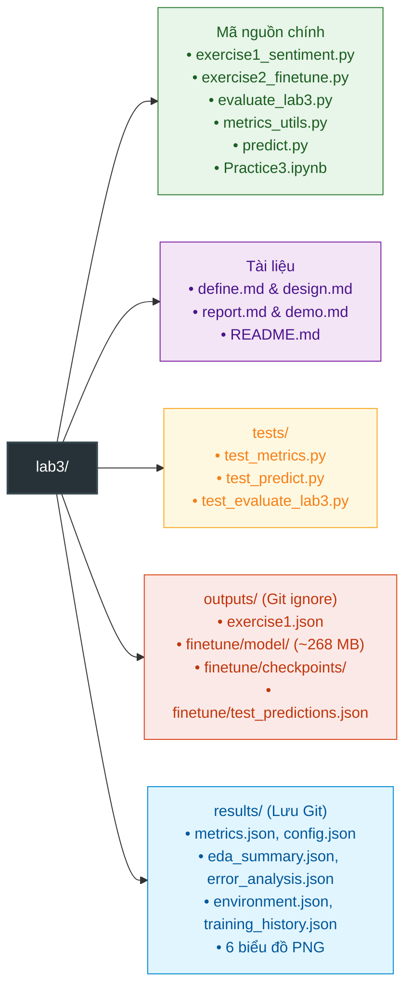

# Design — Thiết kế Kiến trúc & Hệ thống Lab 3 (DistilBERT Sentiment Analysis)

## 1. Kiến trúc Hệ thống Tổng quan

Hệ thống Lab 3 được thiết kế theo cấu trúc tách biệt rõ ràng giữa **Pipeline dữ liệu & EDA**, **Pipeline huấn luyện & chọn checkpoint**, **Pipeline đánh giá & phân tích lỗi (Error Analysis)**, và **Giao diện suy luận CLI/Notebook**. Toàn bộ mã nguồn thực thi nằm tại thư mục `lab3/` và dùng chung logic chuẩn hóa cho cả dòng lệnh PowerShell lẫn Jupyter Notebook (`Practice3.ipynb`).



---

## 2. Phân rã Module Chi tiết

| File / Thư mục | Vai trò chính | Trách nhiệm thiết kế |
|---|---|---|
| `exercise1_sentiment.py` | Suy luận Bài 1 (SST-2) | Nạp `distilbert/distilbert-base-uncased-finetuned-sst-2-english`, tokenize tối đa `256` token, in `tokens`, `input_ids`, `label`, `score` và xuất `outputs/exercise1.json`. |
| `exercise2_finetune.py` | Fine-tuning & Test Bài 2 | Tải IMDb, chia tập Train/Val/Test không rò rỉ theo `seed=42`, cấu hình `TrainingArguments` & `Trainer`, chọn checkpoint tốt nhất theo `val_f1`, đánh giá Test, xuất model, metrics, báo cáo, `test_predictions.json` và 2 biểu đồ cơ bản (`confusion_matrix.png`, `loss_curve.png`). |
| `evaluate_lab3.py` | EDA & Error Analysis | Chạy lại từ checkpoint đã lưu (không cần huấn luyện lại) để tính thống kê EDA toàn tập & subset, log-odds từ khóa, phân tích độ dài/độ tự tin, so sánh Đúng/Sai trên 500 mẫu Test, xuất `eda_summary.json`, `error_analysis.json`, `test_predictions.json` và 4 biểu đồ PNG phân tích chuyên sâu. |
| `metrics_utils.py` | Hàm tính metric thuần | Cung cấp `binary_metrics(labels, predictions)` kiểm tra đầu vào nhị phân (`0/1`), tính `accuracy`, `precision`, `recall`, `f1` với lớp dương `1 = POSITIVE`. |
| `predict.py` | Suy luận câu mới | Nạp model đã lưu (`outputs/finetune/model`), tự đọc `max_length` từ `config.json` của lần chạy (nếu không truyền `--max-length`), suy luận qua `transformers.pipeline` và tùy chọn lưu JSON. |
| `Practice3.ipynb` | Notebook trình diễn & báo cáo | Gọi trực tiếp các script Python trong cùng thư mục (tránh trùng lặp code), hiển thị bảng EDA, kết quả huấn luyện, Confusion Matrix, Loss Curve, Error Analysis và nhận xét. |
| `tests/` | Kiểm thử tự động (`unittest`) | Gồm `test_metrics.py`, `test_predict.py`, `test_evaluate_lab3.py`; chạy độc lập mạng và GPU bằng mock/dữ liệu nhỏ, đồng thời kiểm tra tính nhất quán minh chứng trong `results/`. |

---

## 3. Thiết kế Kiến trúc Mô hình DistilBERT & Luồng Tensor

### 3.1. Cấu hình Kiến trúc (`DistilBertForSequenceClassification`)
Dựa trên tệp cấu hình thực tế của mô hình đã lưu (`outputs/finetune/model/config.json`):
- **Backbone (`distilbert-base-uncased`):**
  - `vocab_size = 30,522`, `max_position_embeddings = 512`.
  - **6 Transformer Encoder layers**, mỗi layer có `n_heads = 12` Multi-Head Self-Attention, chiều ẩn `dim = 768`, tầng Feed-Forward `hidden_dim = 3,072` với hàm kích hoạt `GELU`, `dropout = 0.1`, `attention_dropout = 0.1`.
  - So với `BERT-base` (12 layers, ~110M tham số), DistilBERT chưng cất tri thức giảm ~40% kích thước xuống **66,955,010 tham số** nhưng giữ lại khả năng biểu diễn ngữ cảnh hai chiều, giúp huấn luyện khả thi trên CPU.
- **Classification Head:**
  - Trích xuất biểu diễn tại vị trí token `[CLS]` (chỉ số `0`, kích thước `768`).
  - `pre_classifier`: `Linear(768 -> 768, bias=True)` + `ReLU`.
  - `dropout`: `Dropout(p=0.2)`.
  - `classifier`: `Linear(768 -> 2, bias=True)` xuất logits cho `0: NEGATIVE`, `1: POSITIVE`.

### 3.2. Luồng Biến đổi Dữ liệu & Kích thước Tensor (Data Flow)

```mermaid
flowchart LR
    TXT["Văn bản thô<br/>Batch B = 8"] -->|"WordPiece + Truncation<br/>(L <= 128)"| IDS["input_ids, attention_mask<br/>Shape: (B, L_batch)"]
    IDS -->|"DistilBERT Embeddings<br/>+ 6 Transformer Layers"| HID["Hidden States<br/>Shape: (B, L_batch, 768)"]
    HID -->|"Lấy vector [CLS] tại index 0"| CLS["CLS Representation<br/>Shape: (B, 768)"]
    CLS -->|"pre_classifier (768->768) + ReLU<br/>+ Dropout(0.2) + classifier (768->2)"| LOG["Logits<br/>Shape: (B, 2)"]
    LOG -->|"CrossEntropyLoss (Train)<br/>hoặc Softmax + Argmax (Eval)"| OUT["Xác suất P(NEG), P(POS)<br/>& Nhãn dự đoán (B,)"]

    classDef inStyle fill:#e0f7fa,stroke:#00838f,stroke-width:2px,color:#004d40;
    classDef encStyle fill:#ede7f6,stroke:#512da8,stroke-width:2px,color:#311b92;
    classDef headStyle fill:#fff8e1,stroke:#f57c00,stroke-width:2px,color:#e65100;
    classDef outStyle fill:#e8f5e9,stroke:#2e7d32,stroke-width:2px,color:#1b5e20;

    class TXT,IDS inStyle;
    class HID,CLS encStyle;
    class LOG headStyle;
    class OUT outStyle;
```



- **Dynamic Padding:** Sử dụng `DataCollatorWithPadding(tokenizer=tokenizer)` giúp mỗi mini-batch chỉ pad đến độ dài lớn nhất trong chính batch đó (`L_batch <= 128`), giảm tính toán dư thừa trên CPU so với pad cố định 128 mọi batch.

---

## 4. Cấu trúc Thư mục & Phân tách Artifact



Nguyên tắc phân tách:
- `outputs/` lưu toàn bộ trọng số (`model.safetensors`, checkpoints) và tệp JSON dự đoán đầy đủ cả 500 văn bản (`test_predictions.json`), bị `.gitignore` bỏ qua để tránh làm phình kho lưu trữ Git.
- `results/` đóng vai trò **bản chụp minh chứng nhẹ** của đúng lần chạy báo cáo (`2000/500/500`, `epochs=2`, `seed=42`) để đọc trực tiếp trên GitHub/VS Code mà không cần chạy lại 17.5 phút trên CPU.

---

## 5. Thiết kế Interface & Schema Dữ liệu

### 5.1. Interface các Hàm Thuần Cốt lõi
- `metrics_utils.py`:
  ```python
  def binary_metrics(labels: Sequence[int], predictions: Sequence[int]) -> dict[str, float]: ...
  ```
- `evaluate_lab3.py`:
  ```python
  def clean_review_text(text: str) -> str: ...
  def summarize_split_stats(texts: Sequence[str], labels: Sequence[int], token_lengths: Sequence[int], max_length: int = 128) -> dict[str, Any]: ...
  def extract_distinctive_words(texts: Sequence[str], labels: Sequence[int], top_k: int = 12, alpha: float = 1.0) -> dict[str, list[dict[str, Any]]]: ...
  def classify_outcome(true_label: int, pred_label: int) -> str: ...
  def build_prediction_records(texts, labels, probs, token_lengths, visible_texts, truncated_tails, max_length: int = 128) -> list[dict[str, Any]]: ...
  def compute_length_buckets(records: Sequence[dict[str, Any]]) -> list[dict[str, Any]]: ...
  def compute_confidence_buckets(records: Sequence[dict[str, Any]]) -> list[dict[str, Any]]: ...
  def summarize_error_analysis(records: Sequence[dict[str, Any]]) -> dict[str, Any]: ...
  ```

### 5.2. Schema JSON Minh chứng Mới
- **`eda_summary.json`**:
  - `full_dataset`: tổng mẫu gốc, tỷ lệ `<br />`, thống kê số từ.
  - `splits.{train,validation,test}`: `count`, `neg_count/pos_count`, `word_stats`, `token_stats`, `by_label`, `truncation` (`>128`, `>256`, `>512`), `html_br_pct`, `empty_count`, `duplicate_count`.
  - `distinctive_words_train`: `top_positive`, `top_negative` kèm `score`, `pos_count`, `neg_count`.
- **`error_analysis.json`**:
  - `confusion_matrix` (`tn`, `fp`, `fn`, `tp`), `overall`, `per_class.{NEGATIVE,POSITIVE}`.
  - `truncation_impact.{not_truncated,truncated}`: so sánh trực tiếp `accuracy` và `fp/fn`.
  - `outcome_groups.{TP,TN,FP,FN}`: độ tự tin trung bình/trung vị, độ dài token, tỷ lệ cắt cụt, tỷ lệ chứa `<br />` và từ nối tương phản.
  - `length_buckets`, `confidence_buckets`, và `representative_cases.{TP,TN,FP,FN}` (kèm `visible_snippet` và `truncated_tail_snippet`).

---

## 6. Chiến lược Kiểm thử & Xác minh

Hệ thống kiểm thử chia làm 2 lớp:
1. **Unit Tests không phụ thuộc mạng / model (`unittest`):**
   - `tests/test_metrics.py`: kiểm chứng công thức `accuracy`, `precision`, `recall`, `f1` và xử lý biên đầu vào.
   - `tests/test_predict.py`: dùng `unittest.mock` giả lập `transformers.pipeline` để kiểm tra đọc `max_length` từ `config.json`, ưu tiên flag `--max-length`, `--cpu` và ghi file JSON.
   - `tests/test_evaluate_lab3.py`: kiểm tra làm sạch HTML, phân nhóm `TP/TN/FP/FN`, thống kê EDA, log-odds từ khóa, length/confidence buckets và tổng hợp `summarize_error_analysis`.
2. **Kiểm tra Nhất quán Minh chứng (`ResultsConsistencyTests`):**
   - Khớp chéo `results/metrics.json`, `results/eda_summary.json`, `results/error_analysis.json` và 4 ảnh PNG EDA/Error Analysis mới: bảo đảm `tp + tn == 412`, `fp == 64`, `fn == 24`, `test_accuracy == 0.8240`.

---

## 7. Rủi ro Kỹ thuật & Biện pháp Giảm thiểu

| # | Rủi ro kỹ thuật | Tác động thực tế quan sát được | Biện pháp thiết kế / Hướng khắc phục |
|---|---|---|---|
| 1 | **Data Leakage khi chia Train/Val/Test** | Đánh giá ảo nếu chọn mô hình trên dữ liệu test | Trộn và cắt đoạn không giao nhau từ `raw['train']` cho Train/Val; giữ `raw['test']` hoàn toàn biệt lập; lưu best checkpoint chỉ theo `eval_f1` trên Validation. |
| 2 | **Truncation Loss tại `max_length = 128`** | Cắt mất phần sau của **85.6%** mẫu Test; Accuracy giảm từ **88.89%** (`<=128`) xuống **81.31%** (`>128`), đặc biệt gây ra **60/64 ca FP** | Đã định lượng rõ trong `evaluate_lab3.py`; thiết kế cho phép nâng `--max-length 256/512` hoặc áp dụng chiến lược **Head + Tail truncation** ở bước cải tiến tiếp theo. |
| 3 | **Overfitting trên tập Train nhỏ (2,000 mẫu)** | Epoch 2 `eval_loss` tăng (`0.3757 -> 0.4163`) và `eval_f1` giảm (`0.8518 -> 0.8396`); học vẹt một số tên phim/diễn viên | Bật `load_best_model_at_end=True` để tự động hồi phục trọng số **Epoch 1 (step 250)**; sử dụng `weight_decay=0.01`; hỗ trợ CLI tăng `--train-size 20000`. |
| 4 | **Nhiễu HTML (`<br />`) & Ký tự lặp** | ~58% dữ liệu chứa `<br />`; một số mẫu có chuỗi ký tự lặp (`- - -`) chiếm hết cửa sổ token đầu (ví dụ Test #59) | Chuẩn hóa loại bỏ `<br />` trong bước EDA/Error Analysis và khuyến nghị bổ sung bước tiền xử lý sạch HTML + nén ký tự lặp trước tokenizer. |
| 5 | **Bất đối xứng lỗi (`FP = 64` vs `FN = 24`)** | Recall `NEGATIVE` chỉ đạt **74.80%**, kém xa Recall `POSITIVE` (**90.24%**); Precision `POSITIVE` giảm còn **77.62%** | Ghi nhận rõ trong `error_analysis.json`; đề xuất hiệu chỉnh ngưỡng xác suất trên tập Validation thay vì cố định `argmax (0.50)` nếu ưu tiên cân bằng hai lớp. |
| 6 | **Thời gian chạy CPU lâu & Khả năng tái lập** | Huấn luyện mất 17.5 phút trên CPU; các lần xem lại báo cáo không thể chạy lại từ đầu | Tách riêng `evaluate_lab3.py` và `predict.py` đọc trực tiếp checkpoint đã lưu; cố định `seed=42` và lưu ảnh chụp minh chứng nhẹ trong `results/`. |
