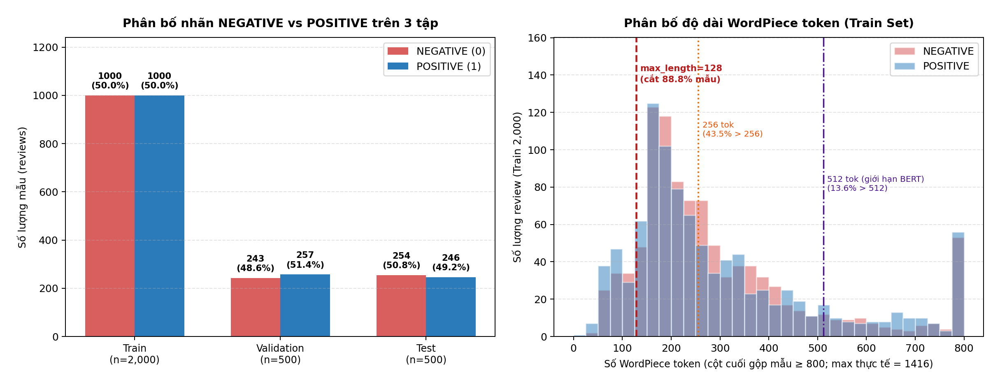
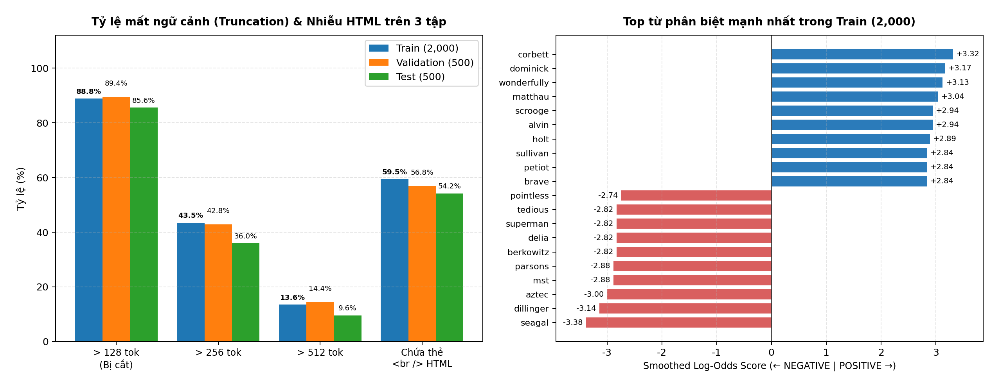
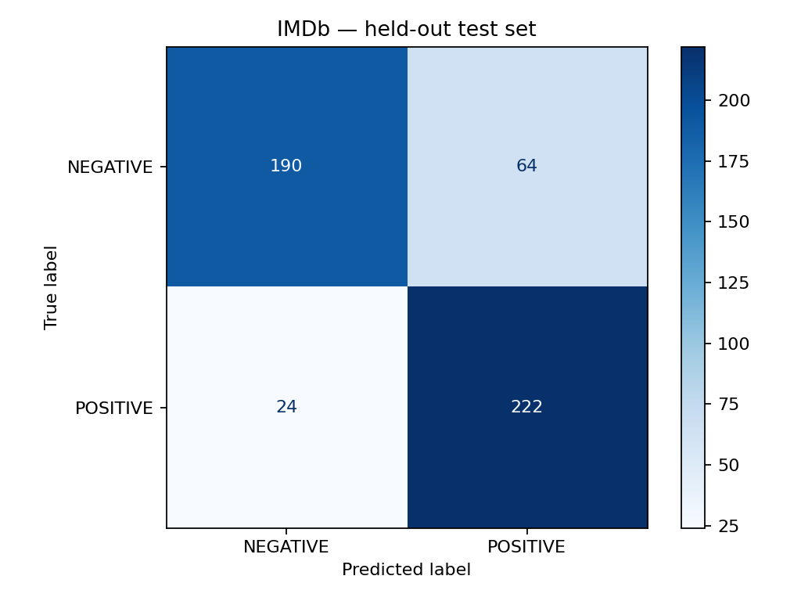
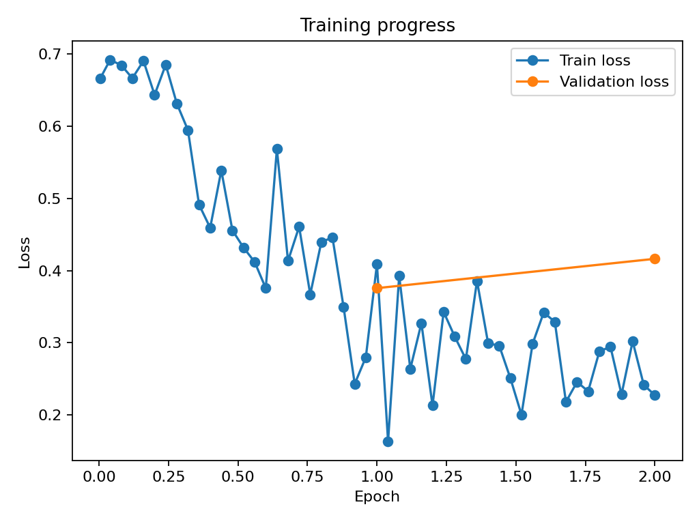
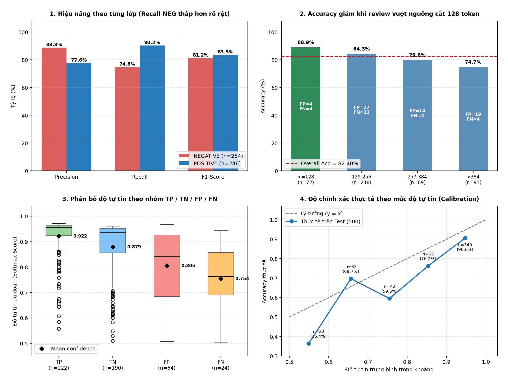
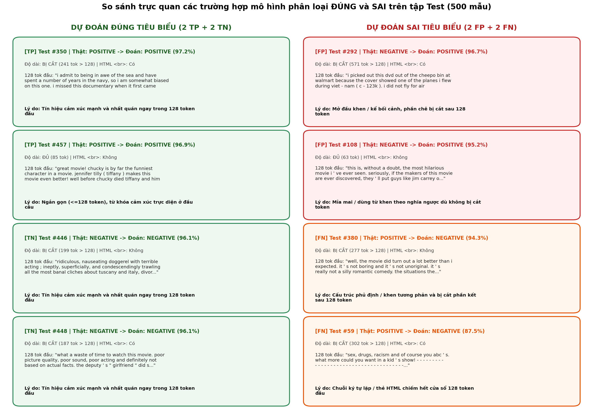

# Báo cáo Lab 3 — Làm quen với Hugging Face

## 1. Thông tin bài thực hành

- Định nghĩa bài toán: [define.md](define.md)
- Thiết kế hệ thống & kiến trúc: [design.md](design.md)
- Notebook: [Practice3.ipynb](Practice3.ipynb)
- Hướng dẫn trình diễn: [demo.md](demo.md)
- Trạng thái: đã chạy bài 1, phân tích EDA dữ liệu IMDb, fine-tune bài 2 và đánh giá chi tiết Đúng/Sai trên 500 mẫu test; toàn bộ minh chứng được lưu trong [results/](results/README.md).

## 2. Mục tiêu

Bài 1 dùng mô hình phân tích cảm xúc có sẵn để quan sát token, ID, nhãn và score. Bài 2 khám phá dữ liệu IMDb (EDA), fine-tune DistilBERT (`66,955,010` tham số) trên tập Train, chọn checkpoint bằng Validation, đánh giá toàn diện Đúng/Sai trên tập Test và dùng mô hình đã lưu để dự đoán câu mới.

Bài toán phân loại nhị phân văn bản **tiếng Anh**: `0 = NEGATIVE`, `1 = POSITIVE`.

## 3. Mã nguồn và môi trường thực tế

| File | Vai trò |
|---|---|
| `exercise1_sentiment.py` | Tokenize và dự đoán bằng mô hình SST-2 |
| `exercise2_finetune.py` | Chia IMDb, huấn luyện, đánh giá và lưu kết quả + `test_predictions.json` |
| `evaluate_lab3.py` | Phân tích EDA dữ liệu IMDb, đánh giá chi tiết Đúng/Sai từ checkpoint đã lưu và xuất 4 biểu đồ |
| `metrics_utils.py` | Tính metric nhị phân |
| `predict.py` | Dự đoán từ mô hình đã lưu; hỗ trợ xuất JSON |
| `Practice3.ipynb` | Chạy các bước, trực quan hóa EDA/Error Analysis và trình bày đầu ra |

Lần chạy đã lưu dùng **Python 3.14.0, Windows 11, CPU**, không có CUDA khả dụng. Phiên bản thư viện được xác nhận từ output kiểm tra môi trường trong notebook:

| Thư viện | Phiên bản |
|---|---|
| torch | 2.13.0 |
| transformers | 4.57.1 |
| datasets | 4.4.1 |
| accelerate | 1.11.0 |
| scikit-learn | 1.7.2 |
| matplotlib | 3.10.7 |
| numpy | 2.3.4 |

Các phiên bản của lần chạy được ghi ở [requirements-run.txt](requirements-run.txt), môi trường ở [results/environment.json](results/environment.json). `requirements.txt` là cấu hình Python 3.11 ban đầu; không dùng file đó để mô tả môi trường đã sinh ra kết quả này.

Trainer ghi thời gian huấn luyện **1050.0554 giây**, khoảng **17 phút 30 giây**; test **27.3788 giây**. Đây là thời gian do Trainer đo, không phải toàn bộ thời gian tải mô hình và chuẩn bị dữ liệu.

## 4. Bài 1 — Tokenization và suy luận

Sử dụng `distilbert/distilbert-base-uncased-finetuned-sst-2-english`. Tokenizer chuyển câu thành đầu vào có padding/cắt tối đa 256 token; mô hình chạy ở chế độ đánh giá, không tính gradient. Softmax chuyển logits thành xác suất và nhãn có xác suất lớn nhất được chọn.

Đã chạy mô hình trên **5 câu tiếng Anh**:

| Câu đầu vào | Nhãn dự đoán | Score |
|---|---|---|
| `I really enjoyed this movie!` | POSITIVE | 0.999872 |
| `The movie was boring and disappointing.` | NEGATIVE | 0.999793 |
| `The acting was excellent and the story was engaging.` | POSITIVE | 0.999879 |
| `I regret watching this movie because it was a waste of time.` | NEGATIVE | 0.999779 |
| `The soundtrack was beautiful and made the film memorable.` | POSITIVE | 0.999887 |

Mô hình gán 3 câu nhãn POSITIVE và 2 câu nhãn NEGATIVE. Các câu 1, 3 và 5 diễn tả sự yêu thích hoặc khen diễn xuất, nội dung, âm nhạc; các câu 2 và 4 diễn tả sự nhàm chán, thất vọng hoặc hối tiếc khi xem phim. Cả năm nhãn dự đoán đều phù hợp với ý nghĩa của các câu minh họa.

- Câu 1: `['i', 'really', 'enjoyed', 'this', 'movie', '!']`; input IDs: `[101, 1045, 2428, 5632, 2023, 3185, 999, 102]`.
- Câu 2: `['the', 'movie', 'was', 'boring', 'and', 'disappointing', '.']`; input IDs: `[101, 1996, 3185, 2001, 11771, 1998, 15640, 1012, 102]`.
- Câu 3: `['the', 'acting', 'was', 'excellent', 'and', 'the', 'story', 'was', 'engaging', '.']`; input IDs: `[101, 1996, 3772, 2001, 6581, 1998, 1996, 2466, 2001, 11973, 1012, 102]`.
- Câu 4: `['i', 'regret', 'watching', 'this', 'movie', 'because', 'it', 'was', 'a', 'waste', 'of', 'time', '.']`; input IDs: `[101, 1045, 9038, 3666, 2023, 3185, 2138, 2009, 2001, 1037, 5949, 1997, 2051, 1012, 102]`.
- Câu 5: `['the', 'soundtrack', 'was', 'beautiful', 'and', 'made', 'the', 'film', 'memorable', '.']`; input IDs: `[101, 1996, 6050, 2001, 3376, 1998, 2081, 1996, 2143, 13432, 1012, 102]`.

Tokenizer chuyển chữ về dạng thường và tách dấu câu riêng; từ `movie` có ID `3185`. ID `101` và `102` đánh dấu đầu/cuối chuỗi.

Score là xác suất softmax của nhãn được chọn, không phải accuracy trên tập dữ liệu. Năm ví dụ chưa đủ để đánh giá chất lượng tổng quát. Với văn bản dài, danh sách tokens do script in chưa cắt có thể dài hơn phần thực sự đưa vào mô hình.

Minh chứng: [results/exercise1.json](results/exercise1.json).

## 5. Phân tích Khám phá Dữ liệu (EDA) trên IMDb

Trước khi diễn giải kết quả huấn luyện, `evaluate_lab3.py` phân tích trực tiếp tập gốc `stanfordnlp/imdb` và đúng 3 tập dữ liệu chia theo `seed = 42` (`2,000` Train / `500` Validation / `500` Test). Minh chứng chi tiết lưu tại [results/eda_summary.json](results/eda_summary.json).

### 5.1. Thống kê Quy mô, Cân bằng Nhãn và Độ dài Chuỗi

- **Tập gốc `stanfordnlp/imdb`:** Có `25,000` train (`12,500 NEG / 12,500 POS`, trung bình `233.79` từ/review, max `2,470`, `58.66%` chứa ` `) và `25,000` test (`12,500 NEG / 12,500 POS`, trung bình `228.53` từ/review, max `2,278`, `58.14%` chứa ` `). Tập `50,000` mẫu unsupervised bị loại bỏ.
- **Ba tập con thực nghiệm (`seed = 42`, `max_length = 128`):** Không có mẫu rỗng (`empty_count = 0`) và không có mẫu trùng lặp (`duplicate_count = 0`).

| Tập | Tổng mẫu | NEG / POS | Số từ TB (sạch HTML) | Token TB (DistilBERT) | Token Trung vị / Max | `> 128` tok (Bị cắt) | `> 256` tok | `> 512` tok | Chứa ` ` |
|---|---:|---:|---:|---:|---:|---:|---:|---:|---:|
| **Train** | 2,000 | 1,000 (50.0%) / 1,000 (50.0%) | 226.25 | 306.51 *(NEG 304.22, POS 308.81)* | 231.0 / 1,416 | **88.85%** (1,777) | 43.50% (870) | 13.55% (271) | 59.45% |
| **Validation** | 500 | 243 (48.6%) / 257 (51.4%) | 225.59 | 305.76 *(NEG 304.35, POS 307.09)* | 224.0 / 1,277 | **89.40%** (447) | 42.80% (214) | 14.40% (72) | 56.80% |
| **Test** | 500 | 254 (50.8%) / 246 (49.2%) | 196.74 | 266.78 *(NEG 278.58, POS 254.61)* | 205.5 / 1,470 | **85.60%** (428) | 36.00% (180) | 9.60% (48) | 54.20% |

### 5.2. Đặc trưng Từ vựng & 4 Insight Hiểu Dữ liệu Cốt lõi

1. **Dữ liệu cân bằng nhãn, không cần oversampling hay class weighting:** Cả tập gốc (`50.0% / 50.0%`) lẫn 3 tập thực nghiệm (`50.0% / 50.0%` ở Train; `48.6% / 51.4%` ở Validation; `50.8% / 49.2%` ở Test) đều rất cân bằng. Mọi thiên lệch lỗi về sau không bắt nguồn từ lệch nhãn huấn luyện.
2. **Mất ngữ cảnh diện rộng tại `max_length = 128` (Insight quan trọng nhất):** Độ dài trung bình của review là **266.8 – 306.5 WordPiece token**, gấp hơn 2 lần ngưỡng cắt `128`. Có tới **88.85%** mẫu Train, **89.40%** mẫu Validation và **85.60%** mẫu Test bị cắt bỏ phần sau (trung vị Test `205.5` token, max `1,470` token). Đặc biệt trên tập Test, review tiêu cực dài hơn tích cực (`278.58` vs `254.61` token trung bình), làm tăng nguy cơ review tiêu cực bị cắt mất phần chốt phê bình ở cuối.
3. **Nhiễu định dạng HTML và ký tự đặc biệt khá cao:** Từ **54.20% đến 59.45%** review chứa thẻ ` ` thô (sinh ra tới 4 token rác `<`, `br`, `/`, `>` cho mỗi lần xuống dòng), kèm nhiều chuỗi dấu câu/phân cách dài (như `- - - - ...`), trực tiếp chiếm dụng cửa sổ `128` token quý giá.
4. **Rủi ro học vẹt thực thể riêng trên tập Train 2,000 mẫu:** Phân tích Smoothed Log-Odds cho thấy bên cạnh các tính từ/trạng từ cảm xúc chuẩn như `wonderfully` (`+3.13`, 23 POS / 0 NEG), `brave` (`+2.84`, 17 POS / 0 NEG) hay `tedious` (`-2.82`, 0 POS / 15 NEG), `pointless` (`-2.74`, 2 POS / 43 NEG), `worthless` (`-2.69`, 0 POS / 13 NEG), vẫn xuất hiện tên diễn viên/phim riêng lẻ như `corbett` (`+3.32`), `matthau` (`+3.04`), `seagal` (`-3.38`), `dillinger` (`-3.14`) do kích thước tập con 2,000 mẫu còn nhỏ.

## 6. Bài 2 — Mô hình và cấu hình huấn luyện

Script tải `stanfordnlp/imdb`, chỉ dùng phần có nhãn và tách theo `seed = 42` như bảng EDA ở mục 5. Validation dùng chọn checkpoint; test chỉ dùng đánh giá cuối. Khởi tạo từ `distilbert/distilbert-base-uncased` với đầu phân loại hai nhãn (`66,955,010` tham số). Đây là mô hình nền khác với mô hình SST-2 có sẵn ở bài 1.

| Tham số | Giá trị |
|---|---|
| Learning rate | `2e-5` |
| Batch size train / evaluation | `8 / 8` |
| Epoch | `2` |
| Max length | `128` |
| Weight decay | `0.01` |
| Seed | `42` |
| Padding | Theo batch bằng `DataCollatorWithPadding` |
| Đánh giá / lưu checkpoint | Mỗi epoch |
| Chọn checkpoint | Validation F1 cao nhất |

Minh chứng: [config.json](results/config.json), [training_history.json](results/training_history.json).

## 7. Kết quả Thực nghiệm & Phân tích Output Đúng / Sai (Error Analysis)

Precision, recall và F1 tổng thể lấy POSITIVE làm lớp dương. Accuracy = số đúng / tổng mẫu; precision = TP/(TP+FP); recall = TP/(TP+FN); F1 là trung bình điều hòa của precision và recall.

| Chỉ số test | Giá trị | Tỷ lệ |
|---|---|---|
| Loss | 0.415744 | — |
| Accuracy | 0.824000 | **82.40%** (`412/500`) |
| Precision (POSITIVE) | 0.776224 | 77.62% |
| Recall (POSITIVE) | 0.902439 | 90.24% |
| F1 (POSITIVE) | 0.834586 | 83.46% |
| Recall (NEGATIVE) | 0.748031 | 74.80% |

Minh chứng: [metrics.json](results/metrics.json), [classification_report.txt](results/classification_report.txt), [error_analysis.json](results/error_analysis.json).

### 7.1. Confusion matrix & Đường cong Loss

| Nhãn thật / dự đoán | NEGATIVE | POSITIVE | Tổng | Recall từng lớp |
|---|---:|---:|---:|---:|
| **NEGATIVE** | **190 (TN)** | **64 (FP)** | 254 | **74.80%** |
| **POSITIVE** | **24 (FN)** | **222 (TP)** | 246 | **90.24%** |

Có **412/500 mẫu đúng** (`TP=222`, `TN=190`) và **88/500 mẫu sai** (`FP=64`, `FN=24`). Số lỗi False Positive (tiêu cực đoán nhầm thành tích cực) cao gấp **2.67 lần** False Negative (`64` vs `24`).

| Epoch | Validation loss | Validation accuracy | Validation F1 |
|---|---|---|---|
| 1 | 0.375688 | 0.8420 | **0.851782** |
| 2 | 0.416295 | 0.8380 | 0.839604 |

Train loss trung bình do Trainer ghi là **0.387907**. Validation loss tăng ở epoch 2 trong khi validation F1 giảm, cho thấy hiện tượng bắt đầu overfit trên tập train 2,000 mẫu. Checkpoint tốt nhất là **epoch 1, step 250** (`eval_f1 = 0.851782`), và `load_best_model_at_end=True` đã nạp lại checkpoint này trước khi đánh giá test.

### 7.2. Đánh giá Chuyên sâu Output theo Độ dài, Nhóm Kết quả & Độ tự tin

#### Tác động của giới hạn cắt chuỗi `max_length = 128` lên độ chính xác
| Nhóm độ dài WordPiece token | Số mẫu | Số mẫu đúng | Accuracy | Error Rate | FP | FN |
|---|---:|---:|---:|---:|---:|---:|
| **`<= 128` (Không bị cắt)** | 72 | 64 | **88.89%** | 11.11% | 4 | 4 |
| `129 – 256` token | 248 | 209 | 84.27% | 15.73% | 27 | 12 |
| `257 – 384` token | 89 | 71 | 79.78% | 20.22% | 14 | 4 |
| **`> 384` token** | 91 | 68 | **74.73%** | 25.27% | 19 | 4 |
| **Tổng hợp nhóm Bị cắt (`> 128`)** | **428** | **348** | **81.31%** | **18.69%** | **60** | **20** |

Accuracy giảm đơn điệu từ **88.89%** (khi mô hình đọc trọn vẹn review `<= 128` token) xuống chỉ còn **74.73%** ở nhóm review dài `> 384` token — chênh lệch **14.16 điểm phần trăm**. Trong 64 lỗi FP, có tới **60 ca (93.75%)** là các review bị cắt cụt.

#### Đặc trưng thống kê của 4 nhóm `TP / TN / FP / FN`
| Nhóm | Số mẫu | Độ tự tin TB | Độ tự tin Trung vị | Số ca tự tin `>= 0.85` | Token TB | Tỷ lệ bị cắt (`>128`) | Chứa ` ` | Chứa từ chuyển ý (`but/however...`) |
|---|---:|---:|---:|---:|---:|---:|---:|---:|
| **TP** (Đúng POSITIVE) | 222 | **0.9218** | 0.9561 | 195 (87.8%) | 249.83 | 82.88% | 50.90% | 74.77% |
| **TN** (Đúng NEGATIVE) | 190 | **0.8793** | 0.9351 | 144 (75.8%) | 258.57 | 86.32% | 52.63% | 74.74% |
| **FP** (Sai: Thật NEG → Đoán POS) | 64 | **0.8050** | 0.8434 | 32 (50.0%) | **337.98** | **93.75%** | **68.75%** | **82.81%** |
| **FN** (Sai: Thật POS → Đoán NEG) | 24 | **0.7541** | 0.7635 | 7 (29.2%) | 298.79 | 83.33% | 58.33% | 75.00% |

Về **Calibration (Độ tin cậy):** Khi mô hình có độ tự tin `0.90–1.00` (`n=340`), độ chính xác thực tế đạt **90.59%**. Khi độ tự tin giảm xuống `0.50–0.60` (`n=22`), accuracy chỉ còn **36.36%**. Tuy nhiên vẫn tồn tại **39 ca đoán sai nhưng độ tự tin rất cao (`>= 0.85`)** (32 FP + 7 FN) — đây chính là các ca cần giải mã nguyên nhân gốc rễ.

### 7.3. Show Kết quả & Trả lời: Tại sao mô hình phân loại ĐÚNG (`TP`, `TN`)?

Bảng các trường hợp dự đoán **ĐÚNG** tiêu biểu trích xuất từ `results/error_analysis.json`:

| Nhóm | Test `#idx` | Thật → Đoán | Score | Độ dài (`truncated`) | Trích đoạn 128 token đầu mô hình nhìn thấy |
|---|---|---|---:|---:|---|
| **TP** | `#350` | POS → POS | 0.9723 | 241 tok (Có cắt) | *"i admit to being in awe of the sea... some of the film is amazing and i have a lot of respect for those who..."* |
| **TP** | `#457` | POS → POS | 0.9690 | 85 tok (Đủ) | *"great movie! chucky is by far the funniest character in a movie. jennifer tilly (tiffany) makes this movie even better!..."* |
| **TP** | `#139` | POS → POS | 0.9685 | 81 tok (Đủ) | *"don't listen to what the critics have always said about this cute, charming little movie. madonna is great in this clever comedy..."* |
| **TN** | `#446` | NEG → NEG | 0.9611 | 199 tok (Có cắt) | *"ridiculous, nauseating doggerel with terrible acting; ineptly, superficially, and condescendingly trawling all the most banal cliches..."* |
| **TN** | `#448` | NEG → NEG | 0.9609 | 187 tok (Có cắt) | *"what a waste of time to watch this movie. poor picture quality, poor sound, poor acting and definitely not based on actual facts..."* |
| **TN** | `#143` | NEG → NEG | 0.9600 | 181 tok (Có cắt) | *"get smart should be titled get stupid. there is not one funny line or gag in the entire film. this film is so bad..."* |

**Tại sao mô hình phân loại ĐÚNG tốt (`82.40%` tổng thể, `90.24%` Recall POSITIVE) ở các mẫu này?**
1. **Tín hiệu từ khóa cảm xúc xuất hiện trực diện ngay trong 128 token đầu:** Với cả mẫu ngắn không bị cắt (`#457`, `#139`) lẫn mẫu dài bị cắt (`#350`, `#446`, `#448`, `#143`), người viết đưa ra nhận định khen/chê ngay câu mở đầu (`great movie`, `amazing`, `clever comedy` vs `ridiculous`, `nauseating`, `terrible acting`, `waste of time`, `poor ...`, `so bad`). Vì phần mở đầu chứa trọn cực tính chính, việc cắt bỏ phần sau không làm mất thông tin quyết định.
2. **Độ nhất quán cực tính cao, ít cấu trúc rẽ nhánh đối lập:** Các review thuộc nhóm đúng có ít mệnh đề nhượng bộ hay chuyển hướng muộn, giúp vector biểu diễn tại `[CLS]` của DistilBERT tổng hợp lực chú ý (Self-Attention) đồng thuận về một phía với độ tự tin trung bình rất cao (`0.9218` ở TP, `0.8793` ở TN).
3. **Ít bị nhiễu định dạng ở đầu câu:** Nhóm dự đoán đúng có tỷ lệ chứa ` ` (`50.9%–52.6%`) thấp hơn hẳn nhóm sai (`68.8%` ở FP), giúp toàn bộ ngân sách 128 token đầu chứa nội dung đánh giá thực chất.

### 7.4. Show Kết quả & Trả lời: Tại sao mô hình phân loại SAI (`FP`, `FN`)?

Bảng các trường hợp dự đoán **SAI** tiêu biểu trích xuất từ `results/error_analysis.json`:

| Nhóm | Test `#idx` | Thật → Đoán | Score | Độ dài (`truncated`) | 128 token đầu mô hình nhìn thấy | Phần bị cắt sau 128 token / Ngữ cảnh thực |
|---|---|---|---:|---:|---|---|
| **FP** | `#292` | NEG → POS | 0.9669 | 571 tok (Cắt) | *"i picked out this dvd out of the cheepo bin at walmart... planes i flew during viet-nam (c-123k). i did not fly for air america..."* | Kể lề mở đầu mất hết 128 token; phần chỉ trích lịch sử/nội dung phim nằm phía sau. |
| **FP** | `#70` | NEG → POS | 0.9649 | 385 tok (Cắt) | *"i used to always love the bill because of its great script and characters, but lately i feel as though it has turned into an emotional type of soap..."* | Mở đầu khen (*always love, great script*); phần chốt *"rate it as 2 out of ten... totally ruined"* bị cắt sạch. |
| **FP** | `#320` | NEG → POS | 0.9637 | 415 tok (Cắt) | *"this movie was included in the six wives of henry viii bbc miniseries dvd. i loved those six movies. they were well-acted, well-scripted..."* | Khen bản BBC cũ & sách ở đầu; loạt câu chê *"why is the script so bad? stutter and stammer"* nằm sau token 128. |
| **FP** | `#499` | NEG → POS | 0.9611 | 224 tok (Cắt) | *"cinemascope color cinematography... is quite remarkable... alfred newmann score has to be the most sensual and seductive... the actors, however, never rise to the..."* | Bị cắt ngay chữ *"never rise to the"*! Toàn bộ phần chê diễn xuất *"zombie-like to stilted... hodgepodge"* mất trắng. |
| **FP** | `#108` | NEG → POS | 0.9520 | 63 tok (Đủ) | *"this is, without a doubt, the most hilarious movie i've ever seen... put guys like jim carrey out of a job. rent 'jack-o' tonight! believe me, you won't regret it!"* | Không bị cắt: sử dụng ngôn từ khen tuyệt đối mang tính **mỉa mai** (hoặc nhiễu nhãn gốc trên phim hạng B *Jack-O*). |
| **FN** | `#380` | POS → NEG | 0.9431 | 277 tok (Cắt) | *"well, the movie did turn out a lot better than i expected. it's not boring and it's not unoriginal. it's really not a silly romantic comedy..."* | Dùng **phủ định kép** (`not boring`, `not unoriginal`, `not silly`); câu khen chốt *"genuinely liked it... worth a watch"* bị cắt. |
| **FN** | `#200` | POS → NEG | 0.9174 | 145 tok (Cắt) | *"i don't understand why this movie has such a low rating. it totally deserves more! sure, it's completely ridiculous... don't expect cinematic transcendence..."* | Phản biện điểm thấp (`low rating`, `ridiculous`); câu kết *"you're gonna love this. i sure did!"* bị cắt mất. |
| **FN** | `#409` | POS → NEG | 0.9027 | 200 tok (Cắt) | *"william h. macy always gives a good performance. he never looks lazy and never seems like he'd rather be somewhere else..."* | Cấu trúc `never` + `sub-par` trong ngữ cảnh so sánh; phần chốt *"light, entertaining fare, and an great watch. 7.6 out of 10"* bị cắt. |
| **FN** | `#59` | POS → NEG | 0.8750 | 302 tok (Cắt) | *"sex, drugs, racism and of course you abc's. what more could you want in a kid's show! - - - - - - - - - - - - ... < br /"* | Chuỗi dấu `- - -` và ` ` lặp chiếm gần hết 128 token đầu, che mất phần nội dung chính ở sau. |

**Tổng hợp 5 nguyên nhân gốc rễ trả lời TẠI SAO mô hình phân loại SAI:**
1. **Mất ngữ cảnh kết luận do cắt cụt ở `max_length = 128` (Nguyên nhân số 1 — chiếm 80/88 ca sai):** Khác với câu ngắn trong SST-2 (Bài 1), review IMDb thường có cấu trúc *"kể bối cảnh / dẫn chuyện / khen tiểu tiết trước, kết luận tổng thể ở đoạn cuối"*. Khi cắt ở 128 token, mô hình không nhìn thấy câu chốt điểm số hoặc phán quyết cuối (`#292`, `#70`, `#320`, `#499`, `#380`, `#200`, `#409`). Riêng nhóm `FP` có độ dài trung bình cao nhất (`337.98` token) và tỷ lệ bị cắt lên tới **93.75%**.
2. **Cảm xúc hỗn hợp & cấu trúc khen-trước-chê-sau ("Bait-and-switch"):** Nhóm `FP` có tỷ lệ chứa từ nối tương phản (`but`, `however`, `although`, `unfortunately`...) cao nhất trong 4 nhóm (**82.81%**). Khi phần đầu chứa các tính từ khen mạnh (`always love`, `great script`, `loved those six movies`, `quite remarkable`, `most sensual`) rồi mới rẽ ngoặt bằng `but`/`however` ngay sát hoặc sau ranh giới 128 token (`#70`, `#320`, `#499`), mô hình đoán `POSITIVE` với độ tự tin >96%.
3. **Phủ định nhiều lớp, khen qua phản biện & mỉa mai:** Với kích thước Train nhỏ (`2,000` mẫu, 1 epoch tối ưu), mô hình còn nhạy cảm với các từ mang sắc thái âm đơn lẻ trong cụm phủ định (`not boring`, `not unoriginal`, `low rating`, `never looks lazy` ở `#380`, `#200`, `#409`) và chưa bắt được hàm ý châm biếm khi toàn bộ từ bề mặt đều là lời khen (`#108`).
4. **Nhiễu định dạng HTML ` ` & chuỗi ký tự lặp:** Nhóm `FP` có tỷ lệ chứa ` ` lên tới **68.75%** (so với ~51–53% ở nhóm đúng). Ở các trường hợp cực đoan như `#59`, dãy gạch ngang `- - -` và thẻ ` ` chiếm dụng hàng chục token đầu, đẩy phần văn bản mang nghĩa ra khỏi cửa sổ `128` token.
5. **Thiên lệch dương nhẹ của ranh giới quyết định (Decision Bias):** Mô hình học được ranh giới có xu hướng nghiêng về `POSITIVE` (Precision POS `77.62%` nhưng Recall POS tới `90.24%`, trong khi Recall NEG chỉ còn `74.80%`), tạo ra **64 FP** so với chỉ **24 FN**.

### 7.5. Hướng Cải tiến Đề xuất
- **Tăng độ dài đầu vào hoặc đổi chiến lược cắt (`Head + Tail Truncation`):** Nâng `--max-length` lên `256` hoặc `512` (giảm tỷ lệ cắt cụt từ `85.6%` xuống `36.0%` hoặc `9.6%` trên Test), hoặc ghép 64 token đầu + 64 token cuối để giữ cả mở đầu lẫn câu kết luận khi giữ nguyên chi phí tính toán.
- **Tiền xử lý làm sạch văn bản:** Loại bỏ thẻ HTML ` ` và rút gọn chuỗi ký tự lặp (`- - -`) trước khi tokenize để tiết kiệm ngân sách token.
- **Mở rộng dữ liệu & hiệu chỉnh ngưỡng:** Huấn luyện trên tập Train đầy đủ (`--train-size 20000 --val-size 5000 --epochs 3`) để giảm học vẹt tên riêng/cụm từ cục bộ, kết hợp tinh chỉnh ngưỡng xác suất trên tập Validation nhằm cân bằng Precision/Recall giữa `NEGATIVE` và `POSITIVE`.

## 8. Dự đoán câu mới và hạn chế

Đã kiểm tra lại mô hình đã lưu trên CPU, không huấn luyện lại:

| Câu mới | Nhãn thực tế | Score |
|---|---|---|
| `The acting was excellent!` | POSITIVE | 0.911281 |
| `I regret watching this movie.` | NEGATIVE | 0.746396 |

Hai nhãn phù hợp với ý nghĩa câu. Đây là ví dụ minh họa, không phải một tập đánh giá bổ sung. Minh chứng: [predictions.json](results/predictions.json).

Các hạn chế cần giữ khi diễn giải kết quả:

- Chỉ đánh giá trên 500 mẫu test trích theo `seed = 42` của IMDb, chưa đại diện toàn bộ 25,000 mẫu test hoặc dữ liệu ngoài miền đánh giá phim.
- Chỉ có hai nhãn (`NEGATIVE` / `POSITIVE`) và đầu vào tiếng Anh; không kết luận chất lượng trên tiếng Việt.
- Cấu hình đã chạy cắt ở `128` token làm mất thông tin sau của `85.60%` mẫu test.
- Chưa chạy đối chứng đa seed hay cấu hình `max_length=256/512` trên GPU để định lượng riêng mức cải thiện của từng thay đổi.

## 9. Kết luận

Đã hoàn thành đầy đủ quy trình Lab 3: **Define → EDA → Design → Fine-tuning → Đánh giá Output Đúng/Sai → Dự đoán câu mới**. Trên 500 mẫu test IMDb với `max_length = 128`, DistilBERT đạt **82.40% accuracy** (`412/500` đúng) và **83.46% F1** cho lớp POSITIVE; checkpoint tốt nhất ở **epoch 1 (step 250)**. Phân tích EDA và Error Analysis chứng minh rõ nguyên nhân dự đoán đúng (tín hiệu cảm xúc xuất hiện sớm và nhất quán trong 128 token đầu) cũng như nguyên nhân 88 ca đoán sai (chủ yếu do mất phần kết khi cắt cụt ở 128 token — đặc biệt với review khen trước chê sau dẫn tới 64 FP vs 24 FN, cấu trúc phủ định/mỉa mai và nhiễu ` `).
