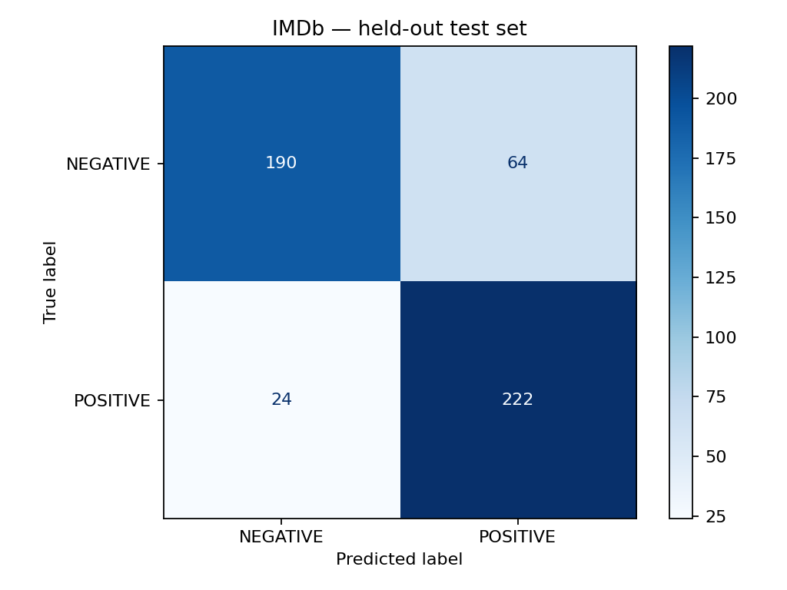
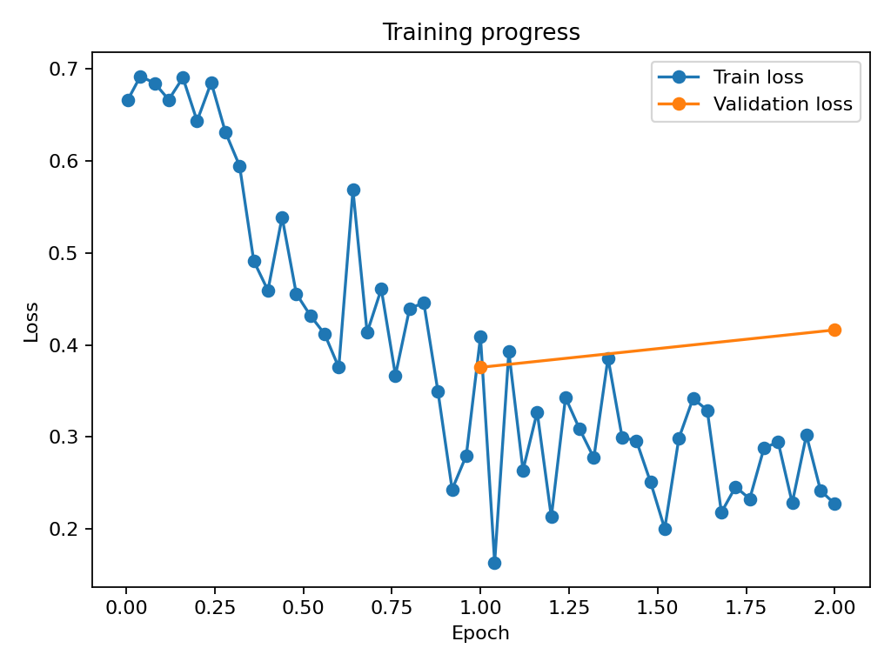

# Báo cáo Lab 3 — Làm quen với Hugging Face

## 1. Thông tin bài thực hành

- Notebook: [Practice3.ipynb](Practice3.ipynb)
- Hướng dẫn trình diễn: [demo.md](demo.md)
- Trạng thái: đã chạy bài 1 và fine-tune bài 2; các kết quả dưới đây lấy từ lần chạy thực tế, được lưu trong [results/](results/README.md).

## 2. Mục tiêu

Bài 1 dùng mô hình phân tích cảm xúc có sẵn để quan sát token, ID, nhãn và score. Bài 2 fine-tune DistilBERT trên IMDb, chọn checkpoint bằng validation, đánh giá test và dùng mô hình đã lưu để dự đoán câu mới.

Bài toán phân loại nhị phân văn bản **tiếng Anh**: `0 = NEGATIVE`, `1 = POSITIVE`.

## 3. Mã nguồn và môi trường thực tế

| File | Vai trò |
|---|---|
| `exercise1_sentiment.py` | Tokenize và dự đoán bằng mô hình SST-2 |
| `exercise2_finetune.py` | Chia IMDb, huấn luyện, đánh giá và lưu kết quả |
| `metrics_utils.py` | Tính metric nhị phân |
| `predict.py` | Dự đoán từ mô hình đã lưu; hỗ trợ xuất JSON |
| `Practice3.ipynb` | Chạy các bước và trình bày đầu ra |

Lần chạy đã lưu dùng **Python 3.14.0, Windows 11, CPU**, không có CUDA khả dụng. Phiên bản thư viện được xác nhận từ output kiểm tra môi trường trong notebook:

| Thư viện | Phiên bản |
|---|---|
| torch | 2.13.0 |
| transformers | 4.57.1 |
| datasets | 4.4.1 |
| accelerate | 1.11.0 |
| scikit-learn | 1.7.2 |
| matplotlib | 3.10.7 |
| numpy | 2.3.4 |

Các phiên bản của lần chạy được ghi ở [requirements-run.txt](requirements-run.txt), môi trường ở [results/environment.json](results/environment.json). `requirements.txt` là cấu hình Python 3.11 ban đầu; không dùng file đó để mô tả môi trường đã sinh ra kết quả này.

Trainer ghi thời gian huấn luyện **1050.0554 giây**, khoảng **17 phút 30 giây**; test **27.3788 giây**. Đây là thời gian do Trainer đo, không phải toàn bộ thời gian tải mô hình và chuẩn bị dữ liệu.

## 4. Bài 1 — Tokenization và suy luận

Sử dụng `distilbert/distilbert-base-uncased-finetuned-sst-2-english`. Tokenizer chuyển câu thành đầu vào có padding/cắt tối đa 256 token; mô hình chạy ở chế độ đánh giá, không tính gradient. Softmax chuyển logits thành xác suất và nhãn có xác suất lớn nhất được chọn.

| Văn bản | Nhãn thực tế | Score |
|---|---|---|
| `I really enjoyed this movie!` | POSITIVE | 0.999872 |
| `The movie was boring and disappointing.` | NEGATIVE | 0.999793 |

Cả hai nhãn phù hợp với ý nghĩa câu: câu đầu yêu thích bộ phim, câu sau chê phim nhàm chán và gây thất vọng.

- Câu 1 có tokens `['i', 'really', 'enjoyed', 'this', 'movie', '!']` và input IDs `[101, 1045, 2428, 5632, 2023, 3185, 999, 102]`.
- Câu 2 có tokens `['the', 'movie', 'was', 'boring', 'and', 'disappointing', '.']` và input IDs `[101, 1996, 3185, 2001, 11771, 1998, 15640, 1012, 102]`.
- `movie` có ID `3185` trong cả hai câu; chữ được chuyển về dạng thường và dấu câu được tách riêng. ID `101` và `102` đánh dấu đầu/cuối chuỗi.

Score là xác suất softmax của nhãn được chọn, không phải accuracy trên tập dữ liệu. Hai ví dụ chưa đủ để đánh giá chất lượng tổng quát. Với văn bản dài, danh sách tokens do script in chưa cắt có thể dài hơn phần thực sự đưa vào mô hình.

Minh chứng: [results/exercise1.json](results/exercise1.json).

## 5. Bài 2 — Dữ liệu, mô hình và cấu hình

Script tải `stanfordnlp/imdb`, chỉ dùng phần có nhãn. Tập gốc có 25.000 train và 25.000 test. Lần chạy này chọn:

| Tập | Số mẫu | Cách chọn |
|---|---:|---|
| Train | 2.000 | Phần đầu tập train sau shuffle với seed 42 |
| Validation | 500 | Phần kế tiếp, không trùng train đã chọn |
| Test | 500 | Từ tập test gốc sau shuffle với seed 42 |

Validation dùng chọn checkpoint; test chỉ dùng đánh giá cuối. Không sử dụng phần unsupervised.

Khởi tạo từ `distilbert/distilbert-base-uncased` với đầu phân loại hai nhãn. Đây là mô hình nền khác với mô hình SST-2 có sẵn ở bài 1.

| Tham số | Giá trị |
|---|---|
| Learning rate | `2e-5` |
| Batch size train / evaluation | `8 / 8` |
| Epoch | `2` |
| Max length | `128` |
| Weight decay | `0.01` |
| Seed | `42` |
| Padding | Theo batch bằng `DataCollatorWithPadding` |
| Đánh giá / lưu checkpoint | Mỗi epoch |
| Chọn checkpoint | Validation F1 cao nhất |

Minh chứng: [config.json](results/config.json), [training_history.json](results/training_history.json).

## 6. Kết quả thực nghiệm

Precision, recall và F1 dưới đây lấy POSITIVE làm lớp dương. Accuracy = số đúng / tổng mẫu; precision = TP/(TP+FP); recall = TP/(TP+FN); F1 là trung bình điều hòa của precision và recall.

| Chỉ số test | Giá trị | Tỷ lệ |
|---|---|---|
| Loss | 0.415744 | — |
| Accuracy | 0.824000 | 82.40% |
| Precision | 0.776224 | 77.62% |
| Recall | 0.902439 | 90.24% |
| F1 | 0.834586 | 83.46% |

Minh chứng: [metrics.json](results/metrics.json), [classification_report.txt](results/classification_report.txt). Classification report hiển thị ít chữ số thập phân hơn nên có thể thấy accuracy `0.82` thay vì `0.824`.

### Confusion matrix

| Nhãn thật / dự đoán | NEGATIVE | POSITIVE | Tổng |
|---|---:|---:|---:|
| NEGATIVE | 190 | 64 | 254 |
| POSITIVE | 24 | 222 | 246 |

Có **412/500 mẫu đúng** và **88 mẫu sai**. Trong đó 64 review tiêu cực bị đoán thành tích cực, còn 24 review tích cực bị đoán thành tiêu cực. Recall NEGATIVE là 190/254 ≈ **74,80%**, thấp hơn recall POSITIVE **90,24%**. Mô hình phát hiện nhiều review tích cực nhưng precision của lớp này chỉ **77,62%** do số false positive cao hơn false negative.

### Loss và lựa chọn checkpoint

| Epoch | Validation loss | Validation accuracy | Validation F1 |
|---|---|---|---|
| 1 | 0.375688 | 0.8420 | 0.851782 |
| 2 | 0.416295 | 0.8380 | 0.839604 |

Train loss có xu hướng giảm nhưng vẫn dao động theo batch. Validation loss tăng ở epoch 2 trong khi validation F1 giảm, cho thấy khả năng tổng quát hóa không cải thiện khi học thêm epoch này. Đây là dấu hiệu phù hợp với overfitting; chỉ hai mốc validation chưa đủ khẳng định xu hướng dài hạn.

Checkpoint tốt nhất là **epoch 1, step 250**, có validation F1 **0.851782**. Theo `load_best_model_at_end=True`, script nạp lại checkpoint này trước khi đánh giá test; số liệu test không phải mặc nhiên lấy từ trọng số cuối epoch 2. Trung bình train loss do Trainer ghi là **0.387907**.

## 7. Dự đoán câu mới và hạn chế

Đã kiểm tra lại mô hình đã lưu trên CPU, không huấn luyện lại:

| Câu mới | Nhãn thực tế | Score |
|---|---|---|
| `The acting was excellent!` | POSITIVE | 0.911281 |
| `I regret watching this movie.` | NEGATIVE | 0.746396 |

Hai nhãn phù hợp với ý nghĩa câu. Đây là ví dụ minh họa, không phải một tập đánh giá bổ sung. Minh chứng: [predictions.json](results/predictions.json).

Các hạn chế cần giữ khi diễn giải kết quả:

- Chỉ đánh giá 500 mẫu test đã chọn, chưa đại diện toàn bộ IMDb hoặc dữ liệu ngoài miền đánh giá phim.
- Chỉ có hai nhãn và đầu vào tiếng Anh; không kết luận chất lượng trên tiếng Việt.
- Cắt ở 128 token có thể mất thông tin cuối review.
- Chưa so sánh nhiều seed/cấu hình để khẳng định tác động riêng của số mẫu hoặc số epoch.
- Chưa lưu văn bản/nhãn dự đoán của từng mẫu test, nên chưa có cơ sở trình bày một review sai cụ thể dù biết tổng số lỗi từ confusion matrix.

## 8. Kết luận

Đã hoàn thành luồng tokenization và suy luận bằng mô hình có sẵn, fine-tune DistilBERT, chọn checkpoint, đánh giá test và dự đoán câu mới. Trên 500 mẫu test của lần chạy này, mô hình đạt **82,40% accuracy** và **83,46% F1** cho lớp POSITIVE. Validation tốt nhất ở epoch 1; học thêm epoch 2 không cải thiện validation F1. Kết quả cho thấy mô hình vẫn nhầm nhiều review tiêu cực thành tích cực và cần được đánh giá thêm trước khi mở rộng kết luận.
